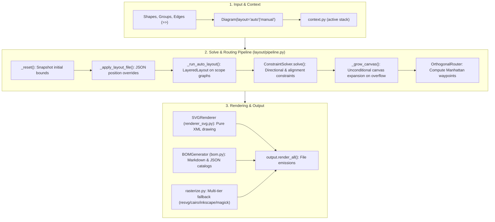

# Architecture

**Analysis Date:** 2026-09-22 (v0.4.0)

## Pattern Overview

**Overall:** Decoupled Directed Diagram Engine with Layered Auto-Layout, Manhattan Routing, and Pure-Python SVG Synthesis.

**Key Invariants:**
1. **Zero External Runtime Dependencies:** Everything runs on the Python 3.10+ standard library.
2. **Deterministic Output:** Same code and data always produces identical SVG coordinates.
3. **Decoupled Lifecycle:** Shape instantiation, hierarchical grouping, placement solving, edge routing, and file rendering are isolated stages.
4. **Strict Layered Dependency Direction:** Lower modules never import higher modules; enforced by AST-based `tests/test_module_boundaries.py`.

## Architectural Pipeline

## Layer Descriptions

1. **Context & Foundation Layer (`context.py`, `geometry.py`):**
   - Active diagram tracking via module-level stack (avoids circular imports).
   - Immutable 2D primitives (`Point`, `Size`, `Rect`, `Anchor`, `UnitBasis`).

2. **Model Layer (`elements.py`, `connections.py`, `groups.py`, `shapes.py`, `theme.py`):**
   - Element lifecycle: unplaced, placed late, relocated, cloned.
   - 13 theme presets, 60 built-in vector icons, and standard SVG shapes (`box`, `cylinder`, `cloud`, `server_rack`, `database`, `diamond`, `badge`).
   - Group hierarchy with auto-bounding.

3. **Layout & Routing Engine (`layout/`, `constraints.py`, `router.py`):**
   - `layout/layered.py`: Deterministic Sugiyama-style rank ordering, crossing minimization (barycenter), and coordinate assignment.
   - `layout/graph.py`: Builds per-scope dependency graphs with edge lifting and pin detection.
   - `layout/sidecar.py`: Stable JSON layout file export and override application.
   - `constraints.py`: Topological DAG solver for directional relative constraints (`right_of`, `below`, etc.).
   - `router.py`: Orthogonal Manhattan routing with automatic port deduction (`NORTH`, `SOUTH`, `EAST`, `WEST`).

4. **Rendering & Export Layer (`renderer_svg.py`, `rasterize.py`, `output.py`, `bom.py`, `cli.py`):**
   - `renderer_svg.py`: Pure string formatting W3C SVG XML generator with multi-line wrapping `<tspan>` and automated luminance contrast text coloring.
   - `rasterize.py`: Headless rasterizer chain returning PNG bytes.
   - `cli.py`: Unified command line runner (`render`, `layout export`, `themes`, `icons`).
   - `iiot_diagrams/`: Facade package forwarding to canonical `diagrams_as_code`.
