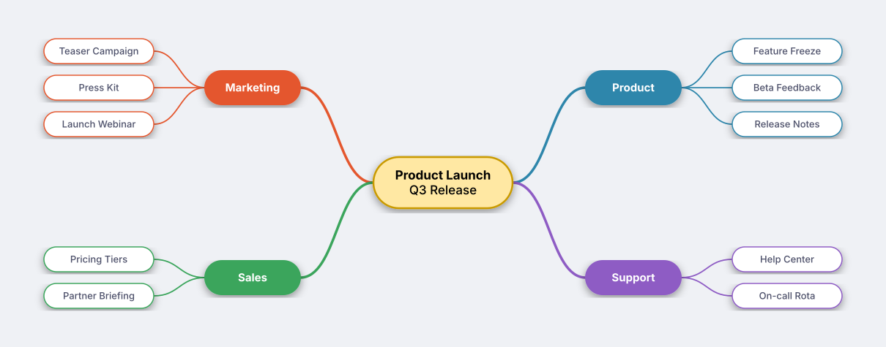
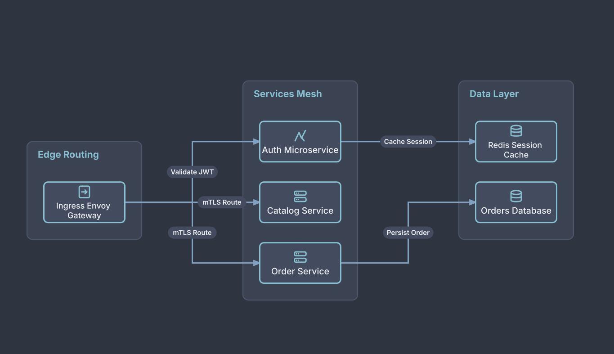
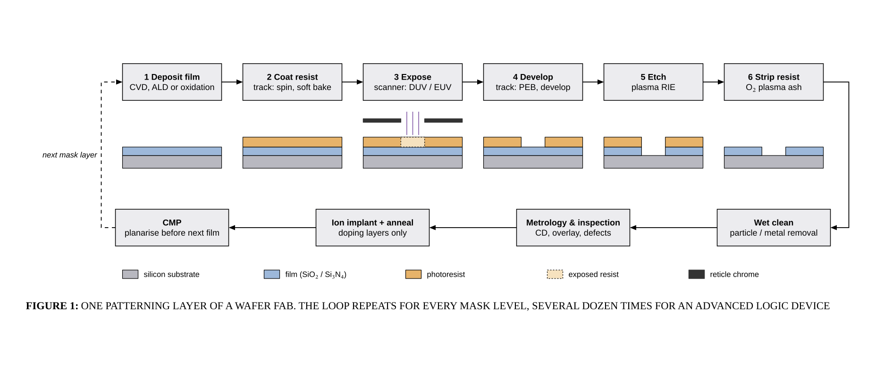
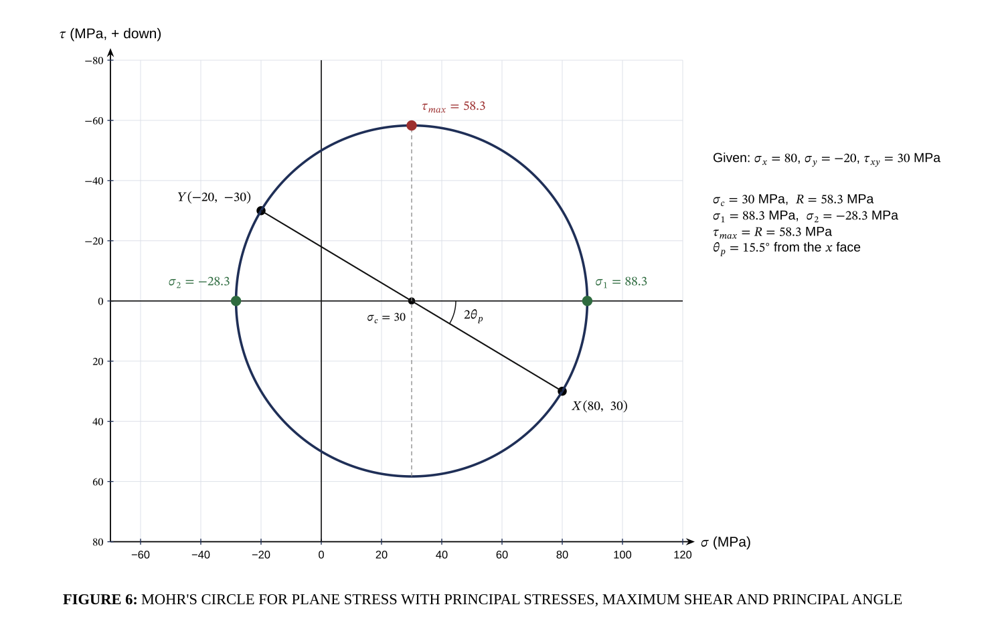
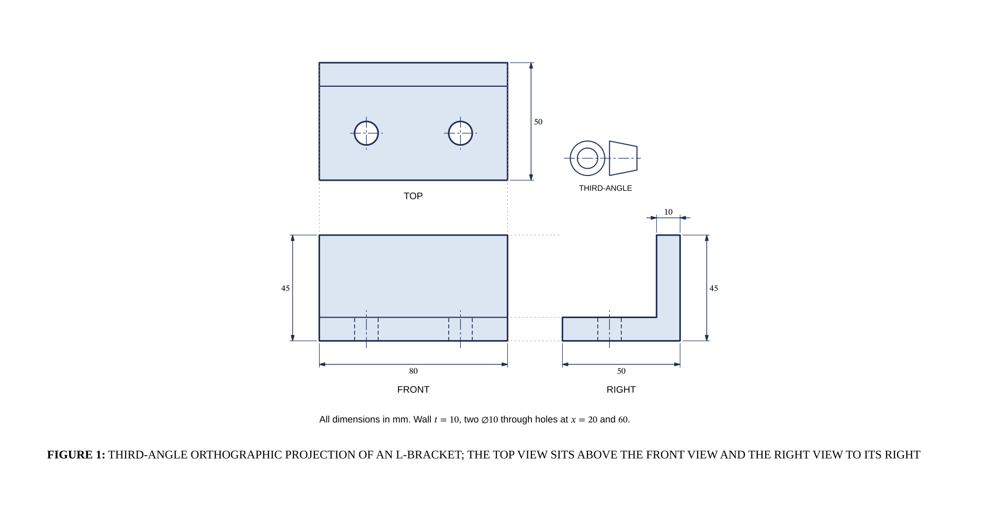

```text
╔══════════════════════════════════════════════════════════════════════════════════════════╗
║  ██████╗ ██╗ █████╗  ██████╗ ██████╗  █████╗ ███╗   ███╗███████╗     █████╗ ███████╗     ║
║  ██╔══██╗██║██╔══██╗██╔════╝ ██╔══██╗██╔══██╗████╗ ████║██╔════╝    ██╔══██╗██╔════╝     ║
║  ██║  ██║██║███████║██║  ███╗██████╔╝███████║██╔████╔██║███████╗    ███████║███████╗     ║
║  ██║  ██║██║██╔══██║██║   ██║██╔══██╗██╔══██║██║╚██╔╝██║╚════██║    ██╔══██║╚════██║     ║
║  ██████╔╝██║██║  ██║╚██████╔╝██║  ██║██║  ██║██║ └──═╝██║███████║    ██║  ██║███████║     ║
║  ╚═════╝ ╚═╝╚═╝  ╚═╝ ╚═════╝ ╚═╝  ╚═╝╚═╝  ╚═╝╚═╝      ╚═╝╚══════╝    ╚═╝  ╚═╝╚══════╝     ║
║                 ██████╗  ██████╗ ██████╗ ███████╗                                        ║
║                ██╔════╝ ██╔═══██╗██╔══██╗██╔════╝     [ PURE PYTHON STANDARD LIBRARY ]   ║
║                ██║      ██║   ██║██║  ██║█████╗       [ ZERO C-DEPS • ZERO GRAPHVIZ  ]   ║
║                ██║      ██║   ██║██║  ██║██╔══╝       [ 1977 TESTS • 361 FIGURES ]       ║
║                ╚██████╗ ╚██████╔╝██████╔╝███████╗     [ CUBIC BEZIER • CORNER FILLETS]   ║
║                 ╚═════╝  ╚═════╝ ╚═════╝ ╚══════╝     [ INTERACTIVE SVG • BOM ENGINE ]   ║
╚══════════════════════════════════════════════════════════════════════════════════════════╝
```

<p align="center">
  
</p>

# Diagrams-as-Code

[](tests/)
[](pyproject.toml)
[](src/diagrams_as_code/)
[](https://docs.astral.sh/uv/)
[](src/diagrams_as_code/theme.py)
[](icons/)
[](LICENSE)

A pure-Python declarative vector diagramming framework. Generate publication-quality architecture diagrams, high-resolution rasterized images, and living Bill of Materials (BOM) documentation from code — with **zero Graphviz**, **zero Cairo**, and **zero external C-library runtime dependencies**.

---

## See What It Draws

<p align="center">
  
</p>

<p align="center"><sub>One script, one SVG. No Graphviz, no Cairo, no browser. Every picture below is a committed example you can regenerate with <code>uv run python main.py</code>.</sub></p>

<table>
  <tr>
    <td width="50%"><br><sub><b>Architecture</b> · service mesh, <code>nord</code> theme</sub></td>
    <td width="50%"><br><sub><b>Process</b> · wafer-fab loop with cross-sections, <code>paper</code> theme</sub></td>
  </tr>
  <tr>
    <td width="50%"><br><sub><b>Computed</b> · Mohr's circle, plotted by <code>Plot</code></sub></td>
    <td width="50%"><br><sub><b>Drafting</b> · third-angle projection, drawn with <code>Draft</code></sub></td>
  </tr>
</table>

The reference architecture that `main.py` renders is [`examples/main_architecture.svg`](examples/main_architecture.svg).

---

## Key Features

- **Pure Python Standard Library Core**: The vector rendering engine, geometric calculations, constraint solver, orthogonal Manhattan router, cubic Bezier curve engine, and SVG generation require zero external C-dependencies.
- **Cubic Bezier Curves & Obstacle Deflection**: Native cubic Bezier edge routing (`Routing.CURVE`) with cardinal port normal tangents, AABB broadphase + recursive De Casteljau collision detection, minimal-deviation C1-continuous spline deflection around intervening obstacles, and lateral escape corridors for reverse-flow edges.
- **Smooth Rounded Corner Fillets**: Analytical quadratic corner fillets (`corner_radius` / `arc_radius`) on Manhattan orthogonal paths with dynamic 50% segment budget clamping (`min(R, L_in/2, L_out/2)`), straight port lead-ins, 2.0px suppression threshold, and native SVG `Q` path emission.
- **Interactive SVG Engine**: Client-side interactive pan-and-zoom with SVG matrix transforms, real-time node search highlighting with auto-focus, reset viewport controls, and miniature minimap navigator HUD embedded directly into vector outputs without external JS libraries.
- **Always Powered by `uv`**: Fast, deterministic package management, virtual environment provisioning, and test runs via [`uv`](https://docs.astral.sh/uv/).
- **14 Built-in Theme Palettes**:
  - **Dark Themes:** `iiot_dark_gold`, `blueprint`, `cyber_slate`, `nord`, `emerald`, `crimson`, `dracula`, `synthwave`.
  - **Light Themes:** `iiot_light`, `monochrome`, `solarized_light`, `pastel_light`, `paper` (black on white, hairlines, square corners, no shadows — for figures in papers).
  - **Accessibility Themes:** `high_contrast` (WCAG AAA compliant).
- **Zero-Clipping Text Engine**: Multi-line word-wrapping via SVG `<tspan>` elements, dynamic font scaling, and support for `label_position="bottom"` (text below graphic tiles).
- **Standalone Vector Icons & Pure Icon Nodes**: Built-in library of 60 handcrafted 24x24 open-source vector icons across 8 domains, with support for `kind="icon"` (borderless icon graphics).
- **Living Documentation & Automated BOM**: Instant emission of Markdown component tables and machine-readable JSON schemas tracking hardware, protocols, and infrastructure specs.
- **Topological Constraint Solving**: Decouples shape instantiation from placement. Elements can be positioned with relative constraints (`right_of`, `below`, `above`, `left_of`) and negative coordinate auto-framing.
- **Technical Drawing Primitives**: free text, captions, brackets, polygons and SVG paths, dashed layer bands with side notes, shapes nested in shapes, double borders, line weights and arrowhead styles, lines attached anywhere on a side or at bare points, shared trunks, leaders, splines, and convex solids in oblique or isometric projection with hidden edges dashed. Nine focused figures in [`examples/primitives/`](examples/primitives/).
- **Technical Figures, Lint & Golden Images**: eleven complete paper-style figures in [`examples/technical/`](examples/technical/) (a four-layer architecture reproduced from a reference figure, a control loop, a transformer block, a state machine, a protocol stack, a memory layout, a timing diagram, a training pipeline, tensor shapes, a geometric construction, a constraint region). `diagrams-as-code lint` reports visual defects by name, and golden-image tests catch any change to how a figure looks. See the [technical figures guide](docs/technical-figures.md) and the [math markup reference](docs/math-markup.md).
- **Vector PDF Export**: `diag.render_pdf("figure.pdf")` or `--format pdf` writes a one-page vector PDF with the standard library alone — no Cairo, Ghostscript or LaTeX. It is drawn from the same SVG, so lines, arrowheads, text and formulas match; see [Export a PDF](docs/technical-figures.md#8-export-a-pdf).
- **361 Example Figures**: 143 reference diagrams across 13 domains (11 each, one auto-laid-out per domain), 100 more in ten newer domain galleries (agentic development, semiconductor, chemistry, data engineering, ML models, DevOps, biology, chemical engineering, organisations, electronics; 10 each), 3 sequence diagrams and 11 project-management figures (Gantt charts, timelines, kanban, burndown, risk matrix, PERT), plus 50 textbook, 30 medical/engineering/CAD, 11 technical, 9 primitive and 4 top-level figures, all in [`examples/`](examples/README.md) with the rendered SVG and BOM beside each script.
- **Sequence Diagrams**: `SequenceDiagram` draws UML sequence diagrams (participants, sync/async/reply messages, self-calls, activation bars, notes, and `loop`/`alt`/`opt`/`par`/`critical`/`break` frames) with the standard library alone; the layout is computed, not hand-placed. See the [sequence diagram guide](docs/sequence-diagrams.md) and [`examples/sequence/`](examples/sequence/).
- **Gantt Charts & Timelines**: `GanttChart` schedules tasks from durations and dependencies (lag, phases, milestones, percent done, a status line) and computes and highlights the critical path; `Timeline` stacks dated event labels so none overlap. Both draw on an ordinary `Diagram`, so themes, lint, SVG, PNG and PDF all apply. See the [Gantt and timeline guide](docs/gantt-timelines.md) and [`examples/project_management/`](examples/project_management/).
- **MCP Server**: `diagrams-as-code mcp [--root DIR]` serves `list_examples`, `render`, `lint`, `list_themes` and `list_icons` to any MCP client over stdio, with the standard library alone. Each script runs in a resource-limited child process (wall-clock `--timeout`, CPU and `--memory-mb` caps, closed stdin, discarded stdout, scrubbed environment). That limits resources; it is not file or network isolation, so use a trusted root or a container. See [Running](docs/running.md).
- **Medical, Engineering & CAD Galleries**: 30 more figures (anatomy, ECG, pharmacokinetics, sectioned and dimensioned drawings, GD&T, beams, Mohr, Bode, exploded assemblies, fits) using the `diagrams_as_code.draft.Draft` drafting helper.
- **Math Markup**: TeX-like labels with `\frac`, `\binom`, `\sqrt[n]{x}`, accents (`\hat \widehat \tilde \widetilde \dot \ddot \vec \grave`), `\rightleftharpoons`/`\rightleftarrows` and the chemistry helper `\ce{H2O}`; see the [math markup reference](docs/math-markup.md).
- **Textbook Galleries**: 50 computed figures for calculus, differential equations, physics, finance and logic in [`examples/`](examples/README.md), drawn with the stdlib-only `diagrams_as_code.plot.Plot` helper.
- **Auto-Layout Engine**: `Diagram(layout="auto")` places unpinned shapes and groups deterministically from the edge structure; pinned shapes can still coexist via `.at()` / `.right_of()`.
- **CLI**: `diagrams-as-code render|layout export|themes|icons` for batch rendering, layout-file export, and catalog discovery without writing a script.

---

## Gallery: 13 Domains, 143 Diagrams

Every diagram is a script in [`examples/`](examples/README.md); its SVG and BOM sit next to it.

| Domain | Focus & Architectures | Key Built-in Icons |
|---|---|---|
| [**Cloud**](examples/cloud/) | Multi-region VPCs, serverless event pipelines, edge CDNs, hybrid VPNs, service meshes. | `vpc`, `serverless`, `storage`, `api_gateway`, `cdn`, `firewall`, `dns` |
| [**AI / Machine Learning**](examples/ai/) | RAG pipelines, multimodal vision inference, agent swarms, distributed GPU training, GraphRAG. | `brain`, `model`, `agent`, `chip`, `vector_db`, `vision`, `workflow` |
| [**Computer & Systems**](examples/computer/) | Workstations, embedded RTOS, developer toolchains, mobile offline sync, thin client VDI. | `server`, `terminal`, `laptop`, `mobile`, `plc`, `router` |
| [**Datacenter**](examples/datacenter/) | Leaf-Spine Clos fabrics, Fibre Channel SANs, 2N UPS power, in-row CRAC cooling, bare-metal K8s. | `server_rack`, `cluster`, `storage_array`, `cooling`, `ups`, `container`, `kubernetes` |
| [**Business Process**](examples/business_process/) | Order-to-Cash, Procure-to-Pay, regulatory audits, release gates, incident escalations. | `user`, `document`, `decision`, `message`, `shield`, `analytics` |
| [**Cybersecurity**](examples/cybersecurity/) | DMZ perimeter defense, SOC SIEM pipelines, ZTNA, PKI CA hierarchy, optical airgap vaults. | `lock`, `key`, `shield_check`, `siem`, `malware_scan`, `vault` |
| [**Network Engineering**](examples/network_engineering/) | Campus 3-tier LAN, dual eBGP WAN, MPLS VPN, EVPN-VXLAN, DWDM optical rings, Anycast DNS. | `switch`, `optical`, `wan`, `vpn`, `dns_mesh`, `auth_server` |
| [**Industrial IoT (IIoT)**](examples/iiot/) | Plant-to-cloud, broker HA clusters, Sparkplug B UNS, OPC UA TSN, predictive maintenance, SCADA. | `sensor`, `gateway`, `broker`, `plc`, `scada`, `hmi`, `historian`, `robot` |
| [**Databases**](examples/database/) | Database design and operations: ER and star schemas, replication and failover, sharding, CDC, lakehouse, B+-tree, LSM and query-plan figures, backup/PITR. | `database`, `storage`, `storage_array`, `queue`, `cluster`, `load_balancer` |
| [**Enterprise Architecture**](examples/enterprise_architecture/) | C4 context and container views, ArchiMate layers, capability heatmaps, TIME portfolio, value streams, transition plateaus, integration, MDM, landing zones. | `user`, `api_gateway`, `workflow`, `shield_check`, `key`, `database`, `vpc` |
| [**Manufacturing & Semiconductor**](examples/manufacturing/) | Wafer-fab process loop, lithography cell, MES/AMHS/SECS-GEM automation, run-to-run + FDC, yield, back-end test, ISA-95, OEE, SPC, ISA-88. | `chip`, `robot`, `vision`, `plc`, `workflow`, `server`, `analytics` |
| [**Mind Maps**](examples/mind_map/) | Launch plans, brainstorms, study notes, OKRs, risk registers, five-whys retros, system-design breakdowns, concept maps. | — (styles and curved branches, no icons) |
| [**Computer Science**](examples/computer_science/) | Hash tables, red-black trees, merge sort, Dijkstra, regex NFA→DFA, CPU pipeline hazards, virtual memory and caches, TCP, scheduling, Raft. | `chip`, `server`, `laptop`, `document`, `analytics` |

### More domain galleries

Ten figures per domain unless noted. Most use the `paper` theme and computed values; every figure is lint-clean and its committed SVG is checked against its script.

| Domain | Focus & Architectures |
|---|---|
| [**Agentic Development**](examples/agentic_dev/) | The five Anthropic agent patterns (chaining, routing, parallelization, orchestrator-workers, evaluator-optimizer), supervisor vs swarm, planner-executor, agentic RAG, spec-driven loop, coding-agent harness. |
| [**Semiconductor**](examples/semiconductor/) | RTL-to-GDSII flow, lithography steps, CMOS/FinFET/GAA cross-sections, BEOL stack, damascene, wafer map, CoWoS package, chiplet floorplan, clock tree. |
| [**Chemistry**](examples/chemistry/) | Reaction energy profiles, titration curves, Maxwell-Boltzmann, water phase diagram, SN2, distillation and titration apparatus, molecular orbitals, reaction orders (uses `\ce{}` and `\rightleftharpoons`). |
| [**Data Engineering**](examples/data_engineering/) | dbt lineage, Airflow task states, Kafka partitions, stream windows, Lambda vs Kappa, column lineage, data contracts, backfill, exactly-once, ingestion to BI. |
| [**ML Models**](examples/ml_models/) | Decoder block, multi-head attention, mixture of experts, diffusion, PPO, RLHF/DPO, CNN feature pyramid, VAE, LoRA, KV cache and speculative decoding. |
| [**DevOps**](examples/devops/) | GitOps, CI quality gates, trunk vs GitFlow, canary vs blue-green, Kubernetes, ingress, OpenTelemetry, SLO burn, incident timeline, Terraform. |
| [**Biology**](examples/biology/) | Central dogma, ribosome, glycolysis and TCA, MAPK cascade, cells, phylogeny, food web, Punnett squares, PCR, population dynamics. |
| [**Chemical Engineering**](examples/chemical_engineering/) | Process flow, distillation column, CSTR control, exchanger network, mass balance, Haber-Bosch loop, PID level control, pump curve, McCabe-Thiele, residence time. |
| [**Organisations**](examples/org/) | Org chart, matrix, Team Topologies, RACI, squads and tribes, span of control, stakeholder grid, on-call rotation, hiring funnel, Conway's law. |
| [**Electronics**](examples/electronics/) | RC and Bode, op-amps, MOSFET amplifier, buck converter, bridge rectifier, 555 timer, SPI and I2C timing, PCB stackup, PDN impedance. |
| [**Sequence Diagrams**](examples/sequence/) | 3 `SequenceDiagram` figures: HTTP retry, OAuth 2.0 with PKCE, an MCP tool call. |
| [**Project Management**](examples/project_management/) | 11 figures: Gantt with critical path, release trains, incident timeline, roadmap, kanban WIP, cumulative flow, burndown, risk matrix, RACI, value stream map, PERT. |

### Figures for papers and textbooks

These use the `paper` theme and the stdlib-only `Plot` and `Draft` helpers; values are computed by the scripts, and every figure is lint-clean.

| Gallery | Contents | Helper |
|---|---|---|
| [**Calculus & Math**](examples/calculus_math/) | Derivative as a limit, Riemann and upper/lower sums, area between curves, Taylor series of sine, epsilon-delta, IVT and MVT, the unit circle. | `Plot` |
| [**Differential Equations**](examples/differential_equations/) | Slope field, exponential and logistic growth, damped oscillator, saddle, spiral and center phase portraits, Lotka-Volterra, pendulum, Euler vs RK4. | `Plot` |
| [**Physics**](examples/physics/) | Free-body incline, projectile motion, series RLC circuit, thin-lens rays, Snell refraction, standing waves and beats, Carnot cycle, dipole field, hydrogen levels. | `Plot`, shapes |
| [**Finance**](examples/finance/) | Candlesticks, compound interest, present value, yield curve, option payoffs, efficient frontier, amortization, supply and demand, Black-Scholes, bond convexity. | `Plot` |
| [**Logic**](examples/logic/) | Truth tables, gates, full adder, De Morgan Venn diagram, Karnaugh map, latch and flip-flop, BDD, proof tree, syllogism, finite automaton. | shapes |
| [**Medical**](examples/medical/) | Heart chambers, ECG, Wiggers diagram, pharmacokinetics, dose-response, neuron action potential, SIR epidemic, cell cycle, oxygen dissociation, Michaelis-Menten. | `Draft`, `Plot` |
| [**Engineering**](examples/engineering/) | Sectioned plate, GD&T shaft, beam shear and moment, truss, stress-strain, Mohr's circle, spur gears, Otto cycle, feedback step response, Bode plot. | `Draft`, `Plot` |
| [**CAD**](examples/cad/) | Third-angle projection, isometric bracket, exploded assembly, fits and tolerances, thread detail, sketch constraints, fillet and chamfer, extrude/revolve/sweep, section views, title block. | `Draft` |
| [**Technical**](examples/technical/) and [**Primitives**](examples/primitives/) | Paper-style architecture, control, protocol, memory and timing figures; one figure per drawing primitive. | shapes |

---

## Quickstart

### 1. Installation

```bash
# Clone and sync with uv
git clone https://github.com/bsommers/diagrams-as-code.git
cd diagrams-as-code
uv sync
```

### 2. Generate a Diagram

```python
from diagrams_as_code import Diagram, Shape

with Diagram("Zero Trust Microservices", theme="nord") as diag:
    with diag.group("Security Perimeter") as g_ingress:
        client = diag.add(Shape("client", "Web Client", icon="mobile"))
        waf = diag.add(Shape("waf", "WAF / Edge Shield", icon="firewall"))
        waf.below(client, margin=30)

    with diag.group("Internal Mesh") as g_mesh:
        api = diag.add(Shape("api", "API Gateway", icon="api_gateway"))
        auth = diag.add(Shape("auth", "Auth Service", icon="key"))
        auth.below(api, margin=30)

    g_ingress.at(60.0, 80.0)
    g_mesh.right_of(g_ingress, margin=90)

    client >> diag.edge("HTTPS :443") >> waf
    waf >> diag.edge("mTLS :8443") >> api
    api >> diag.edge("Verify Token") >> auth

# Render vector SVG, high-DPI PNG, vector PDF, and Bill of Materials
diag.render_svg("examples/quickstart.svg")
diag.render_png("examples/quickstart.png")
diag.render_pdf("examples/quickstart.pdf")
diag.generate_readme("examples/quickstart.svg", "examples/quickstart_README.md")
```

### 3. Or Let the Engine Lay It Out

```python
from diagrams_as_code import Diagram

with Diagram("Auto-Laid-Out Pipeline", theme="nord", layout="auto") as diag:
    gw = diag.shape("API Gateway", icon="api_gateway")
    worker = diag.shape("Worker", icon="server")
    gw >> diag.edge("invoke") >> worker
```

No `.at()` or `.right_of()` needed — `layout="auto"` places every unpinned
shape and group from the edge structure. Render it (and any script) from the
command line:

```bash
uv run diagrams-as-code render my_diagram.py
```

### 4. Run and Verify

```bash
# Run reference architecture
uv run python main.py

# Run the full test suite
uv run pytest
```

### 5. Drive It From an MCP Client

```bash
# Serve the repository's examples to an MCP client over stdio
uv run diagrams-as-code mcp --root .
```

The client can call `list_examples`, `render`, `lint`, `list_themes` and `list_icons`. Paths are confined to `--root`, and each script runs in a resource-limited child process (`--timeout`, default 60 s; `--memory-mb`, default 2048). That is a resource limit, not file or network isolation, so point `--root` only at content you trust, or run the server in a container.

---

## Documentation Hub

Comprehensive architectural, operational, and how-to guides are available in [`docs/`](docs/README.md):

- [**Purpose & Threat Model**](docs/purpose.md): Architectural motivation, pure Python philosophy, and security posture.
- [**System Architecture**](docs/architecture.md): Technical specifications on solver, router, SVG renderer, and BOM engine.
- [**Project site**](https://bsommers.github.io/diagrams-as-code/): the gallery, kits and quickstart on GitHub Pages (source: `docs/index.html`).
- [**User Guide**](docs/user-guide.md): Concepts, first diagram, positioning, routing, themes, icons, outputs, and CLI.
- [**Sequence Diagrams**](docs/sequence-diagrams.md) and [**Gantt Charts & Timelines**](docs/gantt-timelines.md): The `SequenceDiagram`, `GanttChart` and `Timeline` kits.
- [**Development Guidelines**](docs/development.md): Contributor workflow, local-first verification, testing, and doc sync (see also [CONTRIBUTING.md](CONTRIBUTING.md)).
- [**Running & Installation Guide**](docs/running.md): Virtualenv setup with `uv`, CLI commands, Docker execution, and exit codes.
- [**How-To Recipes & Troubleshooting**](docs/how-to.md): Practical recipes for themes, icons, text layouts, CI/CD integration, and troubleshooting.
- [**Visual Architecture Diagrams**](docs/diagrams/README.md): Visual models in ASCII plain text, Mermaid flowcharts, Mermaid sequence lifecycles, and native draw.io XML.
- [**Layout Root Cause Post-Mortem**](docs/LAYOUT_ROOT_CAUSE.md): Context manager coordinate resolution and negative auto-framing post-mortem.
- [**Open-Source Sources & Provenance**](docs/sources.md): Upstream repositories, specifications, and open-source licenses for all icons and tooling.
- [**Changelog**](docs/CHANGELOG.md): Version history, new capabilities, and release notes.

---

## License

Apache-2.0 License. See [LICENSE](LICENSE) for details.
