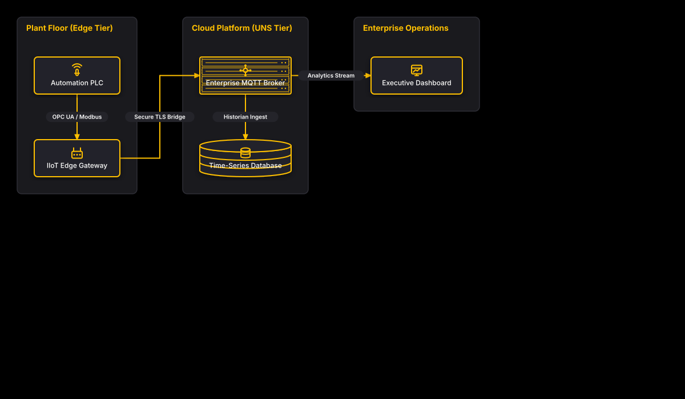

```text
╔══════════════════════════════════════════════════════════════════════════════════════════╗
║  ██████╗ ██╗ █████╗  ██████╗ ██████╗  █████╗ ███╗   ███╗███████╗     █████╗ ███████╗     ║
║  ██╔══██╗██║██╔══██╗██╔════╝ ██╔══██╗██╔══██╗████╗ ████║██╔════╝    ██╔══██╗██╔════╝     ║
║  ██║  ██║██║███████║██║  ███╗██████╔╝███████║██╔████╔██║███████╗    ███████║███████╗     ║
║  ██║  ██║██║██╔══██║██║   ██║██╔══██╗██╔══██║██║╚██╔╝██║╚════██║    ██╔══██║╚════██║     ║
║  ██████╔╝██║██║  ██║╚██████╔╝██║  ██║██║  ██║██║ └──═╝██║███████║    ██║  ██║███████║     ║
║  ╚═════╝ ╚═╝╚═╝  ╚═╝ ╚═════╝ ╚═╝  ╚═╝╚═╝  ╚═╝╚═╝      ╚═╝╚══════╝    ╚═╝  ╚═╝╚══════╝     ║
║                 ██████╗  ██████╗ ██████╗ ███████╗                                        ║
║                ██╔════╝ ██╔═══██╗██╔══██╗██╔════╝     [ PURE PYTHON STANDARD LIBRARY ]   ║
║                ██║      ██║   ██║██║  ██║█████╗       [ ZERO C-DEPS • ZERO GRAPHVIZ  ]   ║
║                ██║      ██║   ██║██║  ██║██╔══╝       [ 935 TESTS • 88 ARCHITECTURES ]   ║
║                ╚██████╗ ╚██████╔╝██████╔╝███████╗     [ CUBIC BEZIER • CORNER FILLETS]   ║
║                 ╚═════╝  ╚═════╝ ╚═════╝ ╚══════╝     [ INTERACTIVE SVG • BOM ENGINE ]   ║
╚══════════════════════════════════════════════════════════════════════════════════════════╝
```

<p align="center">
  
</p>

# Diagrams-as-Code

[](tests/)
[](pyproject.toml)
[](src/diagrams_as_code/)
[](https://docs.astral.sh/uv/)
[](src/diagrams_as_code/theme.py)
[](icons/)
[](LICENSE)

A pure-Python declarative vector diagramming framework. Generate publication-quality architecture diagrams, high-resolution rasterized images, and living Bill of Materials (BOM) documentation from code — with **zero Graphviz**, **zero Cairo**, and **zero external C-library runtime dependencies**.

---

## Reference Architecture Preview



---

## Key Features

- **Pure Python Standard Library Core**: The vector rendering engine, geometric calculations, constraint solver, orthogonal Manhattan router, cubic Bezier curve engine, and SVG generation require zero external C-dependencies.
- **Cubic Bezier Curves & Obstacle Deflection**: Native cubic Bezier edge routing (`Routing.CURVE`) with cardinal port normal tangents, AABB broadphase + recursive De Casteljau collision detection, minimal-deviation C1-continuous spline deflection around intervening obstacles, and lateral escape corridors for reverse-flow edges.
- **Smooth Rounded Corner Fillets**: Analytical quadratic corner fillets (`corner_radius` / `arc_radius`) on Manhattan orthogonal paths with dynamic 50% segment budget clamping (`min(R, L_in/2, L_out/2)`), straight port lead-ins, 2.0px suppression threshold, and native SVG `Q` path emission.
- **Interactive SVG Engine**: Client-side interactive pan-and-zoom with SVG matrix transforms, real-time node search highlighting with auto-focus, reset viewport controls, and miniature minimap navigator HUD embedded directly into vector outputs without external JS libraries.
- **Always Powered by `uv`**: Fast, deterministic package management, virtual environment provisioning, and test runs via [`uv`](https://docs.astral.sh/uv/).
- **14 Built-in Theme Palettes**:
  - **Dark Themes:** `iiot_dark_gold`, `blueprint`, `cyber_slate`, `nord`, `emerald`, `crimson`, `dracula`, `synthwave`.
  - **Light Themes:** `iiot_light`, `monochrome`, `solarized_light`, `pastel_light`, `paper` (black on white, hairlines, square corners, no shadows — for figures in papers).
  - **Accessibility Themes:** `high_contrast` (WCAG AAA compliant).
- **Zero-Clipping Text Engine**: Multi-line word-wrapping via SVG `<tspan>` elements, dynamic font scaling, and support for `label_position="bottom"` (text below graphic tiles).
- **Standalone Vector Icons & Pure Icon Nodes**: Built-in library of 60 handcrafted 24x24 open-source vector icons across 8 domains, with support for `kind="icon"` (borderless icon graphics).
- **Living Documentation & Automated BOM**: Instant emission of Markdown component tables and machine-readable JSON schemas tracking hardware, protocols, and infrastructure specs.
- **Topological Constraint Solving**: Decouples shape instantiation from placement. Elements can be positioned with relative constraints (`right_of`, `below`, `above`, `left_of`) and negative coordinate auto-framing.
- **Technical Drawing Primitives**: free text, captions, brackets, polygons and SVG paths, dashed layer bands with side notes, shapes nested in shapes, double borders, line weights and arrowhead styles, lines attached anywhere on a side or at bare points, shared trunks, leaders, splines, and convex solids in oblique or isometric projection with hidden edges dashed. Nine focused figures in [`examples/primitives/`](examples/primitives/).
- **Technical Figures, Lint & Golden Images**: eleven complete paper-style figures in [`examples/technical/`](examples/technical/) (a four-layer architecture reproduced from a reference figure, a control loop, a transformer block, a state machine, a protocol stack, a memory layout, a timing diagram, a training pipeline, tensor shapes, a geometric construction, a constraint region). `diagrams-as-code lint` reports visual defects by name, and golden-image tests catch any change to how a figure looks. See the [technical figures guide](docs/technical-figures.md) and the [math markup reference](docs/math-markup.md).
- **88 Production Reference Architectures**: 11 comprehensive reference diagrams across 8 architectural domains in [`examples/`](examples/), including auto-layout examples per domain.
- **Auto-Layout Engine**: `Diagram(layout="auto")` places unpinned shapes and groups deterministically from the edge structure; pinned shapes can still coexist via `.at()` / `.right_of()`.
- **CLI**: `diagrams-as-code render|layout export|themes|icons` for batch rendering, layout-file export, and catalog discovery without writing a script.

---

## 8 Architectural Domains Gallery

Explore 88 fully implemented diagrams in [`examples/`](examples/README.md) and [`output/`](output/):

| Domain | Focus & Architectures | Key Built-in Icons |
|---|---|---|
| [**Cloud**](examples/cloud/) | Multi-region VPCs, serverless event pipelines, edge CDNs, hybrid VPNs, service meshes. | `vpc`, `serverless`, `storage`, `api_gateway`, `cdn`, `firewall`, `dns` |
| [**AI / Machine Learning**](examples/ai/) | RAG pipelines, multimodal vision inference, agent swarms, distributed GPU training, GraphRAG. | `brain`, `model`, `agent`, `chip`, `vector_db`, `vision`, `workflow` |
| [**Computer & Systems**](examples/computer/) | Workstations, embedded RTOS, developer toolchains, mobile offline sync, thin client VDI. | `server`, `terminal`, `laptop`, `mobile`, `plc`, `router` |
| [**Datacenter**](examples/datacenter/) | Leaf-Spine Clos fabrics, Fibre Channel SANs, 2N UPS power, in-row CRAC cooling, bare-metal K8s. | `server_rack`, `cluster`, `storage_array`, `cooling`, `ups`, `container`, `kubernetes` |
| [**Business Process**](examples/business_process/) | Order-to-Cash, Procure-to-Pay, regulatory audits, release gates, incident escalations. | `user`, `document`, `decision`, `message`, `shield`, `analytics` |
| [**Cybersecurity**](examples/cybersecurity/) | DMZ perimeter defense, SOC SIEM pipelines, ZTNA, PKI CA hierarchy, optical airgap vaults. | `lock`, `key`, `shield_check`, `siem`, `malware_scan`, `vault` |
| [**Network Engineering**](examples/network_engineering/) | Campus 3-tier LAN, dual eBGP WAN, MPLS VPN, EVPN-VXLAN, DWDM optical rings, Anycast DNS. | `switch`, `optical`, `wan`, `vpn`, `dns_mesh`, `auth_server` |
| [**Industrial IoT (IIoT)**](examples/iiot/) | Plant-to-cloud, broker HA clusters, Sparkplug B UNS, OPC UA TSN, predictive maintenance, SCADA. | `sensor`, `gateway`, `broker`, `plc`, `scada`, `hmi`, `historian`, `robot` |

---

## Quickstart

### 1. Installation

```bash
# Clone and sync with uv
git clone https://github.com/bsommers/diagrams-as-code.git
cd diagrams-as-code
uv sync
```

### 2. Generate a Diagram

```python
from diagrams_as_code import Diagram, Shape

with Diagram("Zero Trust Microservices", theme="nord") as diag:
    with diag.group("Security Perimeter") as g_ingress:
        client = diag.add(Shape("client", "Web Client", icon="mobile"))
        waf = diag.add(Shape("waf", "WAF / Edge Shield", icon="firewall"))
        waf.below(client, margin=30)

    with diag.group("Internal Mesh") as g_mesh:
        api = diag.add(Shape("api", "API Gateway", icon="api_gateway"))
        auth = diag.add(Shape("auth", "Auth Service", icon="key"))
        auth.below(api, margin=30)

    g_ingress.at(60.0, 80.0)
    g_mesh.right_of(g_ingress, margin=90)

    client >> diag.edge("HTTPS :443") >> waf
    waf >> diag.edge("mTLS :8443") >> api
    api >> diag.edge("Verify Token") >> auth

# Render vector SVG, high-DPI PNG, and Bill of Materials
diag.render_svg("output/quickstart.svg")
diag.render_png("output/quickstart.png")
diag.generate_readme("output/quickstart.svg", "output/quickstart_README.md")
```

### 3. Or Let the Engine Lay It Out

```python
from diagrams_as_code import Diagram

with Diagram("Auto-Laid-Out Pipeline", theme="nord", layout="auto") as diag:
    gw = diag.shape("API Gateway", icon="api_gateway")
    worker = diag.shape("Worker", icon="server")
    gw >> diag.edge("invoke") >> worker
```

No `.at()` or `.right_of()` needed — `layout="auto"` places every unpinned
shape and group from the edge structure. Render it (and any script) from the
command line:

```bash
uv run diagrams-as-code render my_diagram.py --out output
```

### 4. Run and Verify

```bash
# Run reference architecture
uv run python main.py

# Run the full test suite
uv run pytest
```

---

## Documentation Hub

Comprehensive architectural, operational, and how-to guides are available in [`docs/`](docs/README.md):

- [**Purpose & Threat Model**](docs/purpose.md): Architectural motivation, pure Python philosophy, and security posture.
- [**System Architecture**](docs/architecture.md): Technical specifications on solver, router, SVG renderer, and BOM engine.
- [**User Guide**](docs/user-guide.md): Concepts, first diagram, positioning, routing, themes, icons, outputs, and CLI.
- [**Development Guidelines**](docs/development.md): Contributor workflow, local-first verification, testing, and doc sync (see also [CONTRIBUTING.md](CONTRIBUTING.md)).
- [**Running & Installation Guide**](docs/running.md): Virtualenv setup with `uv`, CLI commands, Docker execution, and exit codes.
- [**How-To Recipes & Troubleshooting**](docs/how-to.md): Practical recipes for themes, icons, text layouts, CI/CD integration, and troubleshooting.
- [**Visual Architecture Diagrams**](docs/diagrams/README.md): Visual models in ASCII plain text, Mermaid flowcharts, Mermaid sequence lifecycles, and native draw.io XML.
- [**Layout Root Cause Post-Mortem**](docs/LAYOUT_ROOT_CAUSE.md): Context manager coordinate resolution and negative auto-framing post-mortem.
- [**Open-Source Sources & Provenance**](docs/sources.md): Upstream repositories, specifications, and open-source licenses for all icons and tooling.
- [**Changelog**](docs/CHANGELOG.md): Version history, new capabilities, and release notes.

---

## License

Apache-2.0 License. See [LICENSE](LICENSE) for details.
