```text
╔══════════════════════════════════════════════════════════════════════════════════════════╗
║  ██████╗ ██╗ █████╗  ██████╗ ██████╗  █████╗ ███╗   ███╗███████╗     █████╗ ███████╗     ║
║  ██╔══██╗██║██╔══██╗██╔════╝ ██╔══██╗██╔══██╗████╗ ████║██╔════╝    ██╔══██╗██╔════╝     ║
║  ██║  ██║██║███████║██║  ███╗██████╔╝███████║██╔████╔██║███████╗    ███████║███████╗     ║
║  ██║  ██║██║██╔══██║██║   ██║██╔══██╗██╔══██║██║╚██╔╝██║╚════██║    ██╔══██║╚════██║     ║
║  ██████╔╝██║██║  ██║╚██████╔╝██║  ██║██║  ██║██║ └──═╝██║███████║    ██║  ██║███████║     ║
║  ╚═════╝ ╚═╝╚═╝  ╚═╝ ╚═════╝ ╚═╝  ╚═╝╚═╝  ╚═╝╚═╝      ╚═╝╚══════╝    ╚═╝  ╚═╝╚══════╝     ║
║                 ██████╗  ██████╗ ██████╗ ███████╗                                        ║
║                ██╔════╝ ██╔═══██╗██╔══██╗██╔════╝     [ DOCUMENTATION & ARCHITECTURE ]   ║
║                ██║      ██║   ██║██║  ██║█████╗       [ ZERO C-DEPS • ZERO GRAPHVIZ  ]   ║
║                ██║      ██║   ██║██║  ██║██╔══╝       [ 547 TESTS • 88 ARCHITECTURES ]   ║
║                ╚██████╗ ╚██████╔╝██████╔╝███████╗     [ CUBIC BEZIER • CORNER FILLETS]   ║
║                 ╚═════╝  ╚═════╝ ╚═════╝ ╚══════╝     [ INTERACTIVE SVG • BOM ENGINE ]   ║
╚══════════════════════════════════════════════════════════════════════════════════════════╝
```

<p align="center">
  
</p>

# Diagrams-as-Code: Documentation Hub

Welcome to the comprehensive documentation suite for `diagrams-as-code`. This hub provides architectural blueprints, operational runbooks, step-by-step recipes, and multi-format visual diagrams.

---

## Documentation Index

| Document | Topic & Focus |
|---|---|
| [**Purpose & Threat Model**](purpose.md) | Problem statement, architectural motivation, pure standard library philosophy, and security threat model. |
| [**System Architecture**](architecture.md) | Technical specifications: geometry engine, topological constraint solver, orthogonal and curve routers, corner filleting, interactive SVG viewer, and living BOM pipeline. |
| [**User Guide**](user-guide.md) | Task-oriented guide: concepts, first diagram, shapes, groups, positioning, routing, themes, icons, outputs, and the CLI. |
| [**Development Guidelines**](development.md) | Contributor workflow: `uv` rules, repository layout, local-first verification gate, testing, generated artifacts, and doc sync. |
| [**Running & Installation Guide**](running.md) | Prerequisites, virtual environment provisioning with `uv`, CLI commands, test execution, and Docker setup. |
| [**How-To Recipes & Troubleshooting**](how-to.md) | Step-by-step recipes for custom themes, curved routing with obstacle deflection, rounded corner fillets, interactive SVGs, text layout optimization, standalone vector icons, and living BOMs. |
| [**Visual Architecture Diagrams**](diagrams/README.md) | Visual model catalog containing terminal ASCII text, standalone Mermaid flowcharts, Mermaid sequence lifecycles, and native draw.io XML. |
| [**Layout Root Cause Post-Mortem**](LAYOUT_ROOT_CAUSE.md) | Diagnostic analysis and resolution of context-manager lifecycle coordinate resolution and negative bounding box clipping. |
| [**Open-Source Sources & Provenance**](sources.md) | Upstream repositories, specifications, design systems, and permissive open-source licenses for all icons and tooling. |
| [**Changelog & Version History**](CHANGELOG.md) | Release notes, version history, feature additions, and bug fixes across all versions. |

---

## Visual Architecture Quick Preview

```
┌────────────────────────────────────────────────────────────────────────┐
│        User Architecture Script  —or—  the diagrams-as-code CLI        │
│              with Diagram("Title", theme="nord") as diag:              │
└────────────────────────────────────┬───────────────────────────────────┘
                                    │
                                    ▼
┌────────────────────────────────────────────────────────────────────────┐
│                    Declarative Object Model & Stack                    │
│                Diagram  │  Shapes  │  Groups  │  Edges                 │
└────────────────────────────────────┬───────────────────────────────────┘
                                    │
                                    ▼
┌────────────────────────────────────────────────────────────────────────┐
│                            Layout Pipeline                             │
│      Layout File  │  Auto-Place (LayeredLayout)  │  Canvas Growth      │
└────────────────────────────────────┬───────────────────────────────────┘
                                    │
                                    ▼
┌────────────────────────────────────────────────────────────────────────┐
│              Topological Constraint Solver & Auto-Framing              │
│           Relative Alignments  │  DAG Resolution  │  Groups            │
└────────────────────────────────────┬───────────────────────────────────┘
                                    │
                                    ▼
┌────────────────────────────────────────────────────────────────────────┐
│                  Edge Routing Engine (Orthogonal / Curve)              │
│   Orthogonal: Manhattan A*  │  Collinear Clean  │  Corner Fillets (Q)  │
│   Curve: Cubic Bezier (C)   │  Port Normals     │  Obstacle Deflection │
└────────────────────────────────────┬───────────────────────────────────┘
                                    │
                   ┌────────────────┴────────────────┐
                   │                                 │
                   ▼                                 ▼
┌─────────────────────────────────────┐ ┌────────────────────────────────┐
│             SVGRenderer             │ │          BOMGenerator          │
│  - 13 Themes (Light/Dark/A11y)      │ │  - Markdown Tables             │
│  - 60 Built-in Vector Icons         │ │  - Machine-Readable JSON       │
│  - Multi-line <tspan> Wrap          │ └────────────────────────────────┘
│  - Interactive Pan/Zoom & Minimap   │
│  - Client-Side Search Highlighting  │
└─────────────────────────────────────┘
                  │
                  ▼
┌─────────────────────────────────────┐
│              output.py              │
│  - Writes .svg / .png / BOM         │
│  - PNG via rasterize.py:            │
│    resvg-py/Cairo/Inkscape/         │
│    ImageMagick                      │
└─────────────────────────────────────┘
```

For higher resolution ASCII schematics, view [`docs/diagrams/ascii_architecture.txt`](diagrams/ascii_architecture.txt).
