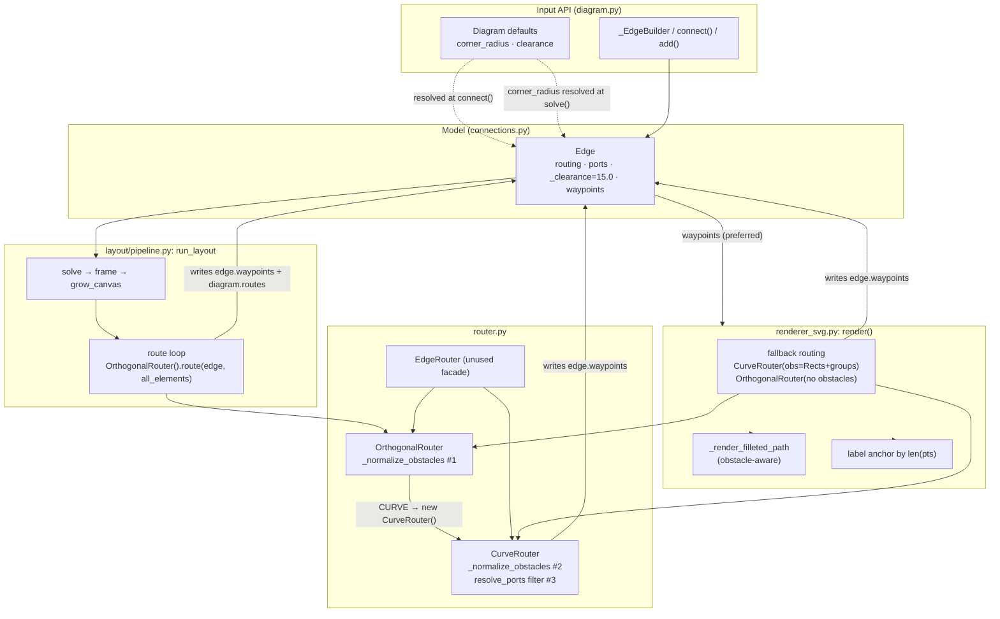
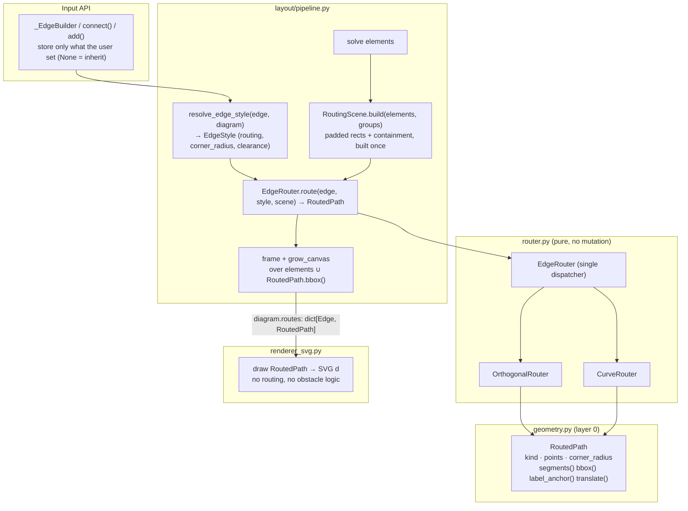
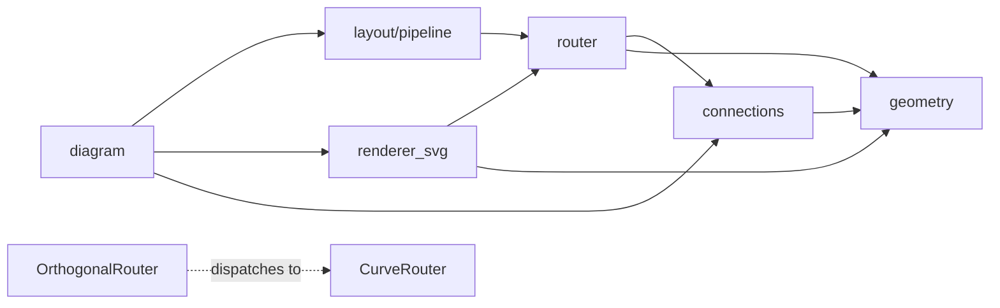

# Architecture Review: Edge Routing Pipeline (2026-09-28)

> **Repository:** `diagrams-as-code` (v0.8.3, `master` @ `d3e0292`)
> **Scope:** from edge declaration to SVG path: `diagram.py`, `connections.py`, `layout/pipeline.py`, `router.py`, `geometry.py`, the edge section of `renderer_svg.py`
> **Inputs:** the `/code-review` of `v0.8.2..HEAD` (15 findings, referenced here as **CR-n**), the [2026-09-22 boundaries review](2026-09-22-architecture-boundaries.md), and the Phase 11 context and research (`.planning/phases/11-*`)
> **Method:** code read by hand plus the import graph. No graphify run was made. The test suite passed (520 tests) at review time.
> **Subsystem health:** **C+ (68/100).** The layering is sound and enforced by a test. The routing data model is weak: it has no typed input, no typed output, and inputs are mixed with outputs.

---

## 1. Code Architecture

### 1.1 Summary

The engine is a layered pipeline written in plain Python (stdlib only). The import direction is enforced by `tests/test_module_boundaries.py` (geometry 0 → elements 1 → connections 2 → router 3 → layout/renderer 4 → diagram 5). That layering holds: `router.py` imports only `connections` and `geometry`.

The problems sit in the **data flow** of routing, not in import direction:

1. **Three routing entry points.** Edges are routed in three places:
   - the layout pipeline, through an `OrthogonalRouter` that forwards CURVE edges to a new `CurveRouter`;
   - the renderer's fallback, for edges with no stored route;
   - the `EdgeRouter` facade, which the package exports but nothing inside it calls.

   Each entry point passes different obstacles.
2. **Routing input is untyped.** `obstacles: Iterable[Any]` is duck-typed (`hasattr(item, "bounds")`, `hasattr(item, "id")`). Each router re-filters the obstacles in its own way: there are three copies of the filter, and they have drifted apart.
3. **Routing output is untyped.** A route is a `list[Point]`. Its meaning (polyline or Bezier chain) depends on `edge.routing` and on `len(pts)` (`(n-1) % 3 == 0`). The renderer works the geometry out again for path commands, label anchors and fillets. The fillets also re-check obstacles.
4. **Input and output share one field.** `edge.waypoints` is written by `CurveRouter.route`, by the pipeline and by the renderer. `diagram.routes` stores the same data a second time, keyed by `id(edge)`.

The 2026-09-22 review already decided *"Route in the layout stage; the renderer receives paths"* (Plan Task 9). Phase 10 partly undid this: it added a curve-routing fallback, with its own obstacle list, inside `SVGRenderer.render`.

### 1.2 Current topology



### 1.3 Target blueprint



The invariants the target enforces:
- **One writer.** Only `run_layout` writes routes. Routers return a value and never mutate the `Edge`.
- **One obstacle model.** `RoutingScene` is built once per solve. It holds padded rects plus an ancestor map, so "skip the groups that contain my endpoints" is a set lookup, not a geometry guess.
- **One path type.** Every consumer, including canvas extrema (Phase 11 D-09), framing translation (D-10), label placement and SVG emission, reads `RoutedPath` methods instead of parsing list lengths.
- **Style resolved once.** Explicit edge value, then the diagram default, then the system default. This happens in one function, at solve time (Phase 11 D-02).

### 1.4 Architectural debt and trade-offs

- **Intentional:** heuristic curve routing (handle lengths from 0.35 × distance, single-corridor detour) instead of a full visibility graph. This is reasonable for diagram-scale inputs and should stay.
- **Accidental complexity:**
  - Routing runs in three places (CR-1, CR-15).
  - Three copies of obstacle filtering (CR-3, CR-14).
  - Mirrored horizontal and vertical implementations of about 130 lines each (`_build_deflected_spline_*`, both halves of `_select_deflected_corridor`).
  - The 15.0 sentinel value used as "unset" (CR-9, CR-11).
  - Router side effects (CR-12).
- **Ordering bug:** routing runs *after* `_grow_canvas`, so the canvas never sees route extents (CR-2, CR-7). Phase 11 D-06 fixes the order.
- **Performance:** not a concern at current scale. `obs.expand(clearance)` is recomputed per segment × obstacle × candidate. `RoutingScene` removes this as a side effect.

---

## 2. Module Review (Intra-Module)

### 2.1 Scorecard

| Module | Role | Cohesion | Complexity | Tests | Grade |
| :--- | :--- | :---: | :---: | :---: | :---: |
| `geometry.py` (410) | Layer-0 primitives, Bezier math | High | Low | 21 | **A−** |
| `connections.py` (186) | `Edge`, `Port`, `Routing` model | Medium | Low | via API | **B−** |
| `router.py` (898) | Orthogonal A*, curve detours, facade | Low | High | 41 + 4 eval | **C** |
| `layout/pipeline.py` (204) | Ordered solve steps | High | Low | `test_layout_*` | **B+** |
| `renderer_svg.py` (1045) | SVG emission, plus routing and fillet geometry | Low | High | 38 | **C−** |
| `diagram.py` (693) | DSL, config, registry | Medium | Medium | `test_diagram_api` | **B−** |

### 2.2 Findings

#### `router.py`
- **SRP:** `CurveRouter` does four jobs: choosing ports, building the default curve, running collision tests and choosing a detour corridor. It is 550 lines, with 180 lines of mirrored horizontal and vertical code. `OrthogonalRouter.route` also dispatches CURVE edges (`router.py:636`), so the orthogonal strategy knows about its sibling.
- **Contracts:** `obstacles: Optional[Iterable[Any]]` is read twice (CR-4). Types are checked with `hasattr` and `isinstance(item, Rect)`, so passing `Element`s and passing bare `Rect`s behave differently: filtering by id or identity only works for `Element`s (CR-15). The effective clearance treats `clearance == 15.0` as "not passed" (`router.py:265`, CR-11).
- **Side effects:** `route()` writes `edge.waypoints` on every return path (`router.py:276,326,331,337`, CR-12). `OrthogonalRouter.route` does not, so the two strategies behave differently.
- **Magic numbers:** 20, 25, 30, 0.25, 0.35, 0.5 and 80 are spread across nine functions, and the `min_top <= 30.0` canvas guess (`router.py:124`) stands in for canvas bounds the router never receives (CR-2).
- **Hotspots:** `_select_deflected_corridor` (`router.py:481`, 125 lines, cyclomatic complexity ≈ 12) and `_find_detour_path` (`router.py:722`, 130 lines, but it is well structured A*).

#### `renderer_svg.py` (edge section, lines 685–838)
- **SRP:** the renderer routes edges (line 702), mutates the model (line 713, inside `try/except Exception: pass`, which hides errors), computes obstacle-aware fillet radii (`_render_filleted_path`, whose obstacle list is shadowed per edge, CR-1), and places labels using three geometry strategies.
- `render()` is a single function of about 490 lines. Extracting `_render_edge(e, path) -> list[str]` would take the edge section out whole.

#### `connections.py`
- `Edge._clearance` is stored as `float` with a default of 15.0, so "unset" and "set to 15" cannot be told apart (CR-9). `corner_radius` gets this right (`None` means inherit). Clearance and routing (Phase 11 D-01) should work the same way.
- `waypoints: Optional[list[Point]]` is ambiguous: it is either user input or a computed cache, and nothing records which.

#### `diagram.py`
- The style cascade is resolved in three places at three different times: `connect()` (clearance, corner_radius), `solve()` (corner_radius only), and never for `add()` or `_EdgeBuilder` (CR-9, CR-10). `_EdgeBuilder.__call__(**kwargs)` silently drops unknown kwargs (CR-10).

#### `geometry.py`
- It is clean. `CubicBezier.intersects_rect` is conservative at maximum depth (CR-8). Because `RoutedPath.bbox()` and collision checks will both depend on it, this should be fixed here once instead of being worked around in the routers.

---

## 3. Inter-Module Review

### 3.1 Dependencies (runtime, scope only)



### 3.2 Coupling
- **Afferent:** `router` has two callers, `pipeline` and `renderer_svg`. Only one should remain. `renderer_svg → router` is a legal import under the layer test, but it contradicts the 2026-09-22 decision. Add it to the boundary test as a forbidden edge.
- **Efferent:** fine. No cycles in scope.
- **Hidden coupling through data:** the renderer depends on the router's *list-length encoding* (`len(pts) == 4`, `(len-1) % 3 == 0`). The import graph does not show this, and it breaks silently if a router emits a different shape.

### 3.3 Boundary integrity
- **Contract strictness:** it is weak at both ends of the router (`Iterable[Any]` in, `list[Point]` out).
- **Leaky state:** `edge.waypoints` is written by three layers. `diagram.routes` duplicates it and is read second (`renderer_svg.py:695–706`), so a stale `edge.waypoints` wins over a fresh `routes` entry.
- **Phase 11 interaction (important):** Phase 11 **D-07** says *"if `edge.waypoints` is already non-empty, preserve it and skip auto-routing."* With today's model, every edge has non-empty waypoints after the first solve. So after `configure(...)` or any other re-solve, D-07 would **freeze every route at its first-solve geometry**. D-07 needs a separate input field (`edge.manual_waypoints`, never written by the engine) before it can be implemented safely.
- Also note that D-05 and the research name the enum `Routing.CURVED`, but the enum is `Routing.CURVE`. The research proposes an alias. Adding an alias is optional, but the plan text should use the real name.

---

## 4. Prioritized Roadmap

The ordering is set against Phase 11. P0 items are **prerequisites Phase 11 should absorb**, because D-06, D-07, D-09 and D-10 each build on the structures they introduce. Fixing CR-1, CR-3, CR-4, CR-12, CR-14 and CR-15 one at a time before P0 would be mostly throwaway work.

### Batch 1 (P0): Routing data model, the foundation for Phase 11

- [ ] **P0.1: `RoutedPath` value type in `geometry.py`**
  - **Problem:** routes are untyped point lists that the renderer, and soon `_grow_canvas` and `_frame`, must decode.
  - **Solution:** a frozen dataclass `RoutedPath(kind: PathKind, points: tuple[Point, ...], corner_radius: float = 0.0)`. `PathKind` is `POLYLINE` or `BEZIER_CHAIN`. It has the methods `segments()`, `bbox()`, `translate(dx, dy)`, `label_anchor()` and `svg_d()`. The fillet math moves in with it, and the renderer no longer applies an obstacle guard (see P0.4).
  - **Effort:** M. **Closes:** the D-09 and D-10 prerequisites, and the label and path-emission duplication.

```python
# ❌ BEFORE (renderer_svg.py:721–737, repeated for labels at 776–812)
if e.routing in (Routing.CURVE, "curve") and len(pts) == 4: ...
elif e.routing in (Routing.CURVE, "curve") and len(pts) >= 4 and (len(pts) - 1) % 3 == 0: ...
elif is_orthogonal and corner_r > 0.0: ...

# ✅ AFTER
path = diagram.routes[e]
lines.append(f'<path d="{path.svg_d()}" .../>')
lx, ly = path.label_anchor()
```

- [ ] **P0.2: Split edge input from output; routers become pure**
  - **Problem:** `edge.waypoints` has three writers. It is duplicated in `diagram.routes`. D-07 would freeze stale routes (§3.3).
  - **Solution:** `Edge.manual_waypoints: Optional[list[Point]]` is set by the user only. Routers *return* a `RoutedPath` and never assign to `edge`. `run_layout` is the only writer of `diagram.routes: dict[Edge, RoutedPath]`. Keep `edge.waypoints` as a read-only property backed by the last solve, for backward compatibility.
  - **Effort:** S–M. **Closes:** CR-12, and makes D-07 safe.

- [ ] **P0.3: One dispatcher, called only by the pipeline; delete the renderer fallback**
  - **Problem:** there are three entry points (CR-1, CR-15), and `OrthogonalRouter` dispatches CURVE edges.
  - **Solution:** `EdgeRouter.route(edge, style, scene) -> RoutedPath` becomes the only entry point. Remove the CURVE branch from `OrthogonalRouter.route`. `SVGRenderer.render` requires `routes`. For direct callers, add a small `route_all(edges, elements, groups)` helper to `router.py` so tests and the public API can build `routes` without a `Diagram`. Add `("renderer_svg", "router")` as forbidden in `test_module_boundaries.py`.
  - **Effort:** M. **Closes:** CR-1 and CR-15, and satisfies D-05 with the existing facade instead of a new `router_for_routing`.

- [ ] **P0.4: `RoutingScene`, a single obstacle model**
  - **Problem:** three drifting filters, duck-typed input read twice, and parent groups counted as blockers (CR-3, CR-4, CR-14).
  - **Solution:** `RoutingScene.build(elements)` runs once per solve. It holds `rects: dict[Element, Rect]`, `ancestors: dict[Element, frozenset[Group]]` and `canvas: Rect`. `scene.obstacles_for(edge, clearance)` returns padded rects, excluding the endpoints and their ancestors, and caches them by clearance. Both routers take a scene, not an `Iterable[Any]`. Fillet obstacle clamping reads the same scene when the path is built (in the router), not in the renderer.
  - **Effort:** M. **Closes:** CR-3, CR-4, CR-14 (the obstacle half), and the root cause of CR-1.

```python
# ❌ BEFORE (router.py:128–142, a third copy of the filter)
for item in obstacles:
    r = item if isinstance(item, Rect) else getattr(item, "bounds", None)
    ...
    src_id = getattr(edge.source, "id", None)   # rebuilt every iteration
    ...

# ✅ AFTER
blocked = scene.obstacles_for(edge, clearance)   # endpoints + containing groups excluded
north_blocked = any(r.overlaps_band(x_span, above=min_top) for r in blocked)
```

### Batch 2 (P0, parallel-safe): Style cascade (overlaps Phase 11 CFG-01 and CFG-02)

- [ ] **P0.5: Store `None` for unset, resolve once**
  - **Solution:** `Edge._clearance` and `Edge._routing` default to `None`, like `corner_radius`. Add `resolve_edge_style(edge, diagram) -> EdgeStyle(routing, corner_radius, clearance)` in `layout/pipeline.py`, called for every edge in `run_layout` regardless of how the edge was created. Remove the resolution from `connect()` and `solve()`. Routers take `EdgeStyle`, and their `clearance=15.0` parameter is removed. `OrthogonalRouter` honours `style.clearance`.
  - **Effort:** S. **Closes:** CR-9, CR-11 and CR-13, and implements D-02 and D-03 directly.
- [ ] **P0.6: `_EdgeBuilder.__call__` rejects unknown kwargs** and does not keep per-call clearance on the builder (CR-10). **Effort:** XS.

### Batch 3 (P1): Pipeline ordering and canvas (this is Phase 11 CFG-04, reshaped)

- [ ] **P1.1: Route → extrema → frame → grow**, using `RoutedPath.bbox()` and `translate()` (D-06, D-09, D-10). Pass `scene.canvas` to the routers so port choice stops guessing with `min_top <= 30` (CR-2). Once framing can translate, the correct rule becomes: *choose ports for obstacles only, and let framing absorb the height.*
- [ ] **P1.2: Scope the explicit-port escape corridor** (CR-7) to obstacles in the span between the two nodes. Try both north and south and collision-test each, using the same corridor selector as the detours.

### Batch 4 (P1): CurveRouter internals

- [ ] **P1.3: Axis-transposed corridor code.** Implement the horizontal case once. Handle the vertical case by swapping x and y on the input and output (`Point(y, x)`). This removes `_build_deflected_spline_vertical` and half of `_select_deflected_corridor`, about 180 lines, and fixes both halves of CR-5 and CR-6 in one place.
- [ ] **P1.4: Iterative corridor widening** (CR-5, D-10). Loop: widen past the union of hits, rebuild with the widened *block* (not only the height), and stop at the canvas edge or after N tries. Return the best route found plus a `RoutingWarning` if a collision remains. Do not fail silently.
- [ ] **P1.5: Clamp handle lengths** to the free run between the port and the first waypoint (CR-6). Move the tuning constants into one `CurveTuning` frozen dataclass.
- [ ] **P1.6: `CubicBezier.intersects_rect`** gets an exact final test at leaf depth (a line-segment check on the flattened leaf, or a higher adaptive depth) (CR-8).

### Batch 5 (P2): Tests that would have caught this release's bugs

- [ ] **P2.1: Routing invariant test over the gallery.** For every example diagram and every edge: (a) the route does not cross any non-endpoint, non-ancestor obstacle (padded by the clearance minus 1px), and (b) `path.bbox()` lies inside the canvas. This single test would have caught CR-1, 2, 3, 5, 6 and 7.
- [ ] **P2.2: Remove the order-dependent and either-port assertions** in `test_e2e.py` that hid CR-3. Assert NORTH when there is nothing above.
- [ ] **P2.3: Router purity test.** Routing an edge twice with the same scene gives equal results, and the `Edge` is not mutated.

### P3: Later
- [ ] Extract `SVGRenderer._render_edge` and `_render_shape` from the 490-line `render()`.
- [ ] Consider a `Router` `Protocol` (`route(edge, style, scene) -> RoutedPath`) so new strategies (for example splines through manual waypoints) plug into `EdgeRouter` without editing it.

---

## 5. Security and Robustness

- **Attack surface:** the inputs are Python DSL scripts, which are trusted code, plus layout sidecar files. SVG text goes through `html.escape`. Colours from `metadata` and `edge.color` go into attributes unescaped (`renderer_svg.py:601, 767`). This is low risk for a code-first DSL, but it is worth escaping if diagrams are ever built from untrusted JSON or YAML.
- **Silent failures:** `renderer_svg.py:712–715` has an `except Exception: pass` around a model mutation, and the curve router returns colliding routes without warning (CR-5). P0.3 removes the first and P1.4 fixes the second.
- **Dependencies:** there are no runtime dependencies (`dependencies = []`). Optional rasterizers are imported lazily.
- **Next step:** `/security-scan` is low priority for this subsystem. `dependency-audit` is only relevant to dev dependencies.

---

## Mapping: code-review findings → roadmap

| CR | Fixed by | CR | Fixed by |
|---|---|---|---|
| 1 | P0.3, P0.4 | 9 | P0.5 |
| 2 | P1.1 | 10 | P0.6 |
| 3 | P0.4 | 11 | P0.5 |
| 4 | P0.4 | 12 | P0.2 |
| 5 | P1.3, P1.4 | 13 | P0.5 |
| 6 | P1.3, P1.5 | 14 | P0.4, P1.3 |
| 7 | P1.2 | 15 | P0.3 |
| 8 | P1.6 | | |

## Decisions
- 2026-09-28: the user approved folding Batches 1–2 (P0.1–P0.6) into Phase 11 (`11-CONTEXT.md` D-05–D-08 revised, D-13–D-19 added). P1.1 was already Phase 11 scope (CFG-04). Batches 4–5 are deferred to a follow-up phase.
