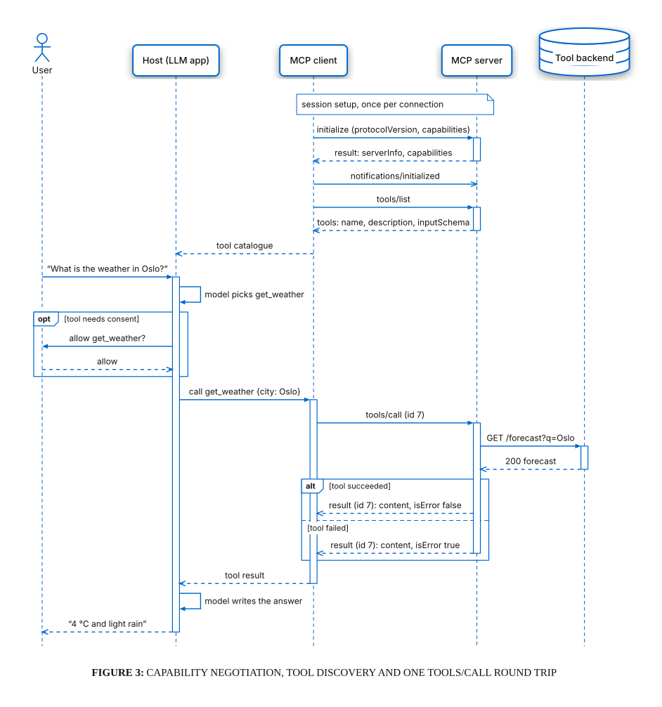

# Sequence Diagrams

`diagrams_as_code.sequence.SequenceDiagram` draws UML sequence diagrams:
participants with lifelines, messages in time order, activation bars,
self-calls, notes and combined fragments (`loop`, `alt`, `opt`, `par`,
`critical`, `break`). You describe the interaction; the kit lays it out.

The output is an ordinary `Diagram` made of the engine's own shapes, text,
paths and edges, so themes, `lint`, SVG, PNG, PDF, the bill of materials, the
CLI and the MCP server all work on it unchanged.



## 1. A first diagram

```python
from diagrams_as_code import Diagram
from diagrams_as_code.sequence import SequenceDiagram


def diagram() -> Diagram:
    seq = SequenceDiagram("Checkout", theme="iiot_light")
    web = seq.participant("Web")
    api = seq.participant("API")
    db = seq.participant("Orders DB", kind="database")

    seq.message(web, api, "POST /orders", activate=True)
    with seq.loop("until committed"):
        seq.message(api, db, "INSERT order")
        seq.reply(db, api, "ok")
    with seq.alt("paid") as alt:
        seq.reply(api, web, "201 Created", deactivate=False)
        alt.branch("declined")
        seq.reply(api, web, "402 Payment Required", deactivate=False)
    seq.deactivate(api)
    seq.note(api, "idempotent on the order key")
    return seq.build()
```

`build()` returns a `Diagram`, so a script that defines `diagram()` like this
one renders with `diagrams-as-code render`, lints with `diagrams-as-code lint`
and is listed by the MCP server like any other example. Add a caption with
`diag = seq.build(); diag.caption("...")`.

## 2. API

### `SequenceDiagram(title, *, theme="iiot_light", mirror=False, autonumber=False, **diagram_options)`

| Option | Effect |
|---|---|
| `theme` | Any built-in or derived theme. Every colour comes from the theme, so `--theme` on the CLI restyles the diagram too. |
| `mirror` | Repeat the participant headers under the lifelines. |
| `autonumber` | Prefix every message label with `1.`, `2.` ... |
| `**diagram_options` | Passed to `Diagram` (`width`, `height`, `precision`, `pixel_snap` ...). |

### Participants

| Call | Draws |
|---|---|
| `seq.participant(name)` | A box header. |
| `seq.participant(name, kind="database")` | A cylinder header. |
| `seq.participant(name, icon="server")` | A box header with a built-in icon. |
| `seq.actor(name)` | A stick figure with the name under it. |

Columns follow declaration order. Names must be unique; anywhere a
participant is expected, its name works too (`seq.message("Web", "API", ...)`).

### Messages

| Call | Line | Head |
|---|---|---|
| `seq.message(a, b, label)` | solid | filled triangle (synchronous call) |
| `seq.message(a, b, label, style="async")` | solid | open (asynchronous signal) |
| `seq.message(a, b, label, style="dashed")` | dashed | open |
| `seq.reply(b, a, label)` | dashed | open (return) |
| `seq.message(a, a, label)` | a loop out to the right and back | filled triangle (self-call) |

Labels take the full label markup: `**bold**`, `*italic*`, `$math$` and `\n`.

### Activations

- `message(..., activate=True)` starts a bar on the receiver where the message
  arrives. `message(..., deactivate=True)` ends the sender's innermost bar
  where the message leaves.
- `reply()` ends the sender's bar if it has one; pass `deactivate=False` to
  keep it (for example in every branch of an `alt`, then call
  `seq.deactivate(p)` after the frame).
- `seq.activate(p)` / `seq.deactivate(p)` do the same as separate calls. Right
  after a message that reaches (or leaves) `p` they attach to that message.
- Nested activations step 5 px to the right. A self-call with `activate=True`
  returns to the new, nested bar. Bars still open at the end run to the bottom.

### Notes

```python
seq.note(api, "text")                  # right of the lifeline (side="right")
seq.note(api, "text", side="left")
seq.note(api, "text", side="over")     # centred on the lifeline
seq.note([web, api], "text")           # over two lifelines
seq.note(api, "long text", width=180)  # wrap width (default 240 px)
```

### Frames (combined fragments)

```python
with seq.loop("for each page"): ...
with seq.opt("cache miss"): ...
with seq.critical("holding the lock"): ...
with seq.break_("quota exceeded"): ...
with seq.alt("ok") as alt:
    ...
    alt.branch("error")        # alias: alt.else_("error")
    ...
with seq.par("left", "right") as par:   # guards given up front
    ...
    par.branch()               # takes the next guard, "right"
    ...
with seq.frame("loop", "every 5 s"): ...   # the general form
```

Frames nest. Each frame is as wide as what happens inside it, plus a margin,
and never narrower than its tag and guard.

### Spacing and placement

- `seq.space(px)` leaves extra time between two rows.
- `seq.draw(diag, origin=(x, y))` adds the diagram to an existing `Diagram`
  with its top-left corner at `origin` and returns the box it fills.
- `seq.layout()` returns the computed geometry (`SequenceLayout`: columns,
  headers, message points and label boxes, bars, notes, frames, texts and
  lifeline runs) without drawing anything, which is what the tests check.

## 3. How the layout works

1. **Columns.** Every participant is a column, in declaration order. The gap
   between neighbouring columns starts at the width of their headers plus
   28 px. Every message label, self-call label and side note then adds a
   constraint "these columns must be at least this far apart", measured with
   the same text metrics the renderer uses (math included). Constraints are
   met narrowest-span first; a message spanning several columns spreads its
   deficit evenly over the gaps it crosses.
2. **Rows.** Every event takes the next row, in the order it was called. A
   row is as tall as its label, so multi-line and fraction-height labels push
   later rows down instead of overlapping them.
3. **Activations and frames** are tracked as the rows are laid out; a frame
   encloses the x-extent of everything recorded inside it.
4. **Lifelines** are dashed and stop short of any text, note or frame tag
   they would cross. A label that crosses an activation bar gets a plate in
   the theme's node fill so it stays readable.

The layout is a pure function of the calls, so the same script produces a
byte-identical SVG on every run and machine.

## 4. Gallery

| # | Script | Shows |
|---|---|---|
| 01 | [`01_http_retry.py`](../examples/sequence/01_http_retry.py) | cache-aside read behind a load balancer, `loop` with backoff note, `alt` outcome, database participant |
| 02 | [`02_oauth_authorization_code.py`](../examples/sequence/02_oauth_authorization_code.py) | OAuth 2.0 authorization code + PKCE, actor, self-call, math in labels, `autonumber`, `nord` theme |
| 03 | [`03_mcp_tool_call.py`](../examples/sequence/03_mcp_tool_call.py) | MCP `initialize` / `tools/list` / `tools/call`, note over two lifelines, `opt` consent, `alt` result, async notification |

## 5. Limits

- Messages are horizontal: there is no slanted "in flight" message (draw those
  with `diag.connect` as in `examples/computer_science/08_tcp_connection_lifecycle.py`).
- No lost/found messages, participant creation or destruction mid-diagram,
  gates, interaction references (`ref`) or timing constraints.
- Alternative branches share one timeline for activation bookkeeping: end a
  bar inside one `alt` operand and it is ended for the next. Use
  `deactivate=False` in the branches and deactivate after the frame.
- Participants are laid out in one row; very wide diagrams are not wrapped.
