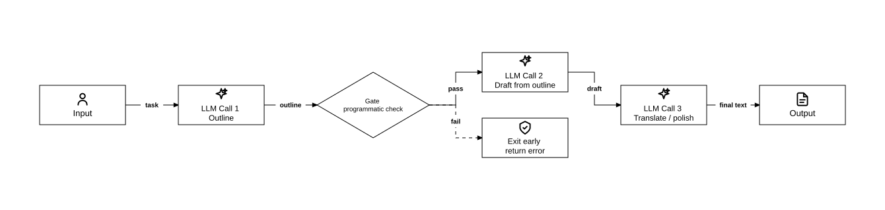

# Prompt Chaining with a Gate

## Bill of Materials

| Symbol / ID | Label | Kind | Group | Technical Notes / Metadata |
| :--- | :--- | :--- | :--- | :--- |
| `shape_1` | **Input** | box | - | - |
| `shape_2` | **LLM Call 1 Outline** | box | - | - |
| `shape_3` | **Gate programmatic check** | diamond | - | - |
| `shape_4` | **LLM Call 2 Draft from outline** | box | - | - |
| `shape_5` | **LLM Call 3 Translate / polish** | box | - | - |
| `shape_6` | **Output** | box | - | - |
| `shape_7` | **Exit early return error** | box | - | - |

## Connections

| Source | Target | Protocol / Label | Style | Routing |
| :--- | :--- | :--- | :--- | :--- |
| **Input** (`shape_1`) | **LLM Call 1 Outline** (`shape_2`) | task | solid | orthogonal |
| **LLM Call 1 Outline** (`shape_2`) | **Gate programmatic check** (`shape_3`) | outline | solid | orthogonal |
| **Gate programmatic check** (`shape_3`) | **LLM Call 2 Draft from outline** (`shape_4`) | pass | solid | orthogonal |
| **LLM Call 2 Draft from outline** (`shape_4`) | **LLM Call 3 Translate / polish** (`shape_5`) | draft | solid | orthogonal |
| **LLM Call 3 Translate / polish** (`shape_5`) | **Output** (`shape_6`) | final text | solid | orthogonal |
| **Gate programmatic check** (`shape_3`) | **Exit early return error** (`shape_7`) | fail | dashed | orthogonal |
