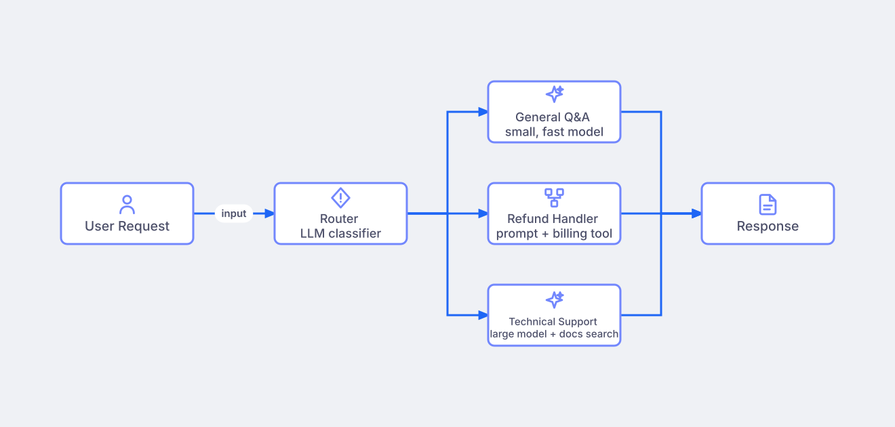

# Routing Workflow

## Bill of Materials

| Symbol / ID | Label | Kind | Group | Technical Notes / Metadata |
| :--- | :--- | :--- | :--- | :--- |
| `shape_1` | **User Request** | box | - | - |
| `shape_2` | **Router LLM classifier** | box | - | - |
| `shape_3` | **General Q&A small, fast model** | box | - | - |
| `shape_4` | **Refund Handler prompt + billing tool** | box | - | - |
| `shape_5` | **Technical Support large model + docs search** | box | - | - |
| `shape_6` | **Response** | box | - | - |

## Connections

| Source | Target | Protocol / Label | Style | Routing |
| :--- | :--- | :--- | :--- | :--- |
| **User Request** (`shape_1`) | **Router LLM classifier** (`shape_2`) | input | solid | orthogonal |
| **Router LLM classifier** (`shape_2`) | **General Q&A small, fast model** (`shape_3`) | - | solid | orthogonal |
| **Router LLM classifier** (`shape_2`) | **Refund Handler prompt + billing tool** (`shape_4`) | - | solid | orthogonal |
| **Router LLM classifier** (`shape_2`) | **Technical Support large model + docs search** (`shape_5`) | - | solid | orthogonal |
| **General Q&A small, fast model** (`shape_3`) | **Response** (`shape_6`) | - | solid | orthogonal |
| **Refund Handler prompt + billing tool** (`shape_4`) | **Response** (`shape_6`) | - | solid | orthogonal |
| **Technical Support large model + docs search** (`shape_5`) | **Response** (`shape_6`) | - | solid | orthogonal |
