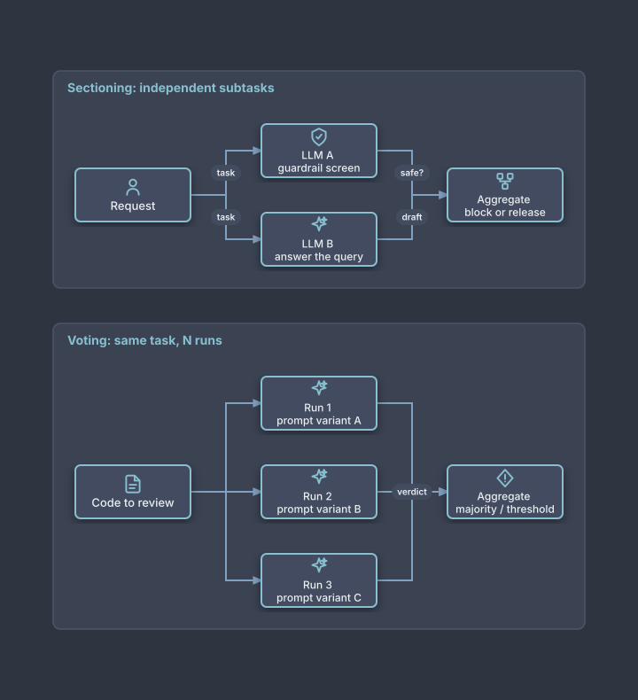

# Parallelization: Sectioning and Voting

## Bill of Materials

| Symbol / ID | Label | Kind | Group | Technical Notes / Metadata |
| :--- | :--- | :--- | :--- | :--- |
| `shape_2` | **Request** | box | Sectioning: independent subtasks | - |
| `shape_3` | **LLM A guardrail screen** | box | Sectioning: independent subtasks | - |
| `shape_4` | **LLM B answer the query** | box | Sectioning: independent subtasks | - |
| `shape_5` | **Aggregate block or release** | box | Sectioning: independent subtasks | - |
| `shape_7` | **Code to review** | box | Voting: same task, N runs | - |
| `shape_8` | **Run 1 prompt variant A** | box | Voting: same task, N runs | - |
| `shape_9` | **Run 2 prompt variant B** | box | Voting: same task, N runs | - |
| `shape_10` | **Run 3 prompt variant C** | box | Voting: same task, N runs | - |
| `shape_11` | **Aggregate majority / threshold** | box | Voting: same task, N runs | - |

## Connections

| Source | Target | Protocol / Label | Style | Routing |
| :--- | :--- | :--- | :--- | :--- |
| **Request** (`shape_2`) | **LLM A guardrail screen** (`shape_3`) | task | solid | orthogonal |
| **Request** (`shape_2`) | **LLM B answer the query** (`shape_4`) | task | solid | orthogonal |
| **LLM A guardrail screen** (`shape_3`) | **Aggregate block or release** (`shape_5`) | safe? | solid | orthogonal |
| **LLM B answer the query** (`shape_4`) | **Aggregate block or release** (`shape_5`) | draft | solid | orthogonal |
| **Code to review** (`shape_7`) | **Run 1 prompt variant A** (`shape_8`) | - | solid | orthogonal |
| **Code to review** (`shape_7`) | **Run 2 prompt variant B** (`shape_9`) | - | solid | orthogonal |
| **Code to review** (`shape_7`) | **Run 3 prompt variant C** (`shape_10`) | - | solid | orthogonal |
| **Run 1 prompt variant A** (`shape_8`) | **Aggregate majority / threshold** (`shape_11`) | verdict | solid | orthogonal |
| **Run 2 prompt variant B** (`shape_9`) | **Aggregate majority / threshold** (`shape_11`) | verdict | solid | orthogonal |
| **Run 3 prompt variant C** (`shape_10`) | **Aggregate majority / threshold** (`shape_11`) | verdict | solid | orthogonal |
