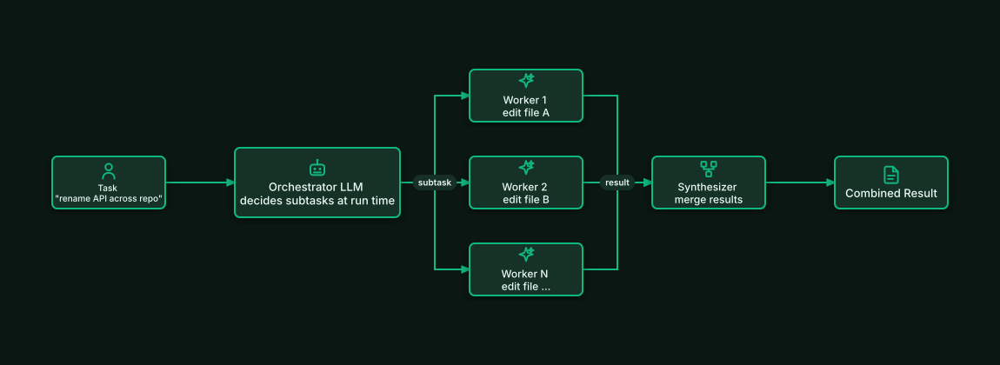

# Orchestrator-Workers

## Bill of Materials

| Symbol / ID | Label | Kind | Group | Technical Notes / Metadata |
| :--- | :--- | :--- | :--- | :--- |
| `shape_1` | **Task "rename API across repo"** | box | - | - |
| `shape_2` | **Orchestrator LLM decides subtasks at run time** | box | - | - |
| `shape_3` | **Worker 1 edit file A** | box | - | - |
| `shape_4` | **Worker 2 edit file B** | box | - | - |
| `shape_5` | **Worker N edit file ...** | box | - | - |
| `shape_6` | **Synthesizer merge results** | box | - | - |
| `shape_7` | **Combined Result** | box | - | - |

## Connections

| Source | Target | Protocol / Label | Style | Routing |
| :--- | :--- | :--- | :--- | :--- |
| **Task "rename API across repo"** (`shape_1`) | **Orchestrator LLM decides subtasks at run time** (`shape_2`) | - | solid | orthogonal |
| **Orchestrator LLM decides subtasks at run time** (`shape_2`) | **Worker 1 edit file A** (`shape_3`) | subtask | solid | orthogonal |
| **Orchestrator LLM decides subtasks at run time** (`shape_2`) | **Worker 2 edit file B** (`shape_4`) | subtask | solid | orthogonal |
| **Orchestrator LLM decides subtasks at run time** (`shape_2`) | **Worker N edit file ...** (`shape_5`) | subtask | solid | orthogonal |
| **Worker 1 edit file A** (`shape_3`) | **Synthesizer merge results** (`shape_6`) | result | solid | orthogonal |
| **Worker 2 edit file B** (`shape_4`) | **Synthesizer merge results** (`shape_6`) | result | solid | orthogonal |
| **Worker N edit file ...** (`shape_5`) | **Synthesizer merge results** (`shape_6`) | result | solid | orthogonal |
| **Synthesizer merge results** (`shape_6`) | **Combined Result** (`shape_7`) | - | solid | orthogonal |
