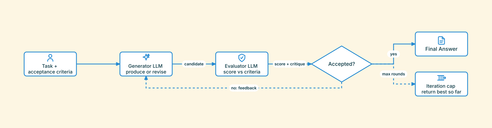

# Evaluator-Optimizer Loop

## Bill of Materials

| Symbol / ID | Label | Kind | Group | Technical Notes / Metadata |
| :--- | :--- | :--- | :--- | :--- |
| `shape_1` | **Task + acceptance criteria** | box | - | - |
| `shape_2` | **Generator LLM produce or revise** | box | - | - |
| `shape_3` | **Evaluator LLM score vs criteria** | box | - | - |
| `shape_4` | **Accepted?** | diamond | - | - |
| `shape_5` | **Final Answer** | box | - | - |
| `shape_6` | **Iteration cap return best so far** | box | - | - |

## Connections

| Source | Target | Protocol / Label | Style | Routing |
| :--- | :--- | :--- | :--- | :--- |
| **Task + acceptance criteria** (`shape_1`) | **Generator LLM produce or revise** (`shape_2`) | - | solid | orthogonal |
| **Generator LLM produce or revise** (`shape_2`) | **Evaluator LLM score vs criteria** (`shape_3`) | candidate | solid | orthogonal |
| **Evaluator LLM score vs criteria** (`shape_3`) | **Accepted?** (`shape_4`) | score + critique | solid | orthogonal |
| **Accepted?** (`shape_4`) | **Final Answer** (`shape_5`) | yes | solid | orthogonal |
| **Accepted?** (`shape_4`) | **Generator LLM produce or revise** (`shape_2`) | no: feedback | dashed | orthogonal |
| **Accepted?** (`shape_4`) | **Iteration cap return best so far** (`shape_6`) | max rounds | dashed | orthogonal |
