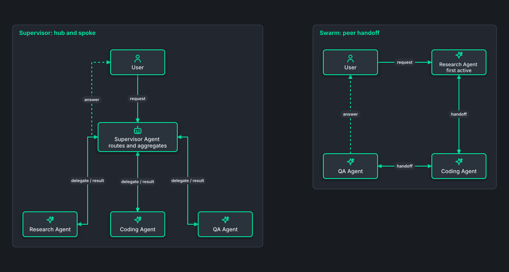

# Multi-Agent Topologies: Supervisor vs Swarm

## Bill of Materials

| Symbol / ID | Label | Kind | Group | Technical Notes / Metadata |
| :--- | :--- | :--- | :--- | :--- |
| `shape_2` | **User** | box | Supervisor: hub and spoke | - |
| `shape_3` | **Supervisor Agent routes and aggregates** | box | Supervisor: hub and spoke | - |
| `shape_4` | **Research Agent** | box | Supervisor: hub and spoke | - |
| `shape_5` | **Coding Agent** | box | Supervisor: hub and spoke | - |
| `shape_6` | **QA Agent** | box | Supervisor: hub and spoke | - |
| `shape_8` | **User** | box | Swarm: peer handoff | - |
| `shape_9` | **Research Agent first active** | box | Swarm: peer handoff | - |
| `shape_10` | **Coding Agent** | box | Swarm: peer handoff | - |
| `shape_11` | **QA Agent** | box | Swarm: peer handoff | - |

## Connections

| Source | Target | Protocol / Label | Style | Routing |
| :--- | :--- | :--- | :--- | :--- |
| **User** (`shape_2`) | **Supervisor Agent routes and aggregates** (`shape_3`) | request | solid | orthogonal |
| **Supervisor Agent routes and aggregates** (`shape_3`) | **Research Agent** (`shape_4`) | delegate / result | solid | orthogonal |
| **Supervisor Agent routes and aggregates** (`shape_3`) | **Coding Agent** (`shape_5`) | delegate / result | solid | orthogonal |
| **Supervisor Agent routes and aggregates** (`shape_3`) | **QA Agent** (`shape_6`) | delegate / result | solid | orthogonal |
| **Supervisor Agent routes and aggregates** (`shape_3`) | **User** (`shape_2`) | answer | dashed | orthogonal |
| **User** (`shape_8`) | **Research Agent first active** (`shape_9`) | request | solid | orthogonal |
| **Research Agent first active** (`shape_9`) | **Coding Agent** (`shape_10`) | handoff | solid | orthogonal |
| **Coding Agent** (`shape_10`) | **QA Agent** (`shape_11`) | handoff | solid | orthogonal |
| **QA Agent** (`shape_11`) | **User** (`shape_8`) | answer | dashed | orthogonal |
