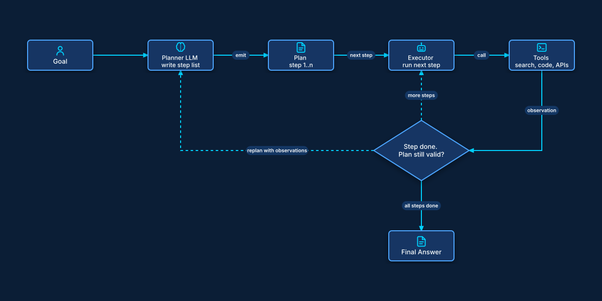

# Planner-Executor with Re-planning

## Bill of Materials

| Symbol / ID | Label | Kind | Group | Technical Notes / Metadata |
| :--- | :--- | :--- | :--- | :--- |
| `shape_1` | **Goal** | box | - | - |
| `shape_2` | **Planner LLM write step list** | box | - | - |
| `shape_3` | **Plan step 1..n** | box | - | - |
| `shape_4` | **Executor run next step** | box | - | - |
| `shape_5` | **Tools search, code, APIs** | box | - | - |
| `shape_6` | **Step done. Plan still valid?** | diamond | - | - |
| `shape_7` | **Final Answer** | box | - | - |

## Connections

| Source | Target | Protocol / Label | Style | Routing |
| :--- | :--- | :--- | :--- | :--- |
| **Goal** (`shape_1`) | **Planner LLM write step list** (`shape_2`) | - | solid | orthogonal |
| **Planner LLM write step list** (`shape_2`) | **Plan step 1..n** (`shape_3`) | emit | solid | orthogonal |
| **Plan step 1..n** (`shape_3`) | **Executor run next step** (`shape_4`) | next step | solid | orthogonal |
| **Executor run next step** (`shape_4`) | **Tools search, code, APIs** (`shape_5`) | call | solid | orthogonal |
| **Tools search, code, APIs** (`shape_5`) | **Step done. Plan still valid?** (`shape_6`) | observation | solid | orthogonal |
| **Step done. Plan still valid?** (`shape_6`) | **Executor run next step** (`shape_4`) | more steps | dashed | orthogonal |
| **Step done. Plan still valid?** (`shape_6`) | **Planner LLM write step list** (`shape_2`) | replan with observations | dashed | orthogonal |
| **Step done. Plan still valid?** (`shape_6`) | **Final Answer** (`shape_7`) | all steps done | solid | orthogonal |
