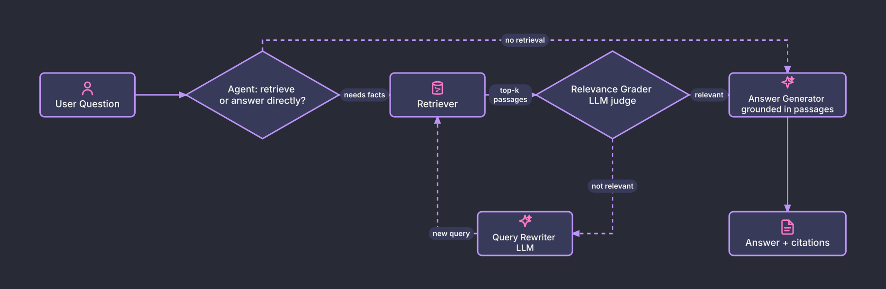

# Agentic RAG: Rewrite and Grade Loop

## Bill of Materials

| Symbol / ID | Label | Kind | Group | Technical Notes / Metadata |
| :--- | :--- | :--- | :--- | :--- |
| `shape_1` | **User Question** | box | - | - |
| `shape_2` | **Agent: retrieve or answer directly?** | diamond | - | - |
| `shape_3` | **Retriever** | box | - | - |
| `shape_4` | **Relevance Grader LLM judge** | diamond | - | - |
| `shape_5` | **Answer Generator grounded in passages** | box | - | - |
| `shape_6` | **Answer + citations** | box | - | - |
| `shape_7` | **Query Rewriter LLM** | box | - | - |

## Connections

| Source | Target | Protocol / Label | Style | Routing |
| :--- | :--- | :--- | :--- | :--- |
| **User Question** (`shape_1`) | **Agent: retrieve or answer directly?** (`shape_2`) | - | solid | orthogonal |
| **Agent: retrieve or answer directly?** (`shape_2`) | **Retriever** (`shape_3`) | needs facts | solid | orthogonal |
| **Retriever** (`shape_3`) | **Relevance Grader LLM judge** (`shape_4`) | top-k passages | solid | orthogonal |
| **Relevance Grader LLM judge** (`shape_4`) | **Answer Generator grounded in passages** (`shape_5`) | relevant | solid | orthogonal |
| **Relevance Grader LLM judge** (`shape_4`) | **Query Rewriter LLM** (`shape_7`) | not relevant | dashed | orthogonal |
| **Query Rewriter LLM** (`shape_7`) | **Retriever** (`shape_3`) | new query | dashed | orthogonal |
| **Agent: retrieve or answer directly?** (`shape_2`) | **Answer Generator grounded in passages** (`shape_5`) | no retrieval | dashed | orthogonal |
| **Answer Generator grounded in passages** (`shape_5`) | **Answer + citations** (`shape_6`) | - | solid | orthogonal |
