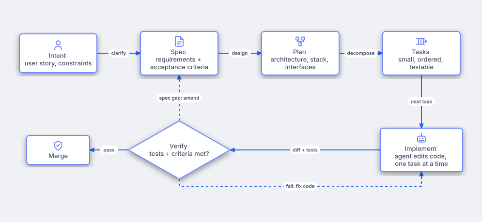

# Spec-Driven Development Loop

## Bill of Materials

| Symbol / ID | Label | Kind | Group | Technical Notes / Metadata |
| :--- | :--- | :--- | :--- | :--- |
| `shape_1` | **Intent user story, constraints** | box | - | - |
| `shape_2` | **Spec requirements + acceptance criteria** | box | - | - |
| `shape_3` | **Plan architecture, stack, interfaces** | box | - | - |
| `shape_4` | **Tasks small, ordered, testable** | box | - | - |
| `shape_5` | **Merge** | box | - | - |
| `shape_6` | **Verify tests + criteria met?** | diamond | - | - |
| `shape_7` | **Implement agent edits code, one task at a time** | box | - | - |

## Connections

| Source | Target | Protocol / Label | Style | Routing |
| :--- | :--- | :--- | :--- | :--- |
| **Intent user story, constraints** (`shape_1`) | **Spec requirements + acceptance criteria** (`shape_2`) | clarify | solid | orthogonal |
| **Spec requirements + acceptance criteria** (`shape_2`) | **Plan architecture, stack, interfaces** (`shape_3`) | design | solid | orthogonal |
| **Plan architecture, stack, interfaces** (`shape_3`) | **Tasks small, ordered, testable** (`shape_4`) | decompose | solid | orthogonal |
| **Tasks small, ordered, testable** (`shape_4`) | **Implement agent edits code, one task at a time** (`shape_7`) | next task | solid | orthogonal |
| **Implement agent edits code, one task at a time** (`shape_7`) | **Verify tests + criteria met?** (`shape_6`) | diff + tests | solid | orthogonal |
| **Verify tests + criteria met?** (`shape_6`) | **Merge** (`shape_5`) | pass | solid | orthogonal |
| **Verify tests + criteria met?** (`shape_6`) | **Implement agent edits code, one task at a time** (`shape_7`) | fail: fix code | dashed | orthogonal |
| **Verify tests + criteria met?** (`shape_6`) | **Spec requirements + acceptance criteria** (`shape_2`) | spec gap: amend | dashed | orthogonal |
