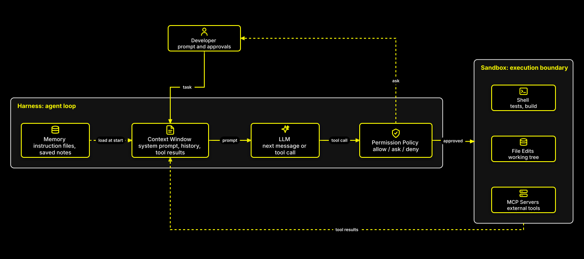

# Coding-Agent Harness

## Bill of Materials

| Symbol / ID | Label | Kind | Group | Technical Notes / Metadata |
| :--- | :--- | :--- | :--- | :--- |
| `shape_1` | **Developer prompt and approvals** | box | - | - |
| `shape_3` | **Memory instruction files, saved notes** | box | Harness: agent loop | - |
| `shape_4` | **Context Window system prompt, history, tool results** | box | Harness: agent loop | - |
| `shape_5` | **LLM next message or tool call** | box | Harness: agent loop | - |
| `shape_6` | **Permission Policy allow / ask / deny** | box | Harness: agent loop | - |
| `shape_8` | **Shell tests, build** | box | Sandbox: execution boundary | - |
| `shape_9` | **File Edits working tree** | box | Sandbox: execution boundary | - |
| `shape_10` | **MCP Servers external tools** | box | Sandbox: execution boundary | - |

## Connections

| Source | Target | Protocol / Label | Style | Routing |
| :--- | :--- | :--- | :--- | :--- |
| **Developer prompt and approvals** (`shape_1`) | **Context Window system prompt, history, tool results** (`shape_4`) | task | solid | orthogonal |
| **Permission Policy allow / ask / deny** (`shape_6`) | **Developer prompt and approvals** (`shape_1`) | ask | dashed | orthogonal |
| **Memory instruction files, saved notes** (`shape_3`) | **Context Window system prompt, history, tool results** (`shape_4`) | load at start | dashed | orthogonal |
| **Context Window system prompt, history, tool results** (`shape_4`) | **LLM next message or tool call** (`shape_5`) | prompt | solid | orthogonal |
| **LLM next message or tool call** (`shape_5`) | **Permission Policy allow / ask / deny** (`shape_6`) | tool call | solid | orthogonal |
| **Permission Policy allow / ask / deny** (`shape_6`) | **Sandbox: execution boundary** (`group_7`) | approved | solid | orthogonal |
| **Sandbox: execution boundary** (`group_7`) | **Context Window system prompt, history, tool results** (`shape_4`) | tool results | dashed | orthogonal |
