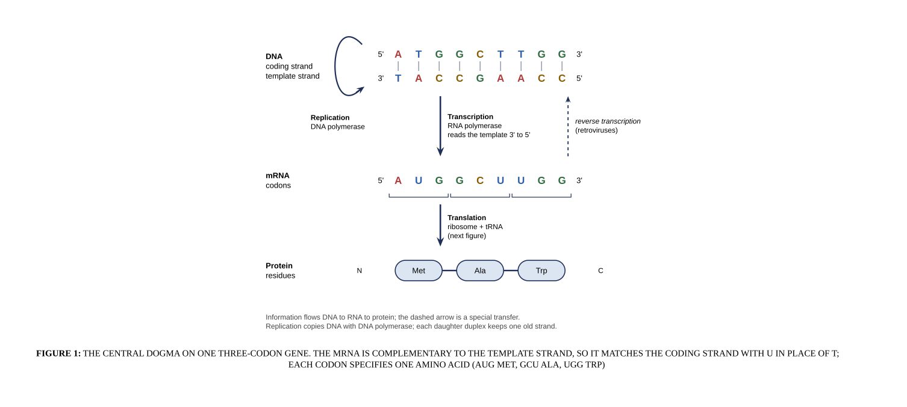

# Central dogma of molecular biology

## Bill of Materials

| Symbol / ID | Label | Kind | Group | Technical Notes / Metadata |
| :--- | :--- | :--- | :--- | :--- |
| `shape_62` | **Met** | box | - | - |
| `shape_63` | **Ala** | box | - | - |
| `shape_65` | **Trp** | box | - | - |

## Connections

| Source | Target | Protocol / Label | Style | Routing |
| :--- | :--- | :--- | :--- | :--- |
| **point_34** (`point_34`) | **point_35** (`point_35`) | - | solid | direct |
| **point_37** (`point_37`) | **point_38** (`point_38`) | - | solid | direct |
| **point_40** (`point_40`) | **point_41** (`point_41`) | - | dashed | direct |
| **point_58** (`point_58`) | **point_59** (`point_59`) | - | solid | direct |
