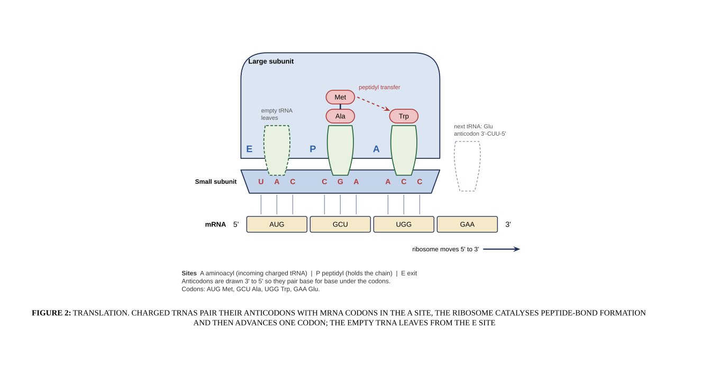

# Translation at the ribosome

## Bill of Materials

| Symbol / ID | Label | Kind | Group | Technical Notes / Metadata |
| :--- | :--- | :--- | :--- | :--- |
| `shape_1` | **AUG** | box | - | - |
| `shape_2` | **GCU** | box | - | - |
| `shape_3` | **UGG** | box | - | - |
| `shape_4` | **GAA** | box | - | - |
| `shape_37` | **Ala** | box | - | - |
| `shape_38` | **Met** | box | - | - |
| `shape_40` | **Trp** | box | - | - |

## Connections

| Source | Target | Protocol / Label | Style | Routing |
| :--- | :--- | :--- | :--- | :--- |
| **point_41** (`point_41`) | **point_42** (`point_42`) | - | dashed | direct |
| **point_44** (`point_44`) | **point_45** (`point_45`) | - | solid | direct |
