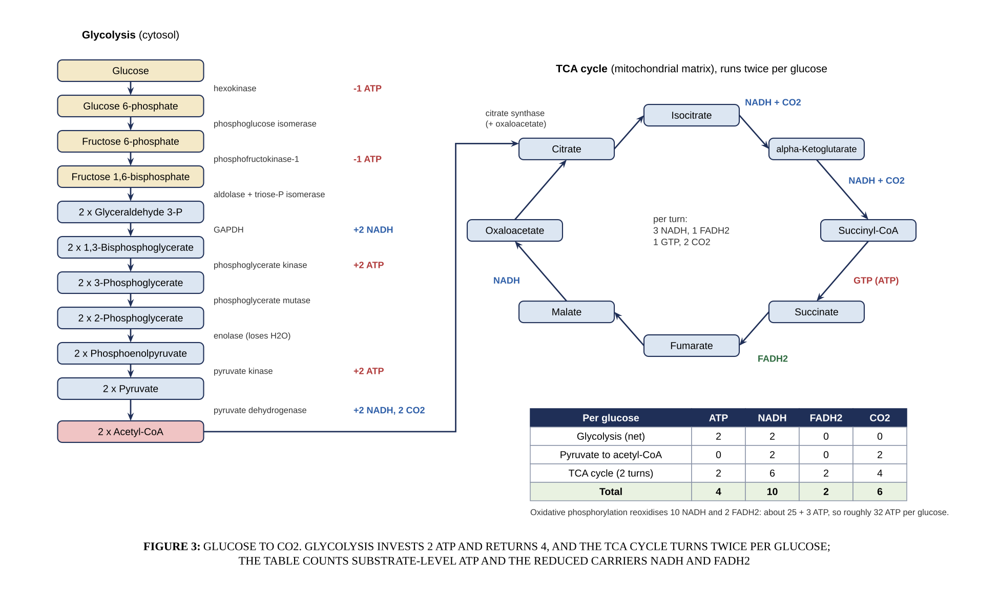

# Glycolysis and the TCA cycle

## Bill of Materials

| Symbol / ID | Label | Kind | Group | Technical Notes / Metadata |
| :--- | :--- | :--- | :--- | :--- |
| `shape_2` | **Glucose** | box | - | - |
| `shape_3` | **Glucose 6-phosphate** | box | - | - |
| `shape_4` | **Fructose 6-phosphate** | box | - | - |
| `shape_5` | **Fructose 1,6-bisphosphate** | box | - | - |
| `shape_6` | **2 x Glyceraldehyde 3-P** | box | - | - |
| `shape_7` | **2 x 1,3-Bisphosphoglycerate** | box | - | - |
| `shape_8` | **2 x 3-Phosphoglycerate** | box | - | - |
| `shape_9` | **2 x 2-Phosphoglycerate** | box | - | - |
| `shape_10` | **2 x Phosphoenolpyruvate** | box | - | - |
| `shape_11` | **2 x Pyruvate** | box | - | - |
| `shape_26` | **2 x Acetyl-CoA** | box | - | - |
| `shape_30` | **Citrate** | box | - | - |
| `shape_31` | **Isocitrate** | box | - | - |
| `shape_32` | **alpha-Ketoglutarate** | box | - | - |
| `shape_33` | **Succinyl-CoA** | box | - | - |
| `shape_34` | **Succinate** | box | - | - |
| `shape_35` | **Fumarate** | box | - | - |
| `shape_36` | **Malate** | box | - | - |
| `shape_37` | **Oxaloacetate** | box | - | - |
| `shape_45` | ****Per glucose**** | box | - | - |
| `shape_46` | ****ATP**** | box | - | - |
| `shape_47` | ****NADH**** | box | - | - |
| `shape_48` | ****FADH2**** | box | - | - |
| `shape_49` | ****CO2**** | box | - | - |
| `shape_50` | **Glycolysis (net)** | box | - | - |
| `shape_51` | **2** | box | - | - |
| `shape_52` | **2** | box | - | - |
| `shape_53` | **0** | box | - | - |
| `shape_54` | **0** | box | - | - |
| `shape_55` | **Pyruvate to acetyl-CoA** | box | - | - |
| `shape_56` | **0** | box | - | - |
| `shape_57` | **2** | box | - | - |
| `shape_58` | **0** | box | - | - |
| `shape_59` | **2** | box | - | - |
| `shape_60` | **TCA cycle (2 turns)** | box | - | - |
| `shape_61` | **2** | box | - | - |
| `shape_62` | **6** | box | - | - |
| `shape_63` | **2** | box | - | - |
| `shape_64` | **4** | box | - | - |
| `shape_65` | ****Total**** | box | - | - |
| `shape_66` | ****4**** | box | - | - |
| `shape_67` | ****10**** | box | - | - |
| `shape_68` | ****2**** | box | - | - |
| `shape_69` | ****6**** | box | - | - |

## Connections

| Source | Target | Protocol / Label | Style | Routing |
| :--- | :--- | :--- | :--- | :--- |
| **Glucose** (`shape_2`) | **Glucose 6-phosphate** (`shape_3`) | - | solid | direct |
| **Glucose 6-phosphate** (`shape_3`) | **Fructose 6-phosphate** (`shape_4`) | - | solid | direct |
| **Fructose 6-phosphate** (`shape_4`) | **Fructose 1,6-bisphosphate** (`shape_5`) | - | solid | direct |
| **Fructose 1,6-bisphosphate** (`shape_5`) | **2 x Glyceraldehyde 3-P** (`shape_6`) | - | solid | direct |
| **2 x Glyceraldehyde 3-P** (`shape_6`) | **2 x 1,3-Bisphosphoglycerate** (`shape_7`) | - | solid | direct |
| **2 x 1,3-Bisphosphoglycerate** (`shape_7`) | **2 x 3-Phosphoglycerate** (`shape_8`) | - | solid | direct |
| **2 x 3-Phosphoglycerate** (`shape_8`) | **2 x 2-Phosphoglycerate** (`shape_9`) | - | solid | direct |
| **2 x 2-Phosphoglycerate** (`shape_9`) | **2 x Phosphoenolpyruvate** (`shape_10`) | - | solid | direct |
| **2 x Phosphoenolpyruvate** (`shape_10`) | **2 x Pyruvate** (`shape_11`) | - | solid | direct |
| **2 x Pyruvate** (`shape_11`) | **2 x Acetyl-CoA** (`shape_26`) | - | solid | direct |
| **Citrate** (`shape_30`) | **Isocitrate** (`shape_31`) | - | solid | direct |
| **Isocitrate** (`shape_31`) | **alpha-Ketoglutarate** (`shape_32`) | - | solid | direct |
| **alpha-Ketoglutarate** (`shape_32`) | **Succinyl-CoA** (`shape_33`) | - | solid | direct |
| **Succinyl-CoA** (`shape_33`) | **Succinate** (`shape_34`) | - | solid | direct |
| **Succinate** (`shape_34`) | **Fumarate** (`shape_35`) | - | solid | direct |
| **Fumarate** (`shape_35`) | **Malate** (`shape_36`) | - | solid | direct |
| **Malate** (`shape_36`) | **Oxaloacetate** (`shape_37`) | - | solid | direct |
| **Oxaloacetate** (`shape_37`) | **Citrate** (`shape_30`) | - | solid | direct |
| **2 x Acetyl-CoA** (`shape_26`) | **Citrate** (`shape_30`) | - | solid | orthogonal |
