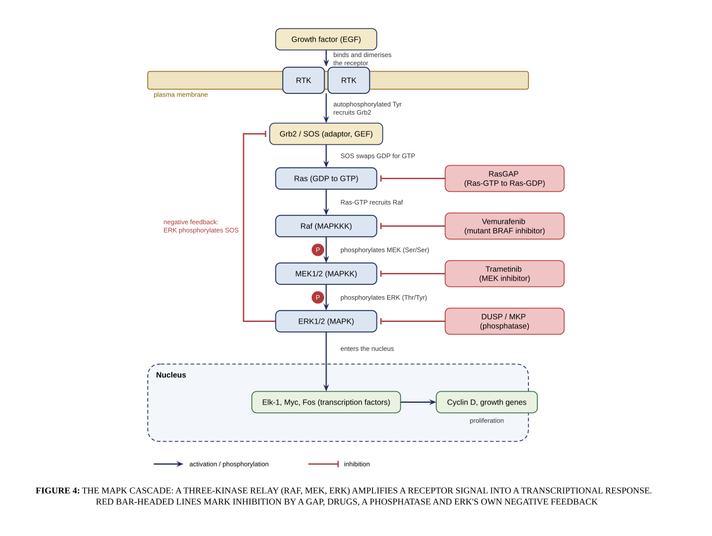

# MAPK signalling cascade

## Bill of Materials

| Symbol / ID | Label | Kind | Group | Technical Notes / Metadata |
| :--- | :--- | :--- | :--- | :--- |
| `shape_5` | **Growth factor (EGF)** | box | - | - |
| `shape_6` | **RTK** | box | - | - |
| `shape_7` | **RTK** | box | - | - |
| `shape_11` | **Grb2 / SOS (adaptor, GEF)** | box | - | - |
| `shape_12` | **Ras  (GDP to GTP)** | box | - | - |
| `shape_13` | **Raf  (MAPKKK)** | box | - | - |
| `shape_14` | **MEK1/2  (MAPKK)** | box | - | - |
| `shape_15` | **ERK1/2  (MAPK)** | box | - | - |
| `shape_16` | **Elk-1, Myc, Fos (transcription factors)** | box | - | - |
| `shape_17` | **Cyclin D, growth genes** | box | - | - |
| `shape_23` | **P** | box | - | - |
| `shape_24` | **P** | box | - | - |
| `shape_27` | **RasGAP (Ras-GTP to Ras-GDP)** | box | - | - |
| `shape_29` | **Vemurafenib (mutant BRAF inhibitor)** | box | - | - |
| `shape_31` | **Trametinib (MEK inhibitor)** | box | - | - |
| `shape_33` | **DUSP / MKP (phosphatase)** | box | - | - |

## Connections

| Source | Target | Protocol / Label | Style | Routing |
| :--- | :--- | :--- | :--- | :--- |
| **Growth factor (EGF)** (`shape_5`) | **point_8** (`point_8`) | - | solid | direct |
| **point_18** (`point_18`) | **Grb2 / SOS (adaptor, GEF)** (`shape_11`) | - | solid | direct |
| **Grb2 / SOS (adaptor, GEF)** (`shape_11`) | **Ras  (GDP to GTP)** (`shape_12`) | - | solid | direct |
| **Ras  (GDP to GTP)** (`shape_12`) | **Raf  (MAPKKK)** (`shape_13`) | - | solid | direct |
| **Raf  (MAPKKK)** (`shape_13`) | **MEK1/2  (MAPKK)** (`shape_14`) | - | solid | direct |
| **MEK1/2  (MAPKK)** (`shape_14`) | **ERK1/2  (MAPK)** (`shape_15`) | - | solid | direct |
| **ERK1/2  (MAPK)** (`shape_15`) | **Elk-1, Myc, Fos (transcription factors)** (`shape_16`) | - | solid | direct |
| **Elk-1, Myc, Fos (transcription factors)** (`shape_16`) | **Cyclin D, growth genes** (`shape_17`) | - | solid | direct |
| **RasGAP (Ras-GTP to Ras-GDP)** (`shape_27`) | **point_28** (`point_28`) | - | solid | direct |
| **Vemurafenib (mutant BRAF inhibitor)** (`shape_29`) | **point_30** (`point_30`) | - | solid | direct |
| **Trametinib (MEK inhibitor)** (`shape_31`) | **point_32** (`point_32`) | - | solid | direct |
| **DUSP / MKP (phosphatase)** (`shape_33`) | **point_34** (`point_34`) | - | solid | direct |
| **ERK1/2  (MAPK)** (`shape_15`) | **point_35** (`point_35`) | - | solid | direct |
| **point_37** (`point_37`) | **point_38** (`point_38`) | - | solid | direct |
| **point_40** (`point_40`) | **point_41** (`point_41`) | - | solid | direct |
