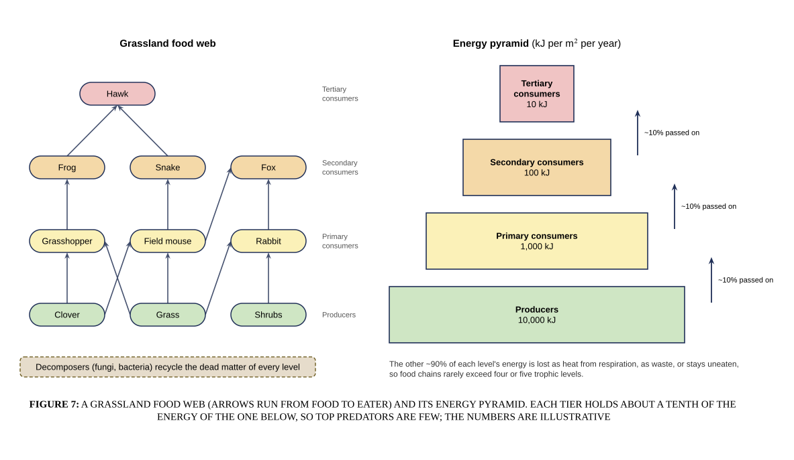

# Food web and energy pyramid

## Bill of Materials

| Symbol / ID | Label | Kind | Group | Technical Notes / Metadata |
| :--- | :--- | :--- | :--- | :--- |
| `shape_2` | **Hawk** | box | - | - |
| `shape_3` | **Frog** | box | - | - |
| `shape_4` | **Snake** | box | - | - |
| `shape_5` | **Fox** | box | - | - |
| `shape_6` | **Grasshopper** | box | - | - |
| `shape_7` | **Field mouse** | box | - | - |
| `shape_8` | **Rabbit** | box | - | - |
| `shape_9` | **Clover** | box | - | - |
| `shape_10` | **Grass** | box | - | - |
| `shape_11` | **Shrubs** | box | - | - |
| `shape_16` | **Decomposers (fungi, bacteria) recycle the dead matter of every level** | box | - | - |
| `shape_18` | ****Tertiary consumers** 10 kJ** | box | - | - |
| `shape_19` | ****Secondary consumers** 100 kJ** | box | - | - |
| `shape_20` | ****Primary consumers** 1,000 kJ** | box | - | - |
| `shape_21` | ****Producers** 10,000 kJ** | box | - | - |

## Connections

| Source | Target | Protocol / Label | Style | Routing |
| :--- | :--- | :--- | :--- | :--- |
| **Clover** (`shape_9`) | **Grasshopper** (`shape_6`) | - | solid | direct |
| **Clover** (`shape_9`) | **Field mouse** (`shape_7`) | - | solid | direct |
| **Grass** (`shape_10`) | **Grasshopper** (`shape_6`) | - | solid | direct |
| **Grass** (`shape_10`) | **Field mouse** (`shape_7`) | - | solid | direct |
| **Grass** (`shape_10`) | **Rabbit** (`shape_8`) | - | solid | direct |
| **Shrubs** (`shape_11`) | **Rabbit** (`shape_8`) | - | solid | direct |
| **Grasshopper** (`shape_6`) | **Frog** (`shape_3`) | - | solid | direct |
| **Field mouse** (`shape_7`) | **Snake** (`shape_4`) | - | solid | direct |
| **Field mouse** (`shape_7`) | **Fox** (`shape_5`) | - | solid | direct |
| **Rabbit** (`shape_8`) | **Fox** (`shape_5`) | - | solid | direct |
| **Frog** (`shape_3`) | **Hawk** (`shape_2`) | - | solid | direct |
| **Snake** (`shape_4`) | **Hawk** (`shape_2`) | - | solid | direct |
| **point_22** (`point_22`) | **point_23** (`point_23`) | - | solid | direct |
| **point_25** (`point_25`) | **point_26** (`point_26`) | - | solid | direct |
| **point_28** (`point_28`) | **point_29** (`point_29`) | - | solid | direct |
