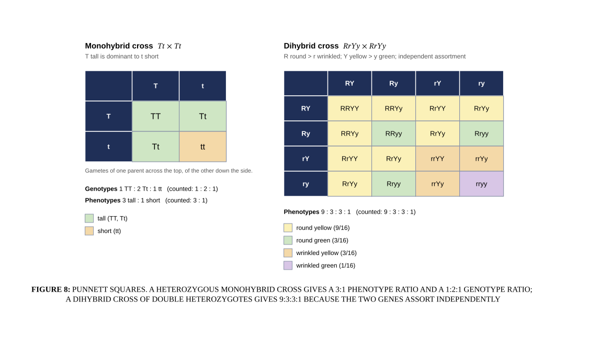

# Punnett squares

## Bill of Materials

| Symbol / ID | Label | Kind | Group | Technical Notes / Metadata |
| :--- | :--- | :--- | :--- | :--- |
| `shape_3` | **** | box | - | - |
| `shape_4` | ****T**** | box | - | - |
| `shape_5` | ****t**** | box | - | - |
| `shape_6` | ****T**** | box | - | - |
| `shape_7` | **TT** | box | - | - |
| `shape_8` | **Tt** | box | - | - |
| `shape_9` | ****t**** | box | - | - |
| `shape_10` | **Tt** | box | - | - |
| `shape_11` | **tt** | box | - | - |
| `shape_15` | **** | box | - | - |
| `shape_17` | **** | box | - | - |
| `shape_21` | **** | box | - | - |
| `shape_22` | ****RY**** | box | - | - |
| `shape_23` | ****Ry**** | box | - | - |
| `shape_24` | ****rY**** | box | - | - |
| `shape_25` | ****ry**** | box | - | - |
| `shape_26` | ****RY**** | box | - | - |
| `shape_27` | **RRYY** | box | - | - |
| `shape_28` | **RRYy** | box | - | - |
| `shape_29` | **RrYY** | box | - | - |
| `shape_30` | **RrYy** | box | - | - |
| `shape_31` | ****Ry**** | box | - | - |
| `shape_32` | **RRYy** | box | - | - |
| `shape_33` | **RRyy** | box | - | - |
| `shape_34` | **RrYy** | box | - | - |
| `shape_35` | **Rryy** | box | - | - |
| `shape_36` | ****rY**** | box | - | - |
| `shape_37` | **RrYY** | box | - | - |
| `shape_38` | **RrYy** | box | - | - |
| `shape_39` | **rrYY** | box | - | - |
| `shape_40` | **rrYy** | box | - | - |
| `shape_41` | ****ry**** | box | - | - |
| `shape_42` | **RrYy** | box | - | - |
| `shape_43` | **Rryy** | box | - | - |
| `shape_44` | **rrYy** | box | - | - |
| `shape_45` | **rryy** | box | - | - |
| `shape_47` | **** | box | - | - |
| `shape_49` | **** | box | - | - |
| `shape_51` | **** | box | - | - |
| `shape_53` | **** | box | - | - |
