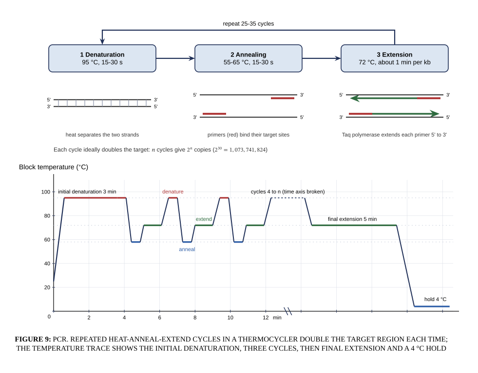

# PCR cycle and thermocycler trace

## Bill of Materials

| Symbol / ID | Label | Kind | Group | Technical Notes / Metadata |
| :--- | :--- | :--- | :--- | :--- |
| `shape_1` | ****1  Denaturation** 95 °C, 15-30 s** | box | - | - |
| `shape_20` | ****2  Annealing** 55-65 °C, 15-30 s** | box | - | - |
| `shape_30` | ****3  Extension** 72 °C, about 1 min per kb** | box | - | - |

## Connections

| Source | Target | Protocol / Label | Style | Routing |
| :--- | :--- | :--- | :--- | :--- |
| **point_37** (`point_37`) | **point_38** (`point_38`) | - | solid | direct |
| **point_39** (`point_39`) | **point_40** (`point_40`) | - | solid | direct |
| ****1  Denaturation** 95 °C, 15-30 s** (`shape_1`) | ****2  Annealing** 55-65 °C, 15-30 s** (`shape_20`) | - | solid | direct |
| ****2  Annealing** 55-65 °C, 15-30 s** (`shape_20`) | ****3  Extension** 72 °C, about 1 min per kb** (`shape_30`) | - | solid | direct |
| ****3  Extension** 72 °C, about 1 min per kb** (`shape_30`) | ****1  Denaturation** 95 °C, 15-30 s** (`shape_1`) | - | solid | orthogonal |
| **point_47** (`point_47`) | **point_48** (`point_48`) | - | solid | direct |
| **point_49** (`point_49`) | **point_50** (`point_50`) | - | solid | direct |
