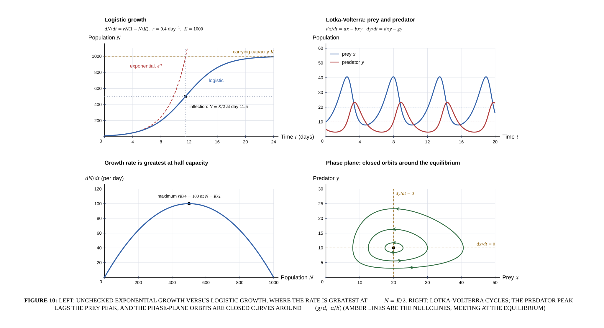

# Population dynamics

## Bill of Materials

| Symbol / ID | Label | Kind | Group | Technical Notes / Metadata |
| :--- | :--- | :--- | :--- | :--- |

## Connections

| Source | Target | Protocol / Label | Style | Routing |
| :--- | :--- | :--- | :--- | :--- |
| **point_4** (`point_4`) | **point_5** (`point_5`) | - | solid | direct |
| **point_6** (`point_6`) | **point_7** (`point_7`) | - | solid | direct |
| **point_35** (`point_35`) | **point_36** (`point_36`) | - | solid | direct |
| **point_37** (`point_37`) | **point_38** (`point_38`) | - | solid | direct |
| **point_61** (`point_61`) | **point_62** (`point_62`) | - | solid | direct |
| **point_63** (`point_63`) | **point_64** (`point_64`) | - | solid | direct |
| **point_90** (`point_90`) | **point_91** (`point_91`) | - | solid | direct |
| **point_92** (`point_92`) | **point_93** (`point_93`) | - | solid | direct |
