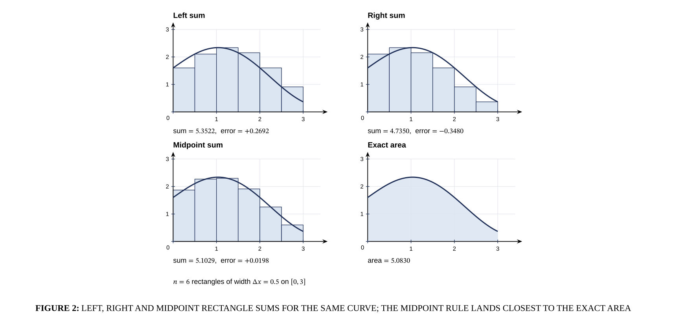

# Riemann sums

## Bill of Materials

| Symbol / ID | Label | Kind | Group | Technical Notes / Metadata |
| :--- | :--- | :--- | :--- | :--- |

## Connections

| Source | Target | Protocol / Label | Style | Routing |
| :--- | :--- | :--- | :--- | :--- |
| **point_2** (`point_2`) | **point_3** (`point_3`) | - | solid | direct |
| **point_4** (`point_4`) | **point_5** (`point_5`) | - | solid | direct |
| **point_24** (`point_24`) | **point_25** (`point_25`) | - | solid | direct |
| **point_26** (`point_26`) | **point_27** (`point_27`) | - | solid | direct |
| **point_46** (`point_46`) | **point_47** (`point_47`) | - | solid | direct |
| **point_48** (`point_48`) | **point_49** (`point_49`) | - | solid | direct |
| **point_68** (`point_68`) | **point_69** (`point_69`) | - | solid | direct |
| **point_70** (`point_70`) | **point_71** (`point_71`) | - | solid | direct |
