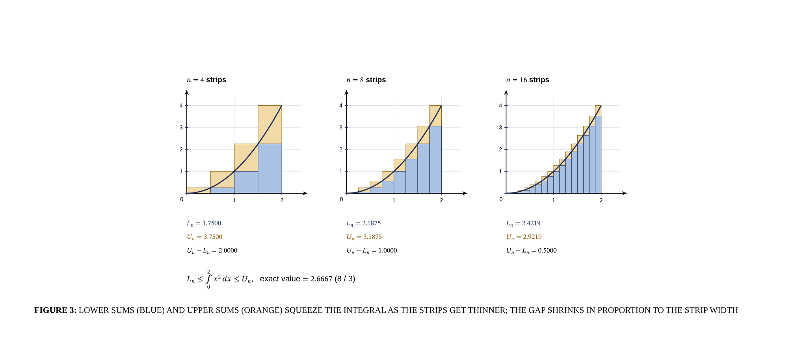

# Upper and lower sums

## Bill of Materials

| Symbol / ID | Label | Kind | Group | Technical Notes / Metadata |
| :--- | :--- | :--- | :--- | :--- |

## Connections

| Source | Target | Protocol / Label | Style | Routing |
| :--- | :--- | :--- | :--- | :--- |
| **point_2** (`point_2`) | **point_3** (`point_3`) | - | solid | direct |
| **point_4** (`point_4`) | **point_5** (`point_5`) | - | solid | direct |
| **point_28** (`point_28`) | **point_29** (`point_29`) | - | solid | direct |
| **point_30** (`point_30`) | **point_31** (`point_31`) | - | solid | direct |
| **point_62** (`point_62`) | **point_63** (`point_63`) | - | solid | direct |
| **point_64** (`point_64`) | **point_65** (`point_65`) | - | solid | direct |
