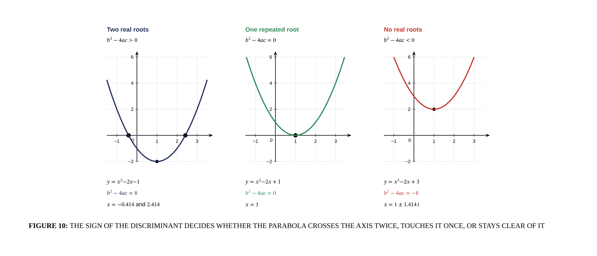

# Discriminant cases of a quadratic

## Bill of Materials

| Symbol / ID | Label | Kind | Group | Technical Notes / Metadata |
| :--- | :--- | :--- | :--- | :--- |

## Connections

| Source | Target | Protocol / Label | Style | Routing |
| :--- | :--- | :--- | :--- | :--- |
| **point_2** (`point_2`) | **point_3** (`point_3`) | - | solid | direct |
| **point_4** (`point_4`) | **point_5** (`point_5`) | - | solid | direct |
| **point_26** (`point_26`) | **point_27** (`point_27`) | - | solid | direct |
| **point_28** (`point_28`) | **point_29** (`point_29`) | - | solid | direct |
| **point_49** (`point_49`) | **point_50** (`point_50`) | - | solid | direct |
| **point_51** (`point_51`) | **point_52** (`point_52`) | - | solid | direct |
