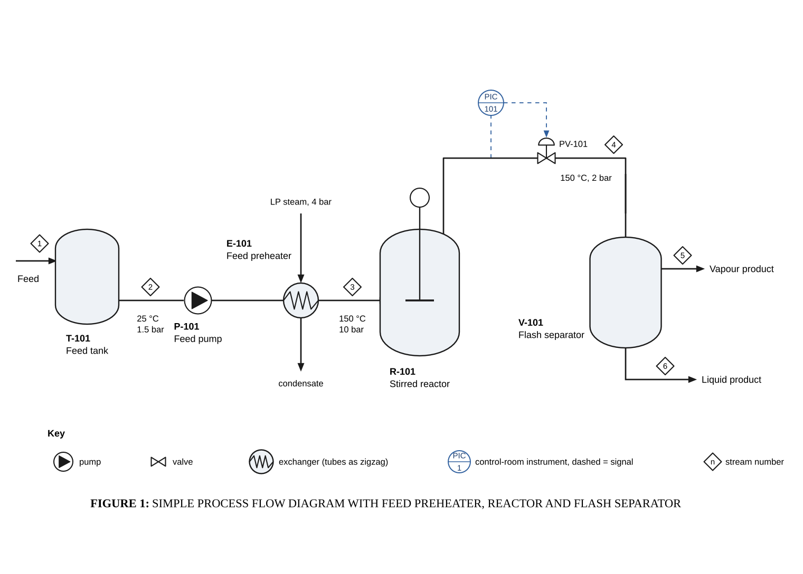

# Simple Process Flow: Feed, Exchanger, Reactor, Separator

## Bill of Materials

| Symbol / ID | Label | Kind | Group | Technical Notes / Metadata |
| :--- | :--- | :--- | :--- | :--- |

## Connections

| Source | Target | Protocol / Label | Style | Routing |
| :--- | :--- | :--- | :--- | :--- |
| **point_3** (`point_3`) | **point_4** (`point_4`) | - | solid | direct |
| **point_6** (`point_6`) | **point_7** (`point_7`) | - | solid | direct |
| **point_11** (`point_11`) | **point_12** (`point_12`) | - | solid | direct |
| **point_15** (`point_15`) | **point_16** (`point_16`) | - | solid | direct |
| **point_17** (`point_17`) | **point_18** (`point_18`) | - | solid | direct |
| **point_19** (`point_19`) | **point_20** (`point_20`) | - | solid | direct |
| **point_40** (`point_40`) | **point_41** (`point_41`) | - | dashed | direct |
| **point_42** (`point_42`) | **point_43** (`point_43`) | - | dashed | orthogonal |
| **point_46** (`point_46`) | **point_47** (`point_47`) | - | solid | direct |
| **point_48** (`point_48`) | **point_49** (`point_49`) | - | solid | orthogonal |
| **point_51** (`point_51`) | **point_52** (`point_52`) | - | solid | direct |
