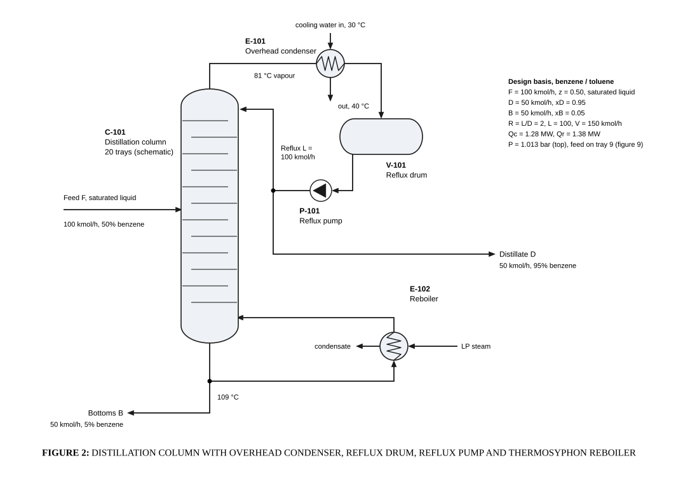

# Distillation Column with Condenser, Reboiler and Reflux

## Bill of Materials

| Symbol / ID | Label | Kind | Group | Technical Notes / Metadata |
| :--- | :--- | :--- | :--- | :--- |

## Connections

| Source | Target | Protocol / Label | Style | Routing |
| :--- | :--- | :--- | :--- | :--- |
| **point_15** (`point_15`) | **point_16** (`point_16`) | - | solid | direct |
| **point_19** (`point_19`) | **point_20** (`point_20`) | - | solid | orthogonal |
| **point_23** (`point_23`) | **point_24** (`point_24`) | - | solid | direct |
| **point_25** (`point_25`) | **point_26** (`point_26`) | - | solid | direct |
| **point_31** (`point_31`) | **point_32** (`point_32`) | - | solid | orthogonal |
| **point_35** (`point_35`) | **point_36** (`point_36`) | - | solid | orthogonal |
| **point_40** (`point_40`) | **point_41** (`point_41`) | - | solid | direct |
| **point_42** (`point_42`) | **point_43** (`point_43`) | - | solid | orthogonal |
| **point_44** (`point_44`) | **point_45** (`point_45`) | - | solid | orthogonal |
| **point_50** (`point_50`) | **point_51** (`point_51`) | - | solid | direct |
| **point_52** (`point_52`) | **point_53** (`point_53`) | - | solid | orthogonal |
| **point_56** (`point_56`) | **point_57** (`point_57`) | - | solid | orthogonal |
| **point_58** (`point_58`) | **point_59** (`point_59`) | - | solid | direct |
| **point_61** (`point_61`) | **point_62** (`point_62`) | - | solid | direct |
| **point_65** (`point_65`) | **point_66** (`point_66`) | - | solid | orthogonal |
