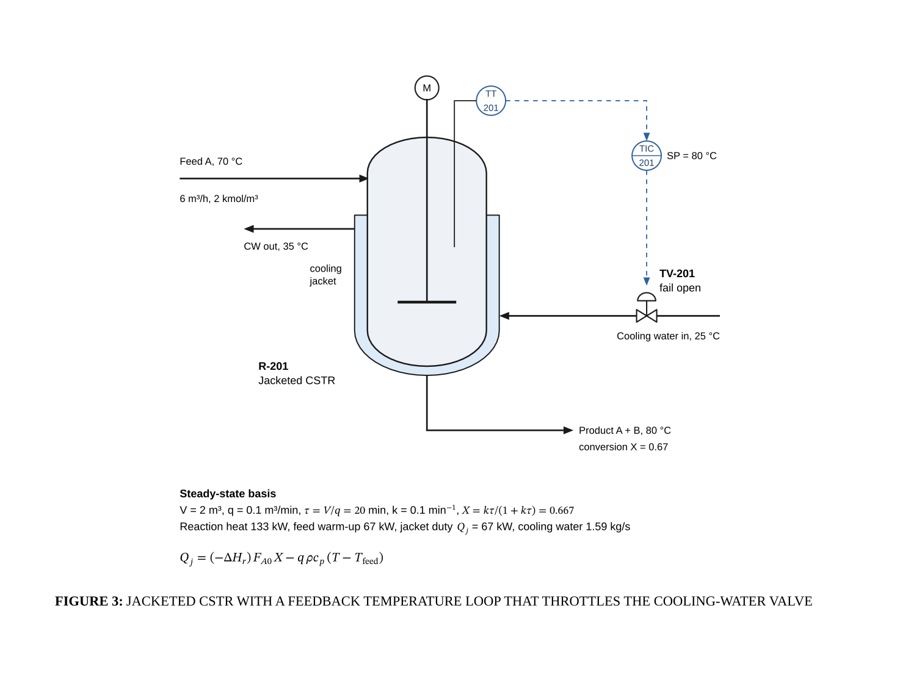

# CSTR with Cooling Jacket and Temperature Control Loop

## Bill of Materials

| Symbol / ID | Label | Kind | Group | Technical Notes / Metadata |
| :--- | :--- | :--- | :--- | :--- |

## Connections

| Source | Target | Protocol / Label | Style | Routing |
| :--- | :--- | :--- | :--- | :--- |
| **point_9** (`point_9`) | **point_10** (`point_10`) | - | solid | direct |
| **point_13** (`point_13`) | **point_14** (`point_14`) | - | solid | orthogonal |
| **point_17** (`point_17`) | **point_18** (`point_18`) | - | solid | direct |
| **point_24** (`point_24`) | **point_25** (`point_25`) | - | solid | direct |
| **point_35** (`point_35`) | **point_36** (`point_36`) | - | dashed | orthogonal |
| **point_37** (`point_37`) | **point_38** (`point_38`) | - | dashed | direct |
