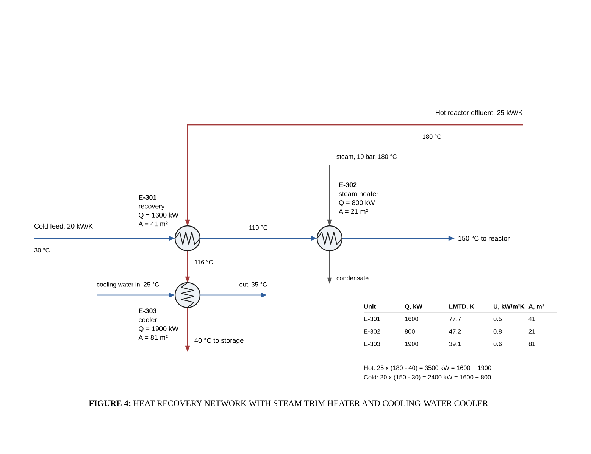

# Shell-and-Tube Exchanger Network: Duties and Temperatures

## Bill of Materials

| Symbol / ID | Label | Kind | Group | Technical Notes / Metadata |
| :--- | :--- | :--- | :--- | :--- |

## Connections

| Source | Target | Protocol / Label | Style | Routing |
| :--- | :--- | :--- | :--- | :--- |
| **point_1** (`point_1`) | **point_2** (`point_2`) | - | solid | direct |
| **point_3** (`point_3`) | **point_4** (`point_4`) | - | solid | direct |
| **point_5** (`point_5`) | **point_6** (`point_6`) | - | solid | direct |
| **point_15** (`point_15`) | **point_16** (`point_16`) | - | solid | orthogonal |
| **point_19** (`point_19`) | **point_20** (`point_20`) | - | solid | direct |
| **point_24** (`point_24`) | **point_25** (`point_25`) | - | solid | direct |
| **point_27** (`point_27`) | **point_28** (`point_28`) | - | solid | direct |
| **point_29** (`point_29`) | **point_30** (`point_30`) | - | solid | direct |
| **point_33** (`point_33`) | **point_34** (`point_34`) | - | solid | direct |
| **point_35** (`point_35`) | **point_36** (`point_36`) | - | solid | direct |
