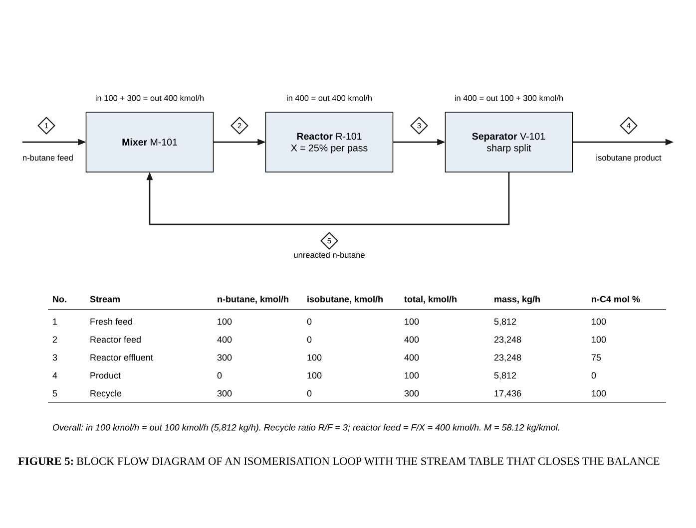

# Mass-Balance Blocks with Stream Table

## Bill of Materials

| Symbol / ID | Label | Kind | Group | Technical Notes / Metadata |
| :--- | :--- | :--- | :--- | :--- |
| `shape_1` | ****Mixer** M-101** | box | - | - |
| `shape_2` | ****Reactor** R-101 X = 25% per pass** | box | - | - |
| `shape_3` | ****Separator** V-101 sharp split** | box | - | - |

## Connections

| Source | Target | Protocol / Label | Style | Routing |
| :--- | :--- | :--- | :--- | :--- |
| ****Mixer** M-101** (`shape_1`) | ****Reactor** R-101 X = 25% per pass** (`shape_2`) | - | solid | direct |
| ****Reactor** R-101 X = 25% per pass** (`shape_2`) | ****Separator** V-101 sharp split** (`shape_3`) | - | solid | direct |
| **point_4** (`point_4`) | **point_5** (`point_5`) | - | solid | direct |
| **point_6** (`point_6`) | **point_7** (`point_7`) | - | solid | direct |
| **point_8** (`point_8`) | **point_9** (`point_9`) | - | solid | orthogonal |
