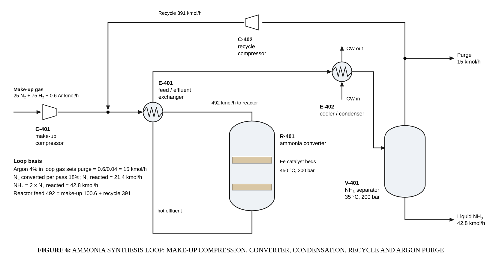

# Haber-Bosch Ammonia Loop with Recycle and Purge

## Bill of Materials

| Symbol / ID | Label | Kind | Group | Technical Notes / Metadata |
| :--- | :--- | :--- | :--- | :--- |

## Connections

| Source | Target | Protocol / Label | Style | Routing |
| :--- | :--- | :--- | :--- | :--- |
| **point_1** (`point_1`) | **point_2** (`point_2`) | - | solid | direct |
| **point_6** (`point_6`) | **point_7** (`point_7`) | - | solid | direct |
| **point_9** (`point_9`) | **point_10** (`point_10`) | - | solid | direct |
| **point_14** (`point_14`) | **point_15** (`point_15`) | - | solid | orthogonal |
| **point_23** (`point_23`) | **point_24** (`point_24`) | - | solid | orthogonal |
| **point_25** (`point_25`) | **point_26** (`point_26`) | - | solid | orthogonal |
| **point_31** (`point_31`) | **point_32** (`point_32`) | - | solid | direct |
| **point_33** (`point_33`) | **point_34** (`point_34`) | - | solid | direct |
| **point_37** (`point_37`) | **point_38** (`point_38`) | - | solid | orthogonal |
| **point_41** (`point_41`) | **point_42** (`point_42`) | - | solid | orthogonal |
| **point_44** (`point_44`) | **point_45** (`point_45`) | - | solid | orthogonal |
| **point_47** (`point_47`) | **point_48** (`point_48`) | - | solid | direct |
| **point_52** (`point_52`) | **point_53** (`point_53`) | - | solid | orthogonal |
