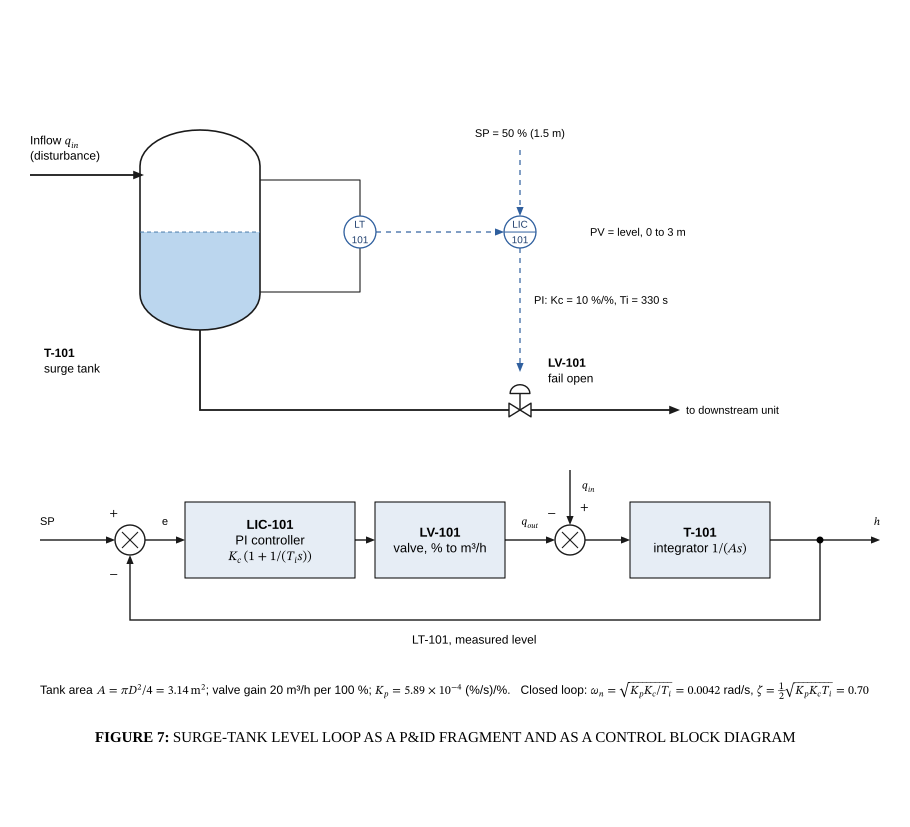

# PID Level-Control Loop on a Surge Tank

## Bill of Materials

| Symbol / ID | Label | Kind | Group | Technical Notes / Metadata |
| :--- | :--- | :--- | :--- | :--- |
| `shape_39` | ****LIC-101** PI controller $K_c\,(1 + 1/(T_i s))$** | box | - | - |
| `shape_40` | ****LV-101** valve, % to m³/h** | box | - | - |
| `shape_41` | ****T-101** integrator $1/(A s)$** | box | - | - |

## Connections

| Source | Target | Protocol / Label | Style | Routing |
| :--- | :--- | :--- | :--- | :--- |
| **point_5** (`point_5`) | **point_6** (`point_6`) | - | solid | direct |
| **point_8** (`point_8`) | **point_9** (`point_9`) | - | solid | orthogonal |
| **point_24** (`point_24`) | **point_25** (`point_25`) | - | dashed | direct |
| **point_26** (`point_26`) | **point_27** (`point_27`) | - | dashed | direct |
| **point_28** (`point_28`) | **point_29** (`point_29`) | - | dashed | direct |
| **point_42** (`point_42`) | **point_43** (`point_43`) | - | solid | direct |
| **point_45** (`point_45`) | **point_46** (`point_46`) | - | solid | direct |
| **point_48** (`point_48`) | **point_49** (`point_49`) | - | solid | direct |
| **point_50** (`point_50`) | **point_51** (`point_51`) | - | solid | direct |
| **point_53** (`point_53`) | **point_54** (`point_54`) | - | solid | direct |
| **point_55** (`point_55`) | **point_56** (`point_56`) | - | solid | direct |
| **point_59** (`point_59`) | **point_60** (`point_60`) | - | solid | direct |
| **point_64** (`point_64`) | **point_65** (`point_65`) | - | solid | orthogonal |
