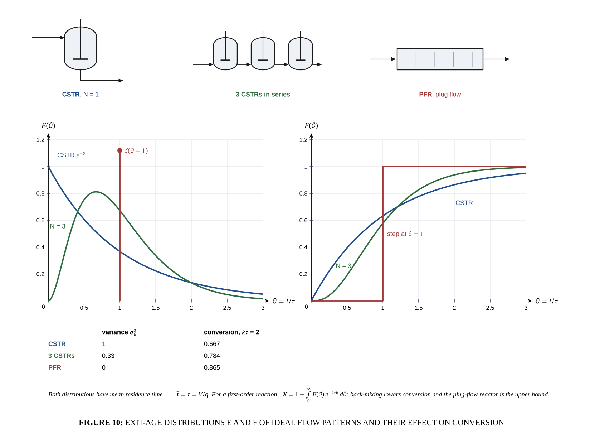

# Residence Time Distribution: CSTR vs PFR

## Bill of Materials

| Symbol / ID | Label | Kind | Group | Technical Notes / Metadata |
| :--- | :--- | :--- | :--- | :--- |

## Connections

| Source | Target | Protocol / Label | Style | Routing |
| :--- | :--- | :--- | :--- | :--- |
| **point_4** (`point_4`) | **point_5** (`point_5`) | - | solid | direct |
| **point_6** (`point_6`) | **point_7** (`point_7`) | - | solid | orthogonal |
| **point_12** (`point_12`) | **point_13** (`point_13`) | - | solid | direct |
| **point_17** (`point_17`) | **point_18** (`point_18`) | - | solid | direct |
| **point_22** (`point_22`) | **point_23** (`point_23`) | - | solid | direct |
| **point_24** (`point_24`) | **point_25** (`point_25`) | - | solid | direct |
| **point_32** (`point_32`) | **point_33** (`point_33`) | - | solid | direct |
| **point_34** (`point_34`) | **point_35** (`point_35`) | - | solid | direct |
| **point_38** (`point_38`) | **point_39** (`point_39`) | - | solid | direct |
| **point_40** (`point_40`) | **point_41** (`point_41`) | - | solid | direct |
| **point_66** (`point_66`) | **point_67** (`point_67`) | - | solid | direct |
| **point_68** (`point_68`) | **point_69** (`point_69`) | - | solid | direct |
