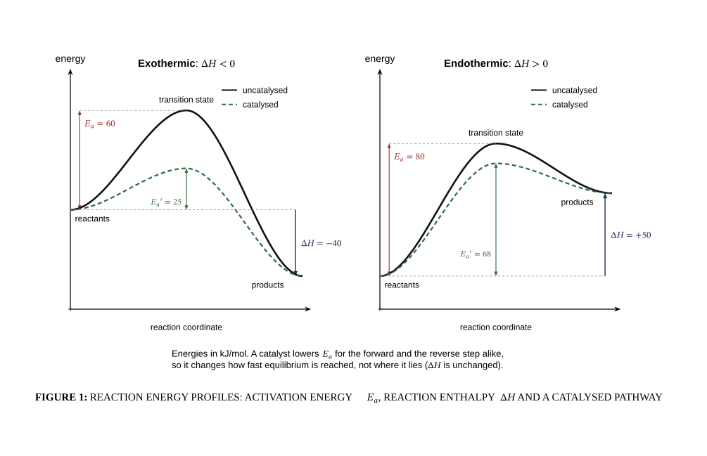

# Reaction energy profiles

## Bill of Materials

| Symbol / ID | Label | Kind | Group | Technical Notes / Metadata |
| :--- | :--- | :--- | :--- | :--- |

## Connections

| Source | Target | Protocol / Label | Style | Routing |
| :--- | :--- | :--- | :--- | :--- |
| **point_1** (`point_1`) | **point_2** (`point_2`) | - | solid | direct |
| **point_3** (`point_3`) | **point_4** (`point_4`) | - | solid | direct |
| **point_15** (`point_15`) | **point_16** (`point_16`) | - | solid | direct |
| **point_18** (`point_18`) | **point_19** (`point_19`) | - | solid | direct |
| **point_21** (`point_21`) | **point_22** (`point_22`) | - | solid | direct |
| **point_29** (`point_29`) | **point_30** (`point_30`) | - | solid | direct |
| **point_31** (`point_31`) | **point_32** (`point_32`) | - | solid | direct |
| **point_43** (`point_43`) | **point_44** (`point_44`) | - | solid | direct |
| **point_46** (`point_46`) | **point_47** (`point_47`) | - | solid | direct |
| **point_49** (`point_49`) | **point_50** (`point_50`) | - | solid | direct |
