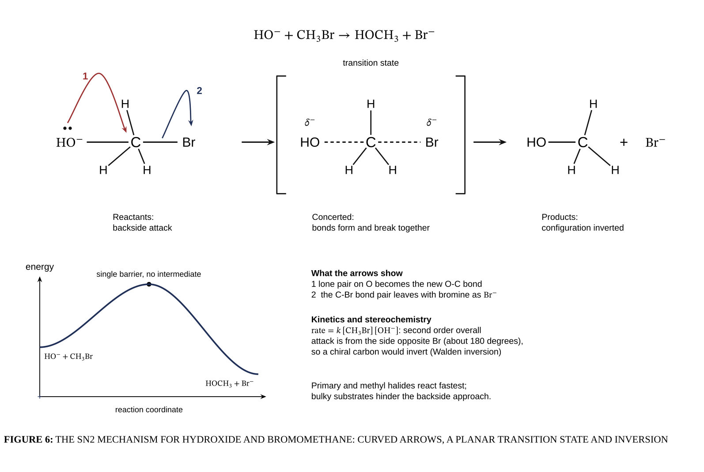

# SN2 mechanism

## Bill of Materials

| Symbol / ID | Label | Kind | Group | Technical Notes / Metadata |
| :--- | :--- | :--- | :--- | :--- |

## Connections

| Source | Target | Protocol / Label | Style | Routing |
| :--- | :--- | :--- | :--- | :--- |
| **point_15** (`point_15`) | **point_16** (`point_16`) | - | solid | spline |
| **point_17** (`point_17`) | **point_18** (`point_18`) | - | solid | spline |
| **point_48** (`point_48`) | **point_49** (`point_49`) | - | solid | direct |
| **point_50** (`point_50`) | **point_51** (`point_51`) | - | solid | direct |
| **point_55** (`point_55`) | **point_56** (`point_56`) | - | solid | direct |
| **point_57** (`point_57`) | **point_58** (`point_58`) | - | solid | direct |
