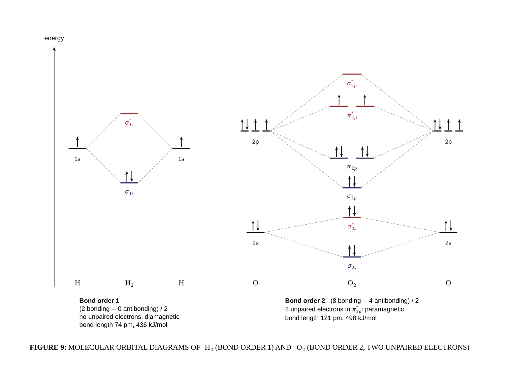

# Molecular orbitals of H2 and O2

## Bill of Materials

| Symbol / ID | Label | Kind | Group | Technical Notes / Metadata |
| :--- | :--- | :--- | :--- | :--- |

## Connections

| Source | Target | Protocol / Label | Style | Routing |
| :--- | :--- | :--- | :--- | :--- |
| **point_1** (`point_1`) | **point_2** (`point_2`) | - | solid | direct |
| **point_5** (`point_5`) | **point_6** (`point_6`) | - | solid | direct |
| **point_7** (`point_7`) | **point_8** (`point_8`) | - | solid | direct |
| **point_13** (`point_13`) | **point_14** (`point_14`) | - | solid | direct |
| **point_17** (`point_17`) | **point_18** (`point_18`) | - | solid | direct |
| **point_28** (`point_28`) | **point_29** (`point_29`) | - | solid | direct |
| **point_30** (`point_30`) | **point_31** (`point_31`) | - | solid | direct |
| **point_34** (`point_34`) | **point_35** (`point_35`) | - | solid | direct |
| **point_36** (`point_36`) | **point_37** (`point_37`) | - | solid | direct |
| **point_40** (`point_40`) | **point_41** (`point_41`) | - | solid | direct |
| **point_42** (`point_42`) | **point_43** (`point_43`) | - | solid | direct |
| **point_46** (`point_46`) | **point_47** (`point_47`) | - | solid | direct |
| **point_48** (`point_48`) | **point_49** (`point_49`) | - | solid | direct |
| **point_51** (`point_51`) | **point_52** (`point_52`) | - | solid | direct |
| **point_53** (`point_53`) | **point_54** (`point_54`) | - | solid | direct |
| **point_57** (`point_57`) | **point_58** (`point_58`) | - | solid | direct |
| **point_60** (`point_60`) | **point_61** (`point_61`) | - | solid | direct |
| **point_66** (`point_66`) | **point_67** (`point_67`) | - | solid | direct |
| **point_68** (`point_68`) | **point_69** (`point_69`) | - | solid | direct |
| **point_74** (`point_74`) | **point_75** (`point_75`) | - | solid | direct |
| **point_76** (`point_76`) | **point_77** (`point_77`) | - | solid | direct |
| **point_78** (`point_78`) | **point_79** (`point_79`) | - | solid | direct |
| **point_80** (`point_80`) | **point_81** (`point_81`) | - | solid | direct |
| **point_84** (`point_84`) | **point_85** (`point_85`) | - | solid | direct |
| **point_86** (`point_86`) | **point_87** (`point_87`) | - | solid | direct |
| **point_92** (`point_92`) | **point_93** (`point_93`) | - | solid | direct |
| **point_94** (`point_94`) | **point_95** (`point_95`) | - | solid | direct |
| **point_96** (`point_96`) | **point_97** (`point_97`) | - | solid | direct |
| **point_98** (`point_98`) | **point_99** (`point_99`) | - | solid | direct |
