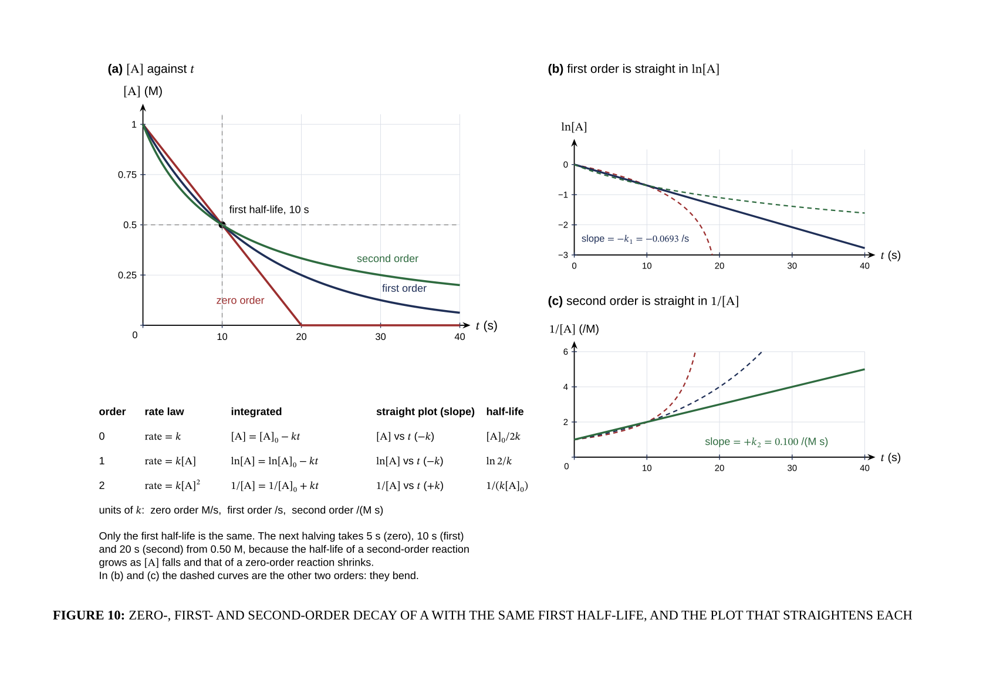

# Reaction order kinetics

## Bill of Materials

| Symbol / ID | Label | Kind | Group | Technical Notes / Metadata |
| :--- | :--- | :--- | :--- | :--- |

## Connections

| Source | Target | Protocol / Label | Style | Routing |
| :--- | :--- | :--- | :--- | :--- |
| **point_2** (`point_2`) | **point_3** (`point_3`) | - | solid | direct |
| **point_4** (`point_4`) | **point_5** (`point_5`) | - | solid | direct |
| **point_30** (`point_30`) | **point_31** (`point_31`) | - | solid | direct |
| **point_32** (`point_32`) | **point_33** (`point_33`) | - | solid | direct |
| **point_52** (`point_52`) | **point_53** (`point_53`) | - | solid | direct |
| **point_54** (`point_54`) | **point_55** (`point_55`) | - | solid | direct |
