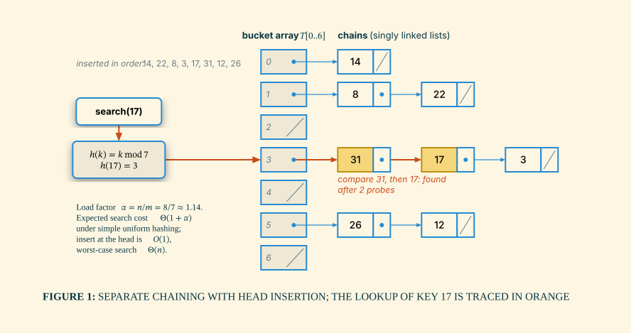

# Hash table with separate chaining

## Bill of Materials

| Symbol / ID | Label | Kind | Group | Technical Notes / Metadata |
| :--- | :--- | :--- | :--- | :--- |
| `shape_3` | **** | box | - | - |
| `shape_6` | **14** | box | - | - |
| `shape_7` | **** | box | - | - |
| `shape_10` | **** | box | - | - |
| `shape_13` | **8** | box | - | - |
| `shape_14` | **** | box | - | - |
| `shape_17` | **22** | box | - | - |
| `shape_18` | **** | box | - | - |
| `shape_21` | **** | box | - | - |
| `shape_24` | **** | box | - | - |
| `shape_27` | **31** | box | - | - |
| `shape_28` | **** | box | - | - |
| `shape_31` | **17** | box | - | - |
| `shape_32` | **** | box | - | - |
| `shape_35` | **3** | box | - | - |
| `shape_36` | **** | box | - | - |
| `shape_39` | **** | box | - | - |
| `shape_42` | **** | box | - | - |
| `shape_45` | **26** | box | - | - |
| `shape_46` | **** | box | - | - |
| `shape_49` | **12** | box | - | - |
| `shape_50` | **** | box | - | - |
| `shape_53` | **** | box | - | - |
| `shape_56` | ****search(17)**** | box | - | - |
| `shape_57` | **$h(k) = k \operatorname{mod} 7$ $h(17) = 3$** | box | - | - |

## Connections

| Source | Target | Protocol / Label | Style | Routing |
| :--- | :--- | :--- | :--- | :--- |
| **point_8** (`point_8`) | **14** (`shape_6`) | - | solid | direct |
| **point_15** (`point_15`) | **8** (`shape_13`) | - | solid | direct |
| **point_19** (`point_19`) | **22** (`shape_17`) | - | solid | direct |
| **point_29** (`point_29`) | **31** (`shape_27`) | - | solid | direct |
| **point_33** (`point_33`) | **17** (`shape_31`) | - | solid | direct |
| **point_37** (`point_37`) | **3** (`shape_35`) | - | solid | direct |
| **point_47** (`point_47`) | **26** (`shape_45`) | - | solid | direct |
| **point_51** (`point_51`) | **12** (`shape_49`) | - | solid | direct |
| ****search(17)**** (`shape_56`) | **$h(k) = k \operatorname{mod} 7$ $h(17) = 3$** (`shape_57`) | - | solid | orthogonal |
| **$h(k) = k \operatorname{mod} 7$ $h(17) = 3$** (`shape_57`) | **shape_24** (`shape_24`) | - | solid | orthogonal |
