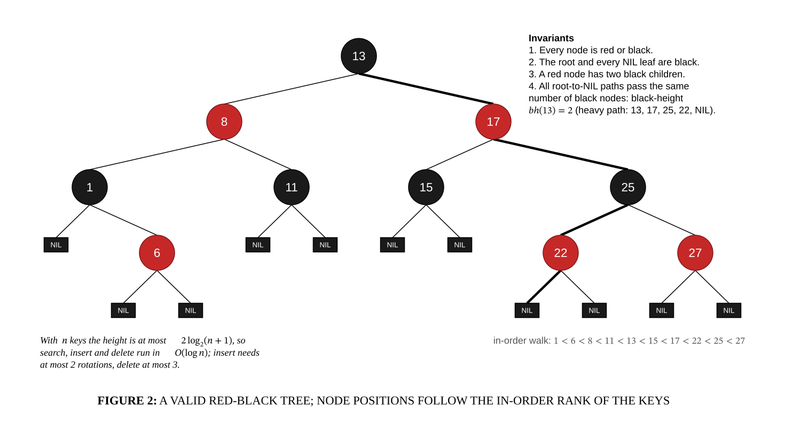

# Red-black tree with NIL leaves

## Bill of Materials

| Symbol / ID | Label | Kind | Group | Technical Notes / Metadata |
| :--- | :--- | :--- | :--- | :--- |
| `shape_1` | **NIL** | box | - | - |
| `shape_2` | **1** | box | - | - |
| `shape_3` | **NIL** | box | - | - |
| `shape_4` | **6** | box | - | - |
| `shape_5` | **NIL** | box | - | - |
| `shape_6` | **8** | box | - | - |
| `shape_7` | **NIL** | box | - | - |
| `shape_8` | **11** | box | - | - |
| `shape_9` | **NIL** | box | - | - |
| `shape_10` | **13** | box | - | - |
| `shape_11` | **NIL** | box | - | - |
| `shape_12` | **15** | box | - | - |
| `shape_13` | **NIL** | box | - | - |
| `shape_14` | **17** | box | - | - |
| `shape_15` | **NIL** | box | - | - |
| `shape_16` | **22** | box | - | - |
| `shape_17` | **NIL** | box | - | - |
| `shape_18` | **25** | box | - | - |
| `shape_19` | **NIL** | box | - | - |
| `shape_20` | **27** | box | - | - |
| `shape_21` | **NIL** | box | - | - |

## Connections

| Source | Target | Protocol / Label | Style | Routing |
| :--- | :--- | :--- | :--- | :--- |
| **1** (`shape_2`) | **NIL** (`shape_1`) | - | solid | direct |
| **8** (`shape_6`) | **1** (`shape_2`) | - | solid | direct |
| **6** (`shape_4`) | **NIL** (`shape_3`) | - | solid | direct |
| **1** (`shape_2`) | **6** (`shape_4`) | - | solid | direct |
| **6** (`shape_4`) | **NIL** (`shape_5`) | - | solid | direct |
| **13** (`shape_10`) | **8** (`shape_6`) | - | solid | direct |
| **11** (`shape_8`) | **NIL** (`shape_7`) | - | solid | direct |
| **8** (`shape_6`) | **11** (`shape_8`) | - | solid | direct |
| **11** (`shape_8`) | **NIL** (`shape_9`) | - | solid | direct |
| **15** (`shape_12`) | **NIL** (`shape_11`) | - | solid | direct |
| **17** (`shape_14`) | **15** (`shape_12`) | - | solid | direct |
| **15** (`shape_12`) | **NIL** (`shape_13`) | - | solid | direct |
| **13** (`shape_10`) | **17** (`shape_14`) | - | solid | direct |
| **22** (`shape_16`) | **NIL** (`shape_15`) | - | solid | direct |
| **25** (`shape_18`) | **22** (`shape_16`) | - | solid | direct |
| **22** (`shape_16`) | **NIL** (`shape_17`) | - | solid | direct |
| **17** (`shape_14`) | **25** (`shape_18`) | - | solid | direct |
| **27** (`shape_20`) | **NIL** (`shape_19`) | - | solid | direct |
| **25** (`shape_18`) | **27** (`shape_20`) | - | solid | direct |
| **27** (`shape_20`) | **NIL** (`shape_21`) | - | solid | direct |
