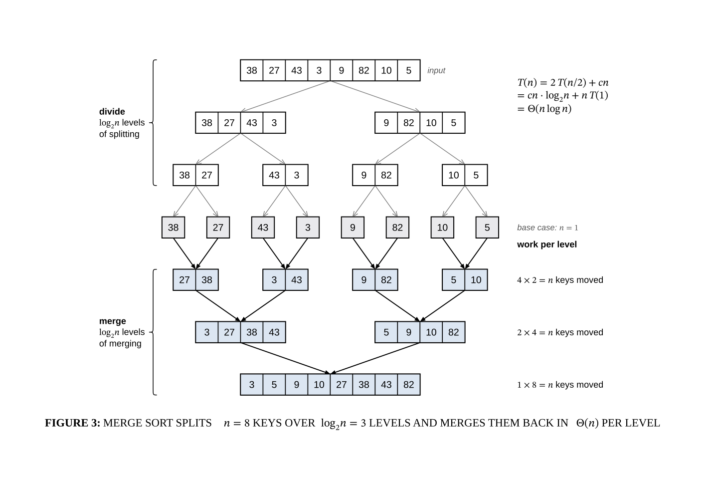

# Merge sort recursion on eight keys

## Bill of Materials

| Symbol / ID | Label | Kind | Group | Technical Notes / Metadata |
| :--- | :--- | :--- | :--- | :--- |
| `shape_1` | **** | box | - | - |
| `shape_2` | **38** | box | - | - |
| `shape_3` | **27** | box | - | - |
| `shape_4` | **43** | box | - | - |
| `shape_5` | **3** | box | - | - |
| `shape_6` | **9** | box | - | - |
| `shape_7` | **82** | box | - | - |
| `shape_8` | **10** | box | - | - |
| `shape_9` | **5** | box | - | - |
| `shape_10` | **** | box | - | - |
| `shape_11` | **38** | box | - | - |
| `shape_12` | **27** | box | - | - |
| `shape_13` | **43** | box | - | - |
| `shape_14` | **3** | box | - | - |
| `shape_15` | **** | box | - | - |
| `shape_16` | **9** | box | - | - |
| `shape_17` | **82** | box | - | - |
| `shape_18` | **10** | box | - | - |
| `shape_19` | **5** | box | - | - |
| `shape_20` | **** | box | - | - |
| `shape_21` | **38** | box | - | - |
| `shape_22` | **27** | box | - | - |
| `shape_23` | **** | box | - | - |
| `shape_24` | **43** | box | - | - |
| `shape_25` | **3** | box | - | - |
| `shape_26` | **** | box | - | - |
| `shape_27` | **9** | box | - | - |
| `shape_28` | **82** | box | - | - |
| `shape_29` | **** | box | - | - |
| `shape_30` | **10** | box | - | - |
| `shape_31` | **5** | box | - | - |
| `shape_32` | **** | box | - | - |
| `shape_33` | **38** | box | - | - |
| `shape_34` | **** | box | - | - |
| `shape_35` | **27** | box | - | - |
| `shape_36` | **** | box | - | - |
| `shape_37` | **43** | box | - | - |
| `shape_38` | **** | box | - | - |
| `shape_39` | **3** | box | - | - |
| `shape_40` | **** | box | - | - |
| `shape_41` | **9** | box | - | - |
| `shape_42` | **** | box | - | - |
| `shape_43` | **82** | box | - | - |
| `shape_44` | **** | box | - | - |
| `shape_45` | **10** | box | - | - |
| `shape_46` | **** | box | - | - |
| `shape_47` | **5** | box | - | - |
| `shape_48` | **** | box | - | - |
| `shape_49` | **27** | box | - | - |
| `shape_50` | **38** | box | - | - |
| `shape_51` | **** | box | - | - |
| `shape_52` | **3** | box | - | - |
| `shape_53` | **43** | box | - | - |
| `shape_54` | **** | box | - | - |
| `shape_55` | **9** | box | - | - |
| `shape_56` | **82** | box | - | - |
| `shape_57` | **** | box | - | - |
| `shape_58` | **5** | box | - | - |
| `shape_59` | **10** | box | - | - |
| `shape_60` | **** | box | - | - |
| `shape_61` | **3** | box | - | - |
| `shape_62` | **27** | box | - | - |
| `shape_63` | **38** | box | - | - |
| `shape_64` | **43** | box | - | - |
| `shape_65` | **** | box | - | - |
| `shape_66` | **5** | box | - | - |
| `shape_67` | **9** | box | - | - |
| `shape_68` | **10** | box | - | - |
| `shape_69` | **82** | box | - | - |
| `shape_70` | **** | box | - | - |
| `shape_71` | **3** | box | - | - |
| `shape_72` | **5** | box | - | - |
| `shape_73` | **9** | box | - | - |
| `shape_74` | **10** | box | - | - |
| `shape_75` | **27** | box | - | - |
| `shape_76` | **38** | box | - | - |
| `shape_77` | **43** | box | - | - |
| `shape_78` | **82** | box | - | - |

## Connections

| Source | Target | Protocol / Label | Style | Routing |
| :--- | :--- | :--- | :--- | :--- |
| **shape_1** (`shape_1`) | **shape_10** (`shape_10`) | - | solid | direct |
| **shape_1** (`shape_1`) | **shape_15** (`shape_15`) | - | solid | direct |
| **shape_10** (`shape_10`) | **shape_20** (`shape_20`) | - | solid | direct |
| **shape_10** (`shape_10`) | **shape_23** (`shape_23`) | - | solid | direct |
| **shape_15** (`shape_15`) | **shape_26** (`shape_26`) | - | solid | direct |
| **shape_15** (`shape_15`) | **shape_29** (`shape_29`) | - | solid | direct |
| **shape_20** (`shape_20`) | **shape_32** (`shape_32`) | - | solid | direct |
| **shape_20** (`shape_20`) | **shape_34** (`shape_34`) | - | solid | direct |
| **shape_23** (`shape_23`) | **shape_36** (`shape_36`) | - | solid | direct |
| **shape_23** (`shape_23`) | **shape_38** (`shape_38`) | - | solid | direct |
| **shape_26** (`shape_26`) | **shape_40** (`shape_40`) | - | solid | direct |
| **shape_26** (`shape_26`) | **shape_42** (`shape_42`) | - | solid | direct |
| **shape_29** (`shape_29`) | **shape_44** (`shape_44`) | - | solid | direct |
| **shape_29** (`shape_29`) | **shape_46** (`shape_46`) | - | solid | direct |
| **shape_32** (`shape_32`) | **shape_48** (`shape_48`) | - | solid | direct |
| **shape_34** (`shape_34`) | **shape_48** (`shape_48`) | - | solid | direct |
| **shape_36** (`shape_36`) | **shape_51** (`shape_51`) | - | solid | direct |
| **shape_38** (`shape_38`) | **shape_51** (`shape_51`) | - | solid | direct |
| **shape_40** (`shape_40`) | **shape_54** (`shape_54`) | - | solid | direct |
| **shape_42** (`shape_42`) | **shape_54** (`shape_54`) | - | solid | direct |
| **shape_44** (`shape_44`) | **shape_57** (`shape_57`) | - | solid | direct |
| **shape_46** (`shape_46`) | **shape_57** (`shape_57`) | - | solid | direct |
| **shape_48** (`shape_48`) | **shape_60** (`shape_60`) | - | solid | direct |
| **shape_51** (`shape_51`) | **shape_60** (`shape_60`) | - | solid | direct |
| **shape_54** (`shape_54`) | **shape_65** (`shape_65`) | - | solid | direct |
| **shape_57** (`shape_57`) | **shape_65** (`shape_65`) | - | solid | direct |
| **shape_60** (`shape_60`) | **shape_70** (`shape_70`) | - | solid | direct |
| **shape_65** (`shape_65`) | **shape_70** (`shape_70`) | - | solid | direct |
