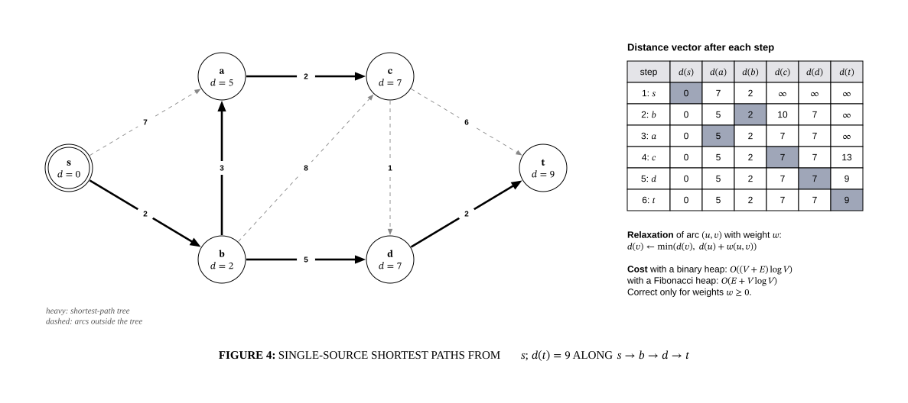

# Dijkstra shortest paths on a weighted digraph

## Bill of Materials

| Symbol / ID | Label | Kind | Group | Technical Notes / Metadata |
| :--- | :--- | :--- | :--- | :--- |
| `shape_1` | **$\mathbf{s}$ $d = 0$** | box | - | - |
| `shape_2` | **$\mathbf{a}$ $d = 5$** | box | - | - |
| `shape_3` | **$\mathbf{b}$ $d = 2$** | box | - | - |
| `shape_4` | **$\mathbf{c}$ $d = 7$** | box | - | - |
| `shape_5` | **$\mathbf{d}$ $d = 7$** | box | - | - |
| `shape_6` | **$\mathbf{t}$ $d = 9$** | box | - | - |
| `shape_26` | **step** | box | - | - |
| `shape_27` | **$d(s)$** | box | - | - |
| `shape_28` | **$d(a)$** | box | - | - |
| `shape_29` | **$d(b)$** | box | - | - |
| `shape_30` | **$d(c)$** | box | - | - |
| `shape_31` | **$d(d)$** | box | - | - |
| `shape_32` | **$d(t)$** | box | - | - |
| `shape_33` | **1: $s$** | box | - | - |
| `shape_34` | **0** | box | - | - |
| `shape_35` | **7** | box | - | - |
| `shape_36` | **2** | box | - | - |
| `shape_37` | **$\infty$** | box | - | - |
| `shape_38` | **$\infty$** | box | - | - |
| `shape_39` | **$\infty$** | box | - | - |
| `shape_40` | **2: $b$** | box | - | - |
| `shape_41` | **0** | box | - | - |
| `shape_42` | **5** | box | - | - |
| `shape_43` | **2** | box | - | - |
| `shape_44` | **10** | box | - | - |
| `shape_45` | **7** | box | - | - |
| `shape_46` | **$\infty$** | box | - | - |
| `shape_47` | **3: $a$** | box | - | - |
| `shape_48` | **0** | box | - | - |
| `shape_49` | **5** | box | - | - |
| `shape_50` | **2** | box | - | - |
| `shape_51` | **7** | box | - | - |
| `shape_52` | **7** | box | - | - |
| `shape_53` | **$\infty$** | box | - | - |
| `shape_54` | **4: $c$** | box | - | - |
| `shape_55` | **0** | box | - | - |
| `shape_56` | **5** | box | - | - |
| `shape_57` | **2** | box | - | - |
| `shape_58` | **7** | box | - | - |
| `shape_59` | **7** | box | - | - |
| `shape_60` | **13** | box | - | - |
| `shape_61` | **5: $d$** | box | - | - |
| `shape_62` | **0** | box | - | - |
| `shape_63` | **5** | box | - | - |
| `shape_64` | **2** | box | - | - |
| `shape_65` | **7** | box | - | - |
| `shape_66` | **7** | box | - | - |
| `shape_67` | **9** | box | - | - |
| `shape_68` | **6: $t$** | box | - | - |
| `shape_69` | **0** | box | - | - |
| `shape_70` | **5** | box | - | - |
| `shape_71` | **2** | box | - | - |
| `shape_72` | **7** | box | - | - |
| `shape_73` | **7** | box | - | - |
| `shape_74` | **9** | box | - | - |

## Connections

| Source | Target | Protocol / Label | Style | Routing |
| :--- | :--- | :--- | :--- | :--- |
| **point_7** (`point_7`) | **point_8** (`point_8`) | 7 | dashed | direct |
| **point_9** (`point_9`) | **point_10** (`point_10`) | 2 | solid | direct |
| **point_11** (`point_11`) | **point_12** (`point_12`) | 3 | solid | direct |
| **point_13** (`point_13`) | **point_14** (`point_14`) | 2 | solid | direct |
| **point_15** (`point_15`) | **point_16** (`point_16`) | 8 | dashed | direct |
| **point_17** (`point_17`) | **point_18** (`point_18`) | 5 | solid | direct |
| **point_19** (`point_19`) | **point_20** (`point_20`) | 1 | dashed | direct |
| **point_21** (`point_21`) | **point_22** (`point_22`) | 6 | dashed | direct |
| **point_23** (`point_23`) | **point_24** (`point_24`) | 2 | solid | direct |
