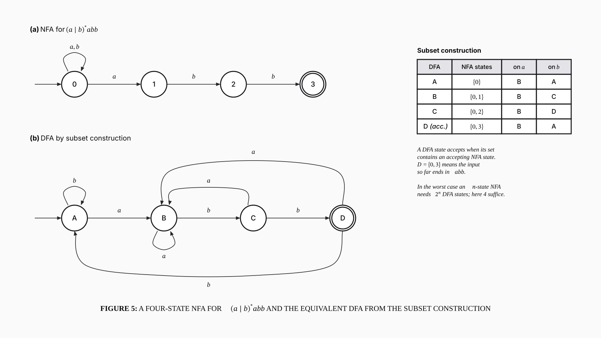

# Regular expression to NFA and DFA

## Bill of Materials

| Symbol / ID | Label | Kind | Group | Technical Notes / Metadata |
| :--- | :--- | :--- | :--- | :--- |
| `shape_2` | **0** | box | - | - |
| `shape_3` | **1** | box | - | - |
| `shape_4` | **2** | box | - | - |
| `shape_5` | **3** | box | - | - |
| `shape_12` | **A** | box | - | - |
| `shape_13` | **B** | box | - | - |
| `shape_14` | **C** | box | - | - |
| `shape_15` | **D** | box | - | - |
| `shape_26` | **DFA** | box | - | - |
| `shape_27` | **NFA states** | box | - | - |
| `shape_28` | **on $a$** | box | - | - |
| `shape_29` | **on $b$** | box | - | - |
| `shape_30` | **A** | box | - | - |
| `shape_31` | **$\{0\}$** | box | - | - |
| `shape_32` | **B** | box | - | - |
| `shape_33` | **A** | box | - | - |
| `shape_34` | **B** | box | - | - |
| `shape_35` | **$\{0, 1\}$** | box | - | - |
| `shape_36` | **B** | box | - | - |
| `shape_37` | **C** | box | - | - |
| `shape_38` | **C** | box | - | - |
| `shape_39` | **$\{0, 2\}$** | box | - | - |
| `shape_40` | **B** | box | - | - |
| `shape_41` | **D** | box | - | - |
| `shape_42` | **D *(acc.)*** | box | - | - |
| `shape_43` | **$\{0, 3\}$** | box | - | - |
| `shape_44` | **B** | box | - | - |
| `shape_45` | **A** | box | - | - |

## Connections

| Source | Target | Protocol / Label | Style | Routing |
| :--- | :--- | :--- | :--- | :--- |
| **point_6** (`point_6`) | **0** (`shape_2`) | - | solid | direct |
| **0** (`shape_2`) | **0** (`shape_2`) | - | solid | spline |
| **0** (`shape_2`) | **1** (`shape_3`) | - | solid | orthogonal |
| **1** (`shape_3`) | **2** (`shape_4`) | - | solid | orthogonal |
| **2** (`shape_4`) | **3** (`shape_5`) | - | solid | orthogonal |
| **point_16** (`point_16`) | **A** (`shape_12`) | - | solid | direct |
| **A** (`shape_12`) | **B** (`shape_13`) | - | solid | orthogonal |
| **B** (`shape_13`) | **C** (`shape_14`) | - | solid | orthogonal |
| **C** (`shape_14`) | **D** (`shape_15`) | - | solid | orthogonal |
| **A** (`shape_12`) | **A** (`shape_12`) | - | solid | spline |
| **B** (`shape_13`) | **B** (`shape_13`) | - | solid | spline |
| **C** (`shape_14`) | **B** (`shape_13`) | - | solid | spline |
| **D** (`shape_15`) | **B** (`shape_13`) | - | solid | spline |
| **D** (`shape_15`) | **A** (`shape_12`) | - | solid | spline |
