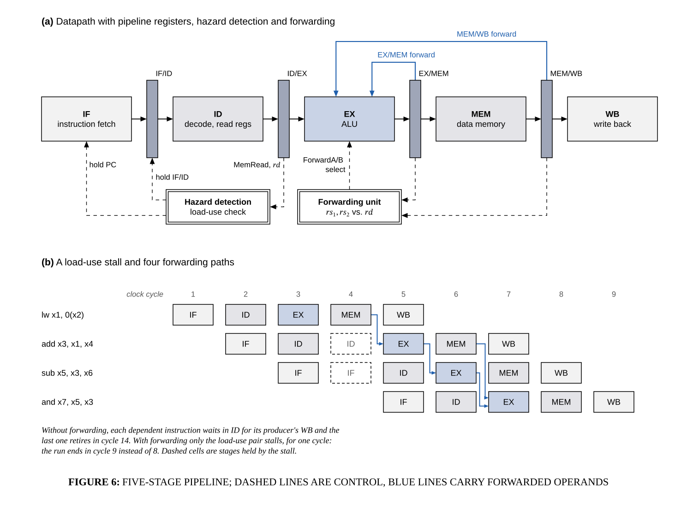

# Five-stage pipeline with hazards and forwarding

## Bill of Materials

| Symbol / ID | Label | Kind | Group | Technical Notes / Metadata |
| :--- | :--- | :--- | :--- | :--- |
| `shape_2` | ****IF** instruction fetch** | box | - | - |
| `shape_3` | ****ID** decode, read regs** | box | - | - |
| `shape_4` | ****EX** ALU** | box | - | - |
| `shape_5` | ****MEM** data memory** | box | - | - |
| `shape_6` | ****WB** write back** | box | - | - |
| `shape_7` | **** | box | - | - |
| `shape_9` | **** | box | - | - |
| `shape_11` | **** | box | - | - |
| `shape_13` | **** | box | - | - |
| `shape_17` | ****Forwarding unit** $rs_1, rs_2$ vs. $rd$** | box | - | - |
| `shape_18` | ****Hazard detection** load-use check** | box | - | - |
| `shape_35` | **IF** | box | - | - |
| `shape_36` | **ID** | box | - | - |
| `shape_37` | **EX** | box | - | - |
| `shape_38` | **MEM** | box | - | - |
| `shape_39` | **WB** | box | - | - |
| `shape_41` | **IF** | box | - | - |
| `shape_42` | **ID** | box | - | - |
| `shape_43` | **ID** | box | - | - |
| `shape_44` | **EX** | box | - | - |
| `shape_45` | **MEM** | box | - | - |
| `shape_46` | **WB** | box | - | - |
| `shape_48` | **IF** | box | - | - |
| `shape_49` | **IF** | box | - | - |
| `shape_50` | **ID** | box | - | - |
| `shape_51` | **EX** | box | - | - |
| `shape_52` | **MEM** | box | - | - |
| `shape_53` | **WB** | box | - | - |
| `shape_55` | **IF** | box | - | - |
| `shape_56` | **ID** | box | - | - |
| `shape_57` | **EX** | box | - | - |
| `shape_58` | **MEM** | box | - | - |
| `shape_59` | **WB** | box | - | - |

## Connections

| Source | Target | Protocol / Label | Style | Routing |
| :--- | :--- | :--- | :--- | :--- |
| ****IF** instruction fetch** (`shape_2`) | **shape_7** (`shape_7`) | - | solid | orthogonal |
| **shape_7** (`shape_7`) | ****ID** decode, read regs** (`shape_3`) | - | solid | orthogonal |
| ****ID** decode, read regs** (`shape_3`) | **shape_9** (`shape_9`) | - | solid | orthogonal |
| **shape_9** (`shape_9`) | ****EX** ALU** (`shape_4`) | - | solid | orthogonal |
| ****EX** ALU** (`shape_4`) | **shape_11** (`shape_11`) | - | solid | orthogonal |
| **shape_11** (`shape_11`) | ****MEM** data memory** (`shape_5`) | - | solid | orthogonal |
| ****MEM** data memory** (`shape_5`) | **shape_13** (`shape_13`) | - | solid | orthogonal |
| **shape_13** (`shape_13`) | ****WB** write back** (`shape_6`) | - | solid | orthogonal |
| **shape_11** (`shape_11`) | ****EX** ALU** (`shape_4`) | - | solid | orthogonal |
| **shape_13** (`shape_13`) | ****EX** ALU** (`shape_4`) | - | solid | orthogonal |
| ****Forwarding unit** $rs_1, rs_2$ vs. $rd$** (`shape_17`) | ****EX** ALU** (`shape_4`) | - | dashed | orthogonal |
| **shape_11** (`shape_11`) | ****Forwarding unit** $rs_1, rs_2$ vs. $rd$** (`shape_17`) | - | dashed | orthogonal |
| **shape_13** (`shape_13`) | ****Forwarding unit** $rs_1, rs_2$ vs. $rd$** (`shape_17`) | - | dashed | orthogonal |
| **shape_9** (`shape_9`) | ****Hazard detection** load-use check** (`shape_18`) | - | dashed | orthogonal |
| ****Hazard detection** load-use check** (`shape_18`) | **shape_7** (`shape_7`) | - | dashed | orthogonal |
| ****Hazard detection** load-use check** (`shape_18`) | ****IF** instruction fetch** (`shape_2`) | - | dashed | orthogonal |
| **point_60** (`point_60`) | **point_61** (`point_61`) | - | solid | direct |
| **point_62** (`point_62`) | **point_63** (`point_63`) | - | solid | direct |
| **point_64** (`point_64`) | **point_65** (`point_65`) | - | solid | direct |
| **point_66** (`point_66`) | **point_67** (`point_67`) | - | solid | direct |
