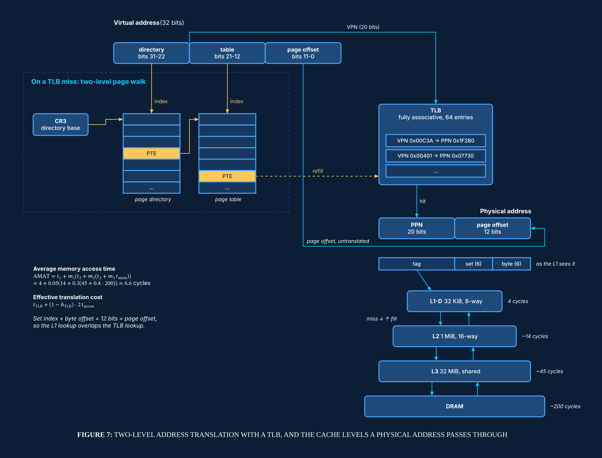

# Virtual memory translation and cache hierarchy

## Bill of Materials

| Symbol / ID | Label | Kind | Group | Technical Notes / Metadata |
| :--- | :--- | :--- | :--- | :--- |
| `shape_2` | ****directory** bits 31-22** | box | - | - |
| `shape_3` | ****table** bits 21-12** | box | - | - |
| `shape_4` | ****page offset** bits 11-0** | box | - | - |
| `shape_6` | ****CR3** directory base** | box | On a TLB miss: two-level page walk | - |
| `shape_7` | **** | box | On a TLB miss: two-level page walk | - |
| `shape_8` | **** | box | On a TLB miss: two-level page walk | - |
| `shape_9` | **** | box | On a TLB miss: two-level page walk | - |
| `shape_10` | **PTE** | box | On a TLB miss: two-level page walk | - |
| `shape_11` | **** | box | On a TLB miss: two-level page walk | - |
| `shape_12` | **** | box | On a TLB miss: two-level page walk | - |
| `shape_13` | **...** | box | On a TLB miss: two-level page walk | - |
| `shape_16` | **** | box | On a TLB miss: two-level page walk | - |
| `shape_17` | **** | box | On a TLB miss: two-level page walk | - |
| `shape_18` | **** | box | On a TLB miss: two-level page walk | - |
| `shape_19` | **** | box | On a TLB miss: two-level page walk | - |
| `shape_20` | **** | box | On a TLB miss: two-level page walk | - |
| `shape_21` | **PTE** | box | On a TLB miss: two-level page walk | - |
| `shape_22` | **...** | box | On a TLB miss: two-level page walk | - |
| `shape_25` | ****TLB** fully associative, 64 entries** | box | - | - |
| `shape_26` | **VPN 0x00C3A  →  PPN 0x1F2B0** | box | **TLB** fully associative, 64 entries | - |
| `shape_27` | **VPN 0x00401  →  PPN 0x07730** | box | **TLB** fully associative, 64 entries | - |
| `shape_28` | **...** | box | **TLB** fully associative, 64 entries | - |
| `shape_33` | ****PPN** 20 bits** | box | - | - |
| `shape_34` | ****page offset** 12 bits** | box | - | - |
| `shape_38` | **tag** | box | - | - |
| `shape_39` | **set (6)** | box | - | - |
| `shape_40` | **byte (6)** | box | - | - |
| `shape_42` | ****L1-D** 32 KiB, 8-way** | box | - | - |
| `shape_44` | ****L2** 1 MiB, 16-way** | box | - | - |
| `shape_46` | ****L3** 32 MiB, shared** | box | - | - |
| `shape_48` | ****DRAM**** | box | - | - |

## Connections

| Source | Target | Protocol / Label | Style | Routing |
| :--- | :--- | :--- | :--- | :--- |
| ****CR3** directory base** (`shape_6`) | **shape_7** (`shape_7`) | - | solid | orthogonal |
| ****directory** bits 31-22** (`shape_2`) | **shape_7** (`shape_7`) | - | solid | orthogonal |
| ****table** bits 21-12** (`shape_3`) | **shape_16** (`shape_16`) | - | solid | orthogonal |
| **PTE** (`shape_10`) | **shape_16** (`shape_16`) | - | solid | orthogonal |
| **point_29** (`point_29`) | ****TLB** fully associative, 64 entries** (`shape_25`) | - | solid | direct |
| **PTE** (`shape_21`) | **point_31** (`point_31`) | - | dashed | direct |
| ****TLB** fully associative, 64 entries** (`shape_25`) | ****PPN** 20 bits** (`shape_33`) | - | solid | direct |
| ****page offset** bits 11-0** (`shape_4`) | ****page offset** 12 bits** (`shape_34`) | - | solid | direct |
| **tag** (`shape_38`) | ****L1-D** 32 KiB, 8-way** (`shape_42`) | - | solid | direct |
| ****L1-D** 32 KiB, 8-way** (`shape_42`) | ****L2** 1 MiB, 16-way** (`shape_44`) | - | solid | direct |
| ****L2** 1 MiB, 16-way** (`shape_44`) | ****L1-D** 32 KiB, 8-way** (`shape_42`) | - | solid | direct |
| ****L2** 1 MiB, 16-way** (`shape_44`) | ****L3** 32 MiB, shared** (`shape_46`) | - | solid | direct |
| ****L3** 32 MiB, shared** (`shape_46`) | ****L2** 1 MiB, 16-way** (`shape_44`) | - | solid | direct |
| ****L3** 32 MiB, shared** (`shape_46`) | ****DRAM**** (`shape_48`) | - | solid | direct |
| ****DRAM**** (`shape_48`) | ****L3** 32 MiB, shared** (`shape_46`) | - | solid | direct |
