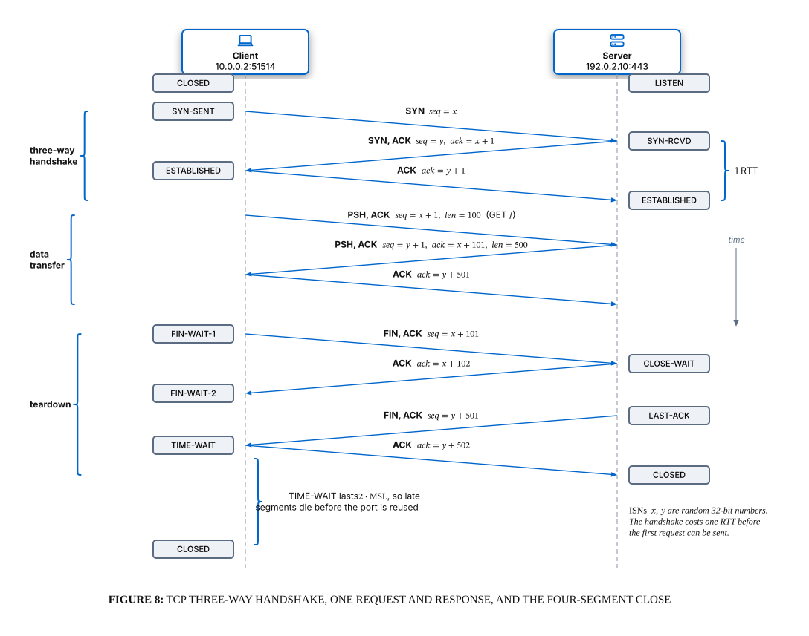

# TCP connection lifecycle sequence chart

## Bill of Materials

| Symbol / ID | Label | Kind | Group | Technical Notes / Metadata |
| :--- | :--- | :--- | :--- | :--- |
| `shape_1` | ****Client** 10.0.0.2:51514** | box | - | - |
| `shape_2` | ****Server** 192.0.2.10:443** | box | - | - |
| `shape_35` | **CLOSED** | box | - | - |
| `shape_36` | **SYN-SENT** | box | - | - |
| `shape_37` | **ESTABLISHED** | box | - | - |
| `shape_38` | **FIN-WAIT-1** | box | - | - |
| `shape_39` | **FIN-WAIT-2** | box | - | - |
| `shape_40` | **TIME-WAIT** | box | - | - |
| `shape_41` | **CLOSED** | box | - | - |
| `shape_42` | **LISTEN** | box | - | - |
| `shape_43` | **SYN-RCVD** | box | - | - |
| `shape_44` | **ESTABLISHED** | box | - | - |
| `shape_45` | **CLOSE-WAIT** | box | - | - |
| `shape_46` | **LAST-ACK** | box | - | - |
| `shape_47` | **CLOSED** | box | - | - |

## Connections

| Source | Target | Protocol / Label | Style | Routing |
| :--- | :--- | :--- | :--- | :--- |
| **point_5** (`point_5`) | **point_6** (`point_6`) | - | solid | direct |
| **point_8** (`point_8`) | **point_9** (`point_9`) | - | solid | direct |
| **point_11** (`point_11`) | **point_12** (`point_12`) | - | solid | direct |
| **point_14** (`point_14`) | **point_15** (`point_15`) | - | solid | direct |
| **point_17** (`point_17`) | **point_18** (`point_18`) | - | solid | direct |
| **point_20** (`point_20`) | **point_21** (`point_21`) | - | solid | direct |
| **point_23** (`point_23`) | **point_24** (`point_24`) | - | solid | direct |
| **point_26** (`point_26`) | **point_27** (`point_27`) | - | solid | direct |
| **point_29** (`point_29`) | **point_30** (`point_30`) | - | solid | direct |
| **point_32** (`point_32`) | **point_33** (`point_33`) | - | solid | direct |
| **point_55** (`point_55`) | **point_56** (`point_56`) | - | solid | direct |
