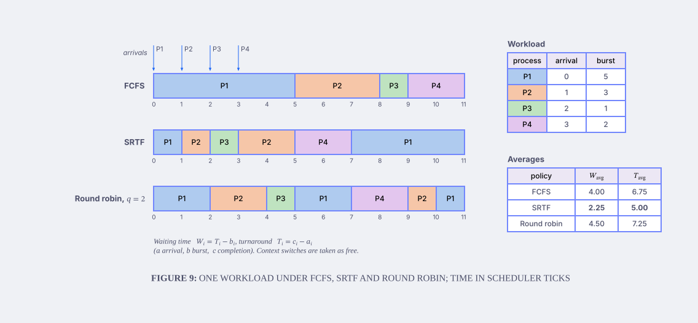

# CPU scheduling Gantt charts

## Bill of Materials

| Symbol / ID | Label | Kind | Group | Technical Notes / Metadata |
| :--- | :--- | :--- | :--- | :--- |
| `shape_15` | **P1** | box | - | - |
| `shape_16` | **P2** | box | - | - |
| `shape_17` | **P3** | box | - | - |
| `shape_18` | **P4** | box | - | - |
| `shape_32` | **P1** | box | - | - |
| `shape_33` | **P2** | box | - | - |
| `shape_34` | **P3** | box | - | - |
| `shape_35` | **P2** | box | - | - |
| `shape_36` | **P4** | box | - | - |
| `shape_37` | **P1** | box | - | - |
| `shape_51` | **P1** | box | - | - |
| `shape_52` | **P2** | box | - | - |
| `shape_53` | **P3** | box | - | - |
| `shape_54` | **P1** | box | - | - |
| `shape_55` | **P4** | box | - | - |
| `shape_56` | **P2** | box | - | - |
| `shape_57` | **P1** | box | - | - |
| `shape_71` | **process** | box | - | - |
| `shape_72` | **arrival** | box | - | - |
| `shape_73` | **burst** | box | - | - |
| `shape_74` | **P1** | box | - | - |
| `shape_75` | **0** | box | - | - |
| `shape_76` | **5** | box | - | - |
| `shape_77` | **P2** | box | - | - |
| `shape_78` | **1** | box | - | - |
| `shape_79` | **3** | box | - | - |
| `shape_80` | **P3** | box | - | - |
| `shape_81` | **2** | box | - | - |
| `shape_82` | **1** | box | - | - |
| `shape_83` | **P4** | box | - | - |
| `shape_84` | **3** | box | - | - |
| `shape_85` | **2** | box | - | - |
| `shape_87` | **policy** | box | - | - |
| `shape_88` | **$W_{\mathrm{avg}}$** | box | - | - |
| `shape_89` | **$T_{\mathrm{avg}}$** | box | - | - |
| `shape_90` | **FCFS** | box | - | - |
| `shape_91` | **4.00** | box | - | - |
| `shape_92` | **6.75** | box | - | - |
| `shape_93` | **SRTF** | box | - | - |
| `shape_94` | ****2.25**** | box | - | - |
| `shape_95` | ****5.00**** | box | - | - |
| `shape_96` | **Round robin** | box | - | - |
| `shape_97` | **4.50** | box | - | - |
| `shape_98` | **7.25** | box | - | - |

## Connections

| Source | Target | Protocol / Label | Style | Routing |
| :--- | :--- | :--- | :--- | :--- |
| **point_2** (`point_2`) | **point_3** (`point_3`) | - | solid | direct |
| **point_5** (`point_5`) | **point_6** (`point_6`) | - | solid | direct |
| **point_8** (`point_8`) | **point_9** (`point_9`) | - | solid | direct |
| **point_11** (`point_11`) | **point_12** (`point_12`) | - | solid | direct |
