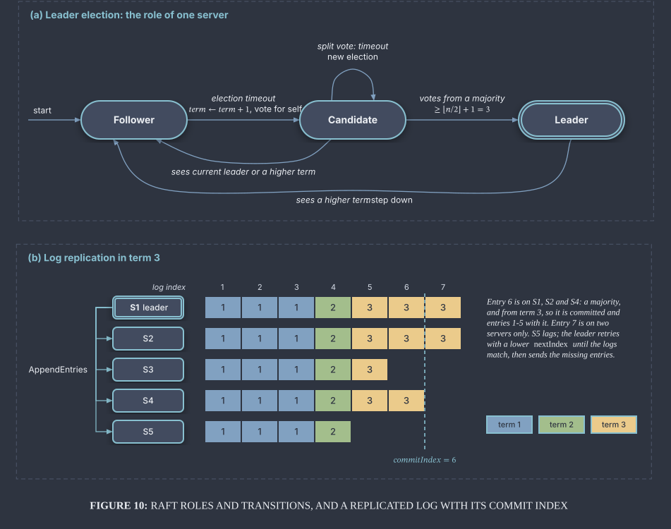

# Raft leader election and log replication

## Bill of Materials

| Symbol / ID | Label | Kind | Group | Technical Notes / Metadata |
| :--- | :--- | :--- | :--- | :--- |
| `shape_2` | ****Follower**** | box | (a) Leader election: the role of one server | - |
| `shape_3` | ****Candidate**** | box | (a) Leader election: the role of one server | - |
| `shape_4` | ****Leader**** | box | (a) Leader election: the role of one server | - |
| `shape_13` | ****S1** leader** | box | (b) Log replication in term 3 | - |
| `shape_14` | **1** | box | (b) Log replication in term 3 | - |
| `shape_15` | **1** | box | (b) Log replication in term 3 | - |
| `shape_16` | **1** | box | (b) Log replication in term 3 | - |
| `shape_17` | **2** | box | (b) Log replication in term 3 | - |
| `shape_18` | **3** | box | (b) Log replication in term 3 | - |
| `shape_19` | **3** | box | (b) Log replication in term 3 | - |
| `shape_20` | **3** | box | (b) Log replication in term 3 | - |
| `shape_21` | **S2** | box | (b) Log replication in term 3 | - |
| `shape_22` | **1** | box | (b) Log replication in term 3 | - |
| `shape_23` | **1** | box | (b) Log replication in term 3 | - |
| `shape_24` | **1** | box | (b) Log replication in term 3 | - |
| `shape_25` | **2** | box | (b) Log replication in term 3 | - |
| `shape_26` | **3** | box | (b) Log replication in term 3 | - |
| `shape_27` | **3** | box | (b) Log replication in term 3 | - |
| `shape_28` | **3** | box | (b) Log replication in term 3 | - |
| `shape_29` | **S3** | box | (b) Log replication in term 3 | - |
| `shape_30` | **1** | box | (b) Log replication in term 3 | - |
| `shape_31` | **1** | box | (b) Log replication in term 3 | - |
| `shape_32` | **1** | box | (b) Log replication in term 3 | - |
| `shape_33` | **2** | box | (b) Log replication in term 3 | - |
| `shape_34` | **3** | box | (b) Log replication in term 3 | - |
| `shape_35` | **S4** | box | (b) Log replication in term 3 | - |
| `shape_36` | **1** | box | (b) Log replication in term 3 | - |
| `shape_37` | **1** | box | (b) Log replication in term 3 | - |
| `shape_38` | **1** | box | (b) Log replication in term 3 | - |
| `shape_39` | **2** | box | (b) Log replication in term 3 | - |
| `shape_40` | **3** | box | (b) Log replication in term 3 | - |
| `shape_41` | **3** | box | (b) Log replication in term 3 | - |
| `shape_42` | **S5** | box | (b) Log replication in term 3 | - |
| `shape_43` | **1** | box | (b) Log replication in term 3 | - |
| `shape_44` | **1** | box | (b) Log replication in term 3 | - |
| `shape_45` | **1** | box | (b) Log replication in term 3 | - |
| `shape_46` | **2** | box | (b) Log replication in term 3 | - |
| `shape_58` | **term 1** | box | (b) Log replication in term 3 | - |
| `shape_59` | **term 2** | box | (b) Log replication in term 3 | - |
| `shape_60` | **term 3** | box | (b) Log replication in term 3 | - |

## Connections

| Source | Target | Protocol / Label | Style | Routing |
| :--- | :--- | :--- | :--- | :--- |
| **point_11** (`point_11`) | ****Follower**** (`shape_2`) | - | solid | direct |
| ****Follower**** (`shape_2`) | ****Candidate**** (`shape_3`) | - | solid | orthogonal |
| ****Candidate**** (`shape_3`) | ****Leader**** (`shape_4`) | - | solid | orthogonal |
| ****Candidate**** (`shape_3`) | ****Candidate**** (`shape_3`) | - | solid | spline |
| ****Candidate**** (`shape_3`) | ****Follower**** (`shape_2`) | - | solid | spline |
| ****Leader**** (`shape_4`) | ****Follower**** (`shape_2`) | - | solid | spline |
| ****S1** leader** (`shape_13`) | **S2** (`shape_21`) | - | solid | orthogonal |
| ****S1** leader** (`shape_13`) | **S3** (`shape_29`) | - | solid | orthogonal |
| ****S1** leader** (`shape_13`) | **S4** (`shape_35`) | - | solid | orthogonal |
| ****S1** leader** (`shape_13`) | **S5** (`shape_42`) | - | solid | orthogonal |
