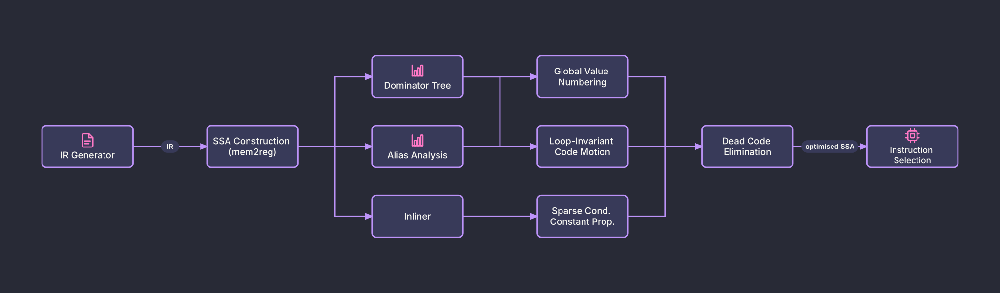

# Auto-Laid-Out Compiler Pass DAG

## Bill of Materials

| Symbol / ID | Label | Kind | Group | Technical Notes / Metadata |
| :--- | :--- | :--- | :--- | :--- |
| `shape_1` | **IR Generator** | box | - | - |
| `shape_2` | **SSA Construction (mem2reg)** | box | - | - |
| `shape_3` | **Dominator Tree** | box | - | - |
| `shape_4` | **Alias Analysis** | box | - | - |
| `shape_5` | **Inliner** | box | - | - |
| `shape_6` | **Sparse Cond. Constant Prop.** | box | - | - |
| `shape_7` | **Global Value Numbering** | box | - | - |
| `shape_8` | **Loop-Invariant Code Motion** | box | - | - |
| `shape_9` | **Dead Code Elimination** | box | - | - |
| `shape_10` | **Instruction Selection** | box | - | - |

## Connections

| Source | Target | Protocol / Label | Style | Routing |
| :--- | :--- | :--- | :--- | :--- |
| **IR Generator** (`shape_1`) | **SSA Construction (mem2reg)** (`shape_2`) | IR | solid | orthogonal |
| **SSA Construction (mem2reg)** (`shape_2`) | **Inliner** (`shape_5`) | - | solid | orthogonal |
| **SSA Construction (mem2reg)** (`shape_2`) | **Dominator Tree** (`shape_3`) | - | solid | orthogonal |
| **SSA Construction (mem2reg)** (`shape_2`) | **Alias Analysis** (`shape_4`) | - | solid | orthogonal |
| **Inliner** (`shape_5`) | **Sparse Cond. Constant Prop.** (`shape_6`) | - | solid | orthogonal |
| **Dominator Tree** (`shape_3`) | **Global Value Numbering** (`shape_7`) | - | solid | orthogonal |
| **Dominator Tree** (`shape_3`) | **Loop-Invariant Code Motion** (`shape_8`) | - | solid | orthogonal |
| **Alias Analysis** (`shape_4`) | **Loop-Invariant Code Motion** (`shape_8`) | - | solid | orthogonal |
| **Sparse Cond. Constant Prop.** (`shape_6`) | **Dead Code Elimination** (`shape_9`) | - | solid | orthogonal |
| **Global Value Numbering** (`shape_7`) | **Dead Code Elimination** (`shape_9`) | - | solid | orthogonal |
| **Loop-Invariant Code Motion** (`shape_8`) | **Dead Code Elimination** (`shape_9`) | - | solid | orthogonal |
| **Dead Code Elimination** (`shape_9`) | **Instruction Selection** (`shape_10`) | optimised SSA | solid | orthogonal |
